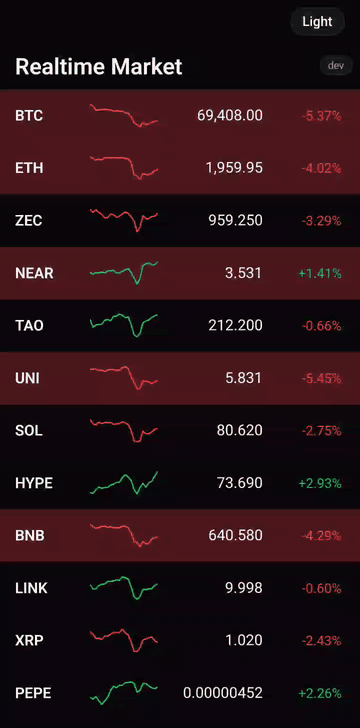
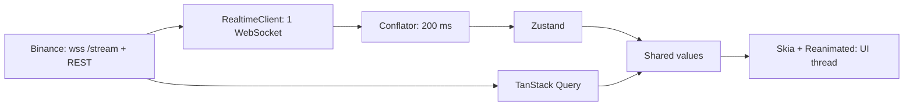
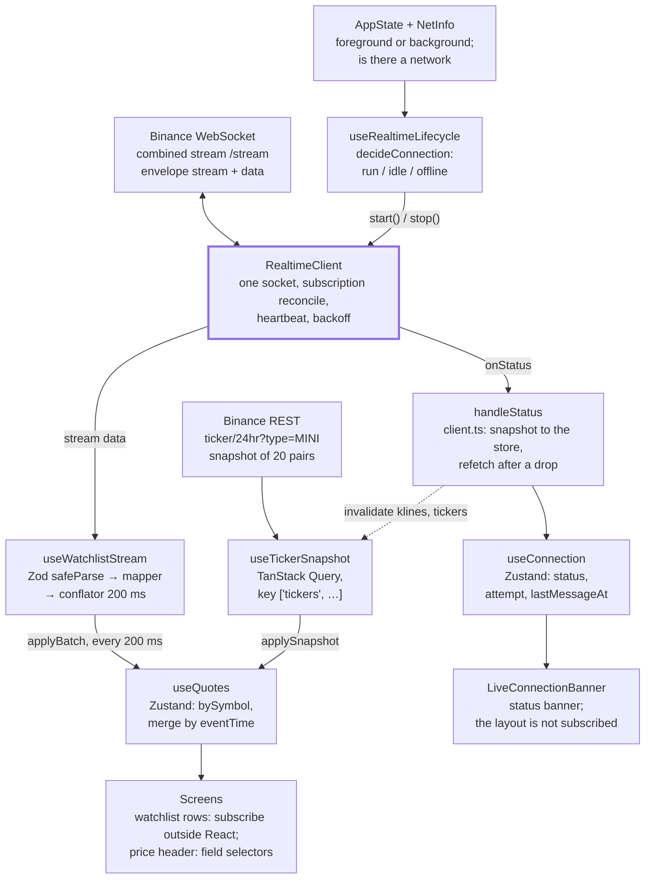
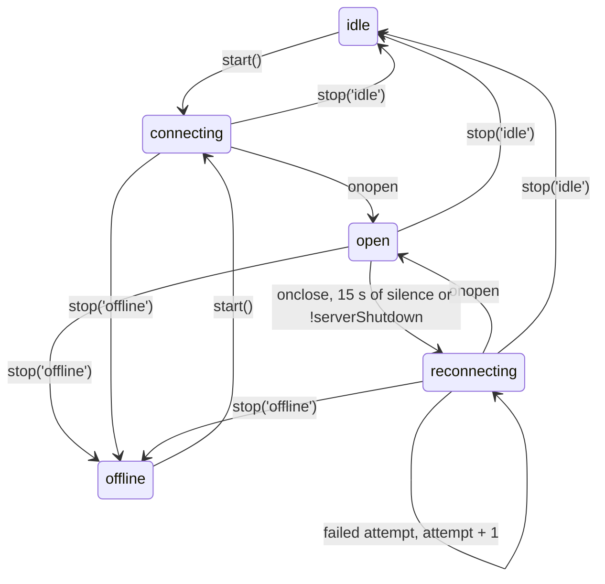

# rn-realtime-market

**EN** · [RU](README.ru.md)

Realtime market data in React Native (Expo SDK 58, development build): a hand-written WebSocket client, a 20-pair watchlist whose rows update without React re-renders, and a Skia candlestick chart with pan, pinch-zoom and a crosshair. Styling is Uniwind (Tailwind CSS 4) with a dark theme.

> Market data: Binance public API, no API key.
> Not affiliated with, endorsed or sponsored by Binance. Not financial advice: prices may be delayed or wrong.
>
> The app shows the same disclaimer on the symbol screen: "Market data: Binance public API. Not affiliated with Binance. Not financial advice."



Development build on a Galaxy M23: the watchlist with price flashes, the BTCUSDT chart with pan and a long-press crosshair, back to the list.

## What it shows

- Realtime client: one WebSocket outside React, reference-counted subscriptions, batched subscribe within the limit of 5 control messages per second (one message every 250 ms), full-jitter backoff, its own heartbeat, `serverShutdown` handling, AppState and NetInfo lifecycle.
- No row re-renders on ticks: server-side conflation (`@miniTicker`, once per second), one store write per 200 ms, rows read the store outside React and update shared values. A component test counts row commits (target: 0).
- Skia chart on the UI thread: 500 one-minute candles from REST plus a live candle, volume bars, pan with inertia, pinch-zoom, long-press crosshair with OHLC, price axis and last-price line.
- Pure, tested chart math: scales, viewport, nice ticks, candle upsert (`src/chart`, no React or Skia imports).
- Dev overlay (development builds, and `preview` builds through `EXPO_PUBLIC_DEV_OVERLAY=1` in `eas.json`): messages per second, store flushes per second, tick cost p50/p95 (JSON + Zod + conflator write per message), invalid messages, reconnects, gaps, latency p50/p95 and FPS.

## Architecture



Hosts: `data-stream.binance.vision` (WebSocket) and `data-api.binance.vision` (REST). Live quotes live in Zustand; klines and sparkline history live in TanStack Query.

## Realtime subsystem

The whole app keeps one WebSocket to the Binance combined stream (`wss://data-stream.binance.vision/stream`). It carries the 24 h tickers of all 20 pairs and the chart's `@kline_1m`. The socket lives outside React in `src/realtime/RealtimeClient.ts` and is open only while the app is in the foreground and the network is not known to be down. Components never touch the socket: they subscribe to streams and read stores. Only the lifecycle hook in the root layout calls `start()` and `stop()`.

One socket feeds two stores: the connection status goes to `useConnection` and the banner, stream data goes through Zod and the conflator to `useQuotes`. The REST snapshot writes to the same `useQuotes`; the dashed arrow is the refetch after a reconnect.



Control has one path: the lifecycle hook calls `start()` / `stop()`.

| Rule | Value |
|---|---|
| Control messages (SUBSCRIBE, UNSUBSCRIBE, LIST_SUBSCRIPTIONS) | at least 250 ms apart, at most 4 per second (Binance limit: 5; over it the server closes with 1008) |
| Streams per connection | at most 1024 (Binance limit); symbols lowercase, stream types camelCase: `btcusdt@miniTicker` |
| Heartbeat | check every 5 s; 10 s of silence → `LIST_SUBSCRIPTIONS` as a ping; 15 s → close with 4000 and reconnect (a dead link is found in 15–20 s) |
| Lost subscription | a wanted stream silent for 30 s while others flow → `LIST_SUBSCRIPTIONS`, re-subscribe what the server lost |
| Reconnect delay | full jitter: `random() · min(30 s, 0.5 s · 2^attempt)`; `attempt` resets after 10 s of stable `open`, and on `stop()` |
| `!serverShutdown` | reconnect at once, without backoff |
| Store writes | one batch per 200 ms (at most 5 per second), whatever the message rate |
| "Data is stale" banner | socket open, no message for 30 s |

<details>
<summary>Modules</summary>

Pure modules are plain TypeScript and run in Jest without React Native. ESLint fails on React Native, Expo, Skia or Uniwind imports in `src/chart`, `src/binance`, `src/store` and the pure files of `src/realtime`.

| File | Layer | What it does | Pure |
|---|---|---|---|
| `src/realtime/RealtimeClient.ts` | transport | One socket: status, subscriptions and their reconcile, heartbeat, reconnect | yes |
| `src/realtime/backoff.ts` | transport | `fullJitterDelay`: delay before a retry, 500 ms → 30 s | yes |
| `src/realtime/decideConnection.ts` | lifecycle | Decision table: app state + network → `run` / `idle` / `offline` | yes |
| `src/realtime/lifecycle.ts` | lifecycle | `useRealtimeLifecycle`: listens to AppState and NetInfo, calls `start()` / `stop()` | no |
| `src/realtime/client.ts` | glue | The `realtime` singleton; `handleStatus` writes the status to the store and refetches data after a drop; `syncClock` and dev metrics | no |
| `src/binance/schemas.ts` | protocol | Zod schemas: `{ stream, data }` envelope, miniTicker, trade, kline, REST ticker | yes |
| `src/binance/streams.ts` | protocol | Stream names: `btcusdt@miniTicker`, `btcusdt@trade`, `btcusdt@kline_1m` | yes |
| `src/binance/queryKeys.ts` | protocol | TanStack Query key roots: `['klines']`, `['tickers']` | yes |
| `src/store/conflator.ts` | data | Merges ticks per symbol, hands over one batch every 200 ms | yes |
| `src/store/quotesStore.ts` | data | Zustand store `useQuotes`: `bySymbol`, `applySnapshot`, `applyBatch` | yes |
| `src/store/mappers.ts`, `types.ts` | data | `Ticker` / `TickerPatch` types and Binance message mappers | yes |
| `src/store/connectionStore.ts` | data | Zustand store `useConnection`: `status`, `attempt`, `lastMessageAt` | yes |
| `src/features/watchlist/useWatchlistStream.ts` | consumer | Subscribes the symbols, validates, pushes into the conflator | no |
| `src/features/watchlist/useTickerSnapshot.ts` | consumer | REST 24 h snapshot through TanStack Query → `applySnapshot` | no |
| `src/ui/LiveConnectionBanner.tsx`, `ConnectionBanner.tsx`, `getBannerState.ts`, `useNow.ts` | UI | Connection banner | `getBannerState` only |
| `src/app/_layout.tsx` | root | Runs the lifecycle hook and `setupQueryManagers()`, renders the banner | no |

</details>

<details>
<summary>Connection states</summary>

The client reports a snapshot `{ status, attempt, lastMessageAt }` through `onStatus`: on every status change, on every scheduled reconnect, when `attempt` resets, and at most once per second while messages flow (so the banner can see stale data).

| Status | Meaning | Socket |
|---|---|---|
| `idle` | Stopped: app start or background | none |
| `connecting` | First attempt (`attempt` = 0) | opening |
| `open` | Connected, data flows | open |
| `reconnecting` | Connection lost: waiting for backoff or retrying (`attempt` > 0) | none or opening |
| `offline` | Stopped because there is no network; no retries | none |



- `start()` is idempotent. `stop(reason)` cancels the reconnect timer, forgets the socket before `close(1000)`, resets `attempt` and leaves no timers.
- `subscribe(stream, listener)` returns an unsubscribe function and also works on a stopped client: the stream goes to the server on the next `open`.
- Every socket handler starts with `if (ws !== this.ws) return`, and the client forgets a socket before closing it, so a late `onclose` of an old socket cannot start a second connection.
- `onStatus`, `onError`, stream listeners and `ws.close()` run in `try/catch`; the reconnect timer is set before `onStatus`, so a failing consumer cannot stop recovery.

</details>

<details>
<summary>Subscriptions: reconcile, not a command queue</summary>

The client keeps two sets: `subs` (wanted: stream → listeners) and `serverStreams` (what the server knows; cleared on every new socket). It sends only the difference.

1. A new stream, or the last listener leaving, calls `scheduleFlush()`: one timer, only while the socket is open.
2. The timer fires at least 250 ms after the previous control message.
3. `flush()` computes the difference when it runs: 20 `subscribe()` calls in one render become one `SUBSCRIBE` with 20 params; a stream added and removed in between sends nothing.
4. One message per pass: first `SUBSCRIBE` for the missing streams, then `UNSUBSCRIBE` for the extra ones on the next pass.
5. If Binance rejects a `SUBSCRIBE`, those streams leave `serverStreams` and go out with the next flush, not in an immediate retry loop.
6. `LIST_SUBSCRIPTIONS` checks the server: a stream we thought subscribed but missing in the reply leaves `serverStreams`, and the next flush subscribes it again. Streams added after the request are not judged by that reply.

After a reconnect `serverStreams` is empty, so one flush restores everything in one message. A queue would have to replay commands that are no longer relevant.

</details>

<details>
<summary>App lifecycle</summary>

`decideConnection(appState, isConnected)` decides, `useRealtimeLifecycle` acts, and calls the client only when the decision changes.

| AppState | NetInfo `isConnected` | Decision | Client call |
|---|---|---|---|
| `active` | `true` | run | `start()` |
| `active` | `null` (no answer yet) | run | `start()` |
| `active` | `false` | offline | `stop('offline')` |
| `inactive` (notification shade, incoming call on iOS) | `true` | run | `start()` |
| `background` | any | idle | `stop('idle')` |
| `null`, `unknown`, `extension` | as `active` | as `active` | — |

- Background closes the socket: iOS suspends the app soon after it leaves the screen, Android Doze cuts the network. Reopening is cheap; a half-dead socket costs battery and shows wrong data.
- `inactive` lasts seconds, so it does not drop the connection.
- `isConnected === null` means "try": waiting for NetInfo would delay a cold start.
- No retries while offline: the user sees "No internet", not a growing attempt counter.

</details>

<details>
<summary>From a message to the store</summary>

Validation has two layers. The client checks only the envelope; the subscriber checks the payload with the schema of its own stream.

1. `JSON.parse`; not JSON → invalid counter and `onError`, the frame is dropped.
2. No `stream` field → a control reply (`{ id, result }` or an error in nested, flat or `id: null` form): a rejected `SUBSCRIBE` or a `LIST_SUBSCRIPTIONS` reply goes to reconcile.
3. `stream` present → `{ stream, data }` envelope; `!serverShutdown` → reconnect now; otherwise `data` goes to every listener of the stream, each in its own `try/catch`.
4. `useWatchlistStream` checks `data` with `MiniTickerSchema` or `TradeSchema` (`safeParse`), maps it and pushes it into the conflator. An invalid message is dropped and counted in the dev overlay; the next miniTicker brings the full state a second later.

Prices stay strings (`"84710.60000000"`, format checked by regex) and become numbers only at the chart boundary.

The conflator is not a throttle: it merges fields per symbol (a miniTicker brings open/high/low/volume, a trade only the last price). On a conflict the larger `eventTime` wins; an older event only fills missing fields. The 200 ms timer starts on the first push into an empty batch, so no data means no JS wake-ups. `flushMs = 0` turns batching off for measurements.

`useQuotes` merges the REST snapshot and stream batches with one function:

| Case | Result |
|---|---|
| `eventTime` older than the stored one | skipped: an old snapshot does not overwrite a fresh tick |
| partial patch (price only) and no row yet | skipped |
| newer event with other values | a new object for this symbol only |
| nothing changed for any symbol | same state: Zustand does not notify |

The REST snapshot (`GET /api/v3/ticker/24hr?type=MINI`, key `['tickers', …]`) gives prices at a cold start before the first tick (20 prices in 2.6 s on a live request). Its `closeTime` comes from the same exchange clock as the ticks' `E`, so the race "snapshot after tick" is decided by `eventTime`.

</details>

<details>
<summary>Connection banner and recovery after a drop</summary>

Chain: `RealtimeClient.onStatus` → `handleStatus` → `useConnection` → `LiveConnectionBanner` → `ConnectionBanner`. The root layout is not subscribed: while data flows `lastMessageAt` changes once a second, and only the small banner component re-renders.

| Snapshot | Banner |
|---|---|
| `idle` | none |
| `connecting` | "Connecting" |
| `reconnecting`, attempt N | "Reconnecting (attempt N)" |
| `offline` | "No internet" |
| `open`, last message older than 30 s | "Data is stale" |
| `open`, fresh data or no message yet | none |

On every return to `open` except the first one in a run, `handleStatus` invalidates `['klines']` and `['tickers']`: the ticker snapshot is refetched and the chart reloads its history, because the stream brings only the current candle. Subscriptions restore themselves: the new socket starts with an empty server set, and `onopen` → `flush()` sends one `SUBSCRIBE` for everything wanted.

| Scenario | What happens | Banner |
|---|---|---|
| Airplane mode on | NetInfo `false` → `stop('offline')`: socket closed, no timers, no retries | "No internet" |
| Airplane mode off | `start()` → `connecting` → `open` → one `SUBSCRIBE` → invalidation | "Connecting", then gone |
| App to background | `stop('idle')`, socket closed with 1000 | none (app hidden) |
| Back to foreground | as after airplane mode; TanStack Query also gets focus | "Connecting", then gone |
| Wi-Fi → LTE without `isConnected: false` | half-open TCP: probe at 10 s, `close(4000)` at 15 s → backoff → new socket | "Reconnecting (attempt 1)", then gone |
| Binance server restart | `!serverShutdown` → connect at once; or `onclose` → backoff | short "Connecting" or "Reconnecting" |
| 24 h connection limit | server closes the socket → normal backoff | short "Reconnecting" |
| Server lost one subscription | stream silent 30 s → `LIST_SUBSCRIPTIONS` → reconcile → `SUBSCRIBE` | none |

Checked on the phone (2026-11-13): 20 s of airplane mode and 30 s in background; the chart refetches its history after a reconnect without gaps.

</details>

<details>
<summary>How the subsystem is tested</summary>

Everything runs in Jest without network or device. `FakeSocket` (`src/test/FakeSocket.ts`) replaces `WebSocket` through the `createSocket` option: it records what the client sends, and the test decides when the socket opens, what the server sends and when it closes. Its `close()` does not fire `onclose` by itself, so tests can reproduce the late `onclose` race. Fake timers run minutes of backoff and silence in milliseconds; `random: () => 0.5` makes jitter predictable.

| Test file | Tests | What it checks |
|---|---|---|
| `RealtimeClient.test.ts` | 16 | Core contract: start, batched subscribe, send limit, backoff, heartbeat, `stop()` |
| `RealtimeClient.reconcile.test.ts` | 13 | Reconcile against `LIST_SUBSCRIPTIONS` (case, foreign and repeated ids, late subscriptions), 1008, `stop()` without timers |
| `RealtimeClient.robustness.test.ts` | 17 | One stream silent 30 s, rejected `SUBSCRIBE`, throwing callbacks and `close()`, failed `send`, `id: null` replies, broken envelopes |
| `RealtimeClient.guards.test.ts`, `.stop.test.ts`, `.onMessage.test.ts` | 4 + 1 + 3 | Old-socket guards, `stop()` during a pending reconnect, the per-message hook (added after mutation testing) |
| `backoff.test.ts`, `decideConnection.test.ts`, `lifecycle.test.tsx` | 3 + 2 + 9 | Full jitter formula, the decision table (15 rows), AppState and NetInfo → client calls |
| `client.test.ts` | 16 | `handleStatus`: store write, invalidation only after a drop, reconnect counter; clock sync; import does not open a socket |
| `conflator.test.ts`, `quotesStore.test.ts`, `mappers.test.ts`, `connectionStore.test.ts` | 11 + 12 + 3 + 3 | 1000 ticks → 1 batch, field merge, lazy timer; new objects only for changed symbols; fixtures |
| `useWatchlistStream.test.tsx`, `useTickerSnapshot.test.tsx` | 14 + 4 | Streams per symbol, Zod filter, batch after 200 ms, unsubscribe on unmount; snapshot order and refetch |
| `getBannerState`, `ConnectionBanner`, `LiveConnectionBanner`, `useNow` | 9 + 7 + 4 + 5 | Banner texts, 30 s threshold, store wiring, a timer only when needed |
| `src/test/connectionChain.test.tsx`, `symbolChain.test.tsx` | 9 + 7 | Whole chains: lifecycle → client → store → banner; kline SUBSCRIBE / UNSUBSCRIBE on enter and leave, history refetch after a drop without gaps |

Live check: `bunx tsx scripts/live-check.ts` runs the real client against Binance in Node: `connecting → open → ticks → idle`, no errors. Never in CI.

</details>

<details>
<summary>Known gaps and open questions</summary>

- The quotes store creates a new ticker object on every new `eventTime`, even with the same prices; `useConnection` gets a new object once a second while open. Rows and other consumers read fields, not objects.
- Switching stress mode or `flushMs` drops the pending batch.
- No timeout for the `connecting` state; no minimum interval for `!serverShutdown`; a probe rejected by the 250 ms limit is not retried until the 15 s check.
- The 24 h connection limit is handled only when the server closes the socket: once a day a short "Reconnecting".
- Open: do miniTicker streams go silent on quiet pairs (would the 30 s stream check fire for nothing)? Should NetInfo be debounced on a flapping network? Should REST honor `Retry-After`?

</details>

## Quick start

The app runs in a development build (expo-dev-client), not in Expo Go. You need Node 24 (see `.nvmrc`), Bun and an Android phone or emulator (Android 8 / API 26+ with Vulkan 1.1, required by Skia Graphite).

```sh
bun install --frozen-lockfile
bun run android      # build and install the development build locally (Android SDK, JDK, device or emulator)
bun start            # then every day: Metro for the installed development build
```

- Cloud build instead of a local one (after linking your own Expo project): `eas build -p android --profile development`.
- iOS (deployment target 16.4): `bun run ios` on a Mac with a matching Xcode, or an EAS build with `--profile development-simulator`. iOS is build-only and unmeasured.
- Release APK for testing: `eas build -p android --profile preview` (this profile also turns the dev overlay on).
- A new native dependency, plugin or `app.json` change needs a new development build; JS changes only need Metro.

## Styling

Uniwind (Tailwind CSS 4): `className` on React Native components, theme tokens in `src/global.css` (dark by default, with a toggle). Skia and Reanimated read the same tokens through hooks. Animations use Reanimated, never `className` changes on ticks.

## Scripts

| Command | What it does |
|---|---|
| `bun start` | `expo start --dev-client`: Metro for the development build |
| `bun run android` | `expo run:android`: build and run locally |
| `bun run ios` | `expo run:ios`: build and run locally |
| `bun run web` | `expo start --web` (web is out of scope and not maintained) |
| `bun run lint` | `expo lint --max-warnings 0` |
| `bun run test` | `jest`, no network |
| `bun run test:watch` | `jest --watch` |
| `bun run uniwind:types` | generate Uniwind type artifacts |
| `bun run typecheck` | Uniwind types, then `tsc --noEmit` |
| `bun run doctor` | `expo-doctor` |
| `bun run check` | typecheck, lint, tests |
| `bun run eas:update` | publish an OTA update with `scripts/publish-update.mjs` |
| `bunx tsx scripts/live-check.ts` | the realtime client against the live stream (never in CI) |
| `bun scripts/bench-chart.mjs` | chart frame benchmark over adb on a release build with the dev overlay (`--manual` for a hand-driven run; never in CI) |

## Tests

Jest 30 with jest-expo and React Native Testing Library: 403 tests in 53 files, all passing (2026-11-16). Unit tests cover pure logic; the client is tested with a fake socket and fake timers; REST and CI use no network. Coverage: `RealtimeClient.ts` 98% lines, every file in `src/chart` 100% functions (CI fails below 90% and 100%).

Mutation check: 6 deliberate bugs in the core (client, conflator, candle series, zoom), one at a time; each one fails 1 to 3 tests, so 6 of 6 are caught. A wider pass of about 40 mutations left 7 meaningful survivors; 5 of them now have a dedicated test that fails on that mutation.

Run `bun run check`; for coverage: `bun run test -- --ci --coverage --runInBand`.

## Performance

Device: Samsung Galaxy M23 5G, Android 14, 120 Hz screen, Wi-Fi. iOS is not measured.

**Watchlist, 20 symbols.** EAS `preview` build (release, dev overlay on), 2026-11-14, 60 s, overlay read at 20, 40 and 60 s. Row renders come from a development build (2026-11-13), because the render counter is development-only.

| Mode | Messages/s | Store flushes/s | Row renders/s | Tick p50 / p95 (ms) | JS FPS |
|---|---|---|---|---|---|
| `@miniTicker`, 200 ms batches | 9–15 | 3–4 | 0.00 | 0.17 / 0.25–0.34 | 109–121 |
| Stress mode (+ `@trade` streams), 200 ms batches | not measured | not measured | 0.00 | not measured | not measured |
| Stress mode, no batching | not measured | not measured | 0.00 | not measured | not measured |

UI thread on the watchlist: 2.25% janky frames over 60 s (7,143 frames, `dumpsys gfxinfo`). Stress mode and the batching switch exist only in development builds, so in release only the default mode was measured.

Latency from the exchange event time `E` to the message handled in JS: p50 142–153 ms, p95 224–250 ms. The phone clock is corrected with `/api/v3/time` (error ± half the round trip). The end-to-end time to a painted row is not measured; batching adds up to 200 ms on top.

**Chart: pan and pinch.** Local release build, 2026-11-16. A slow frame is a present-to-present interval of 13 ms or more (over 1.5 refresh periods at 120 Hz), from `dumpsys SurfaceFlinger --timestats` of the chart layer.

| Run | Slow frames | Chart layer FPS |
|---|---|---|
| Scripted: 10 s pan at 1,500 px/s plus a pinch every 2 s, 8 runs (`scripts/bench-chart.mjs`) | 1.5–3.7% | 115–117 |
| By hand, 10 s, frames while a finger is on the screen | 2.7% | ~112 |
| By hand, all frames while the chart moves (includes fling starts) | 7.2–9.6% | 99–112 |

Target: at most 5% slow frames. It is met in the scripted run and while the finger is down. The first ~150 ms after an idle pause are still slow: the GPU and CPU clocks ramp up, and drawing less does not help. The first release measurement of the chart was 16% janky frames (`gfxinfo`); building candle geometry in data space and moving it with one matrix per frame brought it to the numbers above.

Targets: chart at most 5% slow frames during gestures; 0 row renders on ticks; tick handling at most 1 ms p95; at most 5 store writes per second; exchange-to-screen latency p95 at most 250 ms; a dead connection found within 20 s.

## Limitations and roadmap

- Public market data only: no orders, accounts or private streams. Binance may be unavailable in some regions (HTTP 451).
- Fixed list of 20 pairs and one-minute candles; no web, tablets or store publishing.
- Skia 3 (Graphite) needs Android 8+ with Vulkan 1.1 and iOS 15.1+; the app sets the iOS deployment target to 16.4.
- Measured on one Android phone only. Not measured: iOS, stress mode in release, end-to-end latency to a painted row. The chart drops some frames during the first ~150 ms of a gesture after a pause.
- Some installed packages are not imported by the app yet: `expo-widgets` (its plugin adds an extra iOS widget target), `expo-secure-store`, `expo-linear-gradient`, `react-native-keyboard-controller`, `expo-image`, `react-native-mmkv` and `react-native-nitro-modules`.
- Next: order book, trade tape, interval switching.

## License

MIT, see [LICENSE](LICENSE). AI tools (Claude Code) were used to write and review code. See also [CONTRIBUTING.md](CONTRIBUTING.md), [SECURITY.md](SECURITY.md) and [CHANGELOG.md](CHANGELOG.md).

Market data comes from Binance public endpoints. Each phone connects to Binance directly; there is no relay server, and the repository holds only a few small test fixtures, not recorded streams. The project is non-commercial: no ads, paid features, referral links or trading buttons. It is not affiliated with Binance and uses no Binance logos, colors or fonts. Commercial use or store publishing would need written consent from the data provider.
