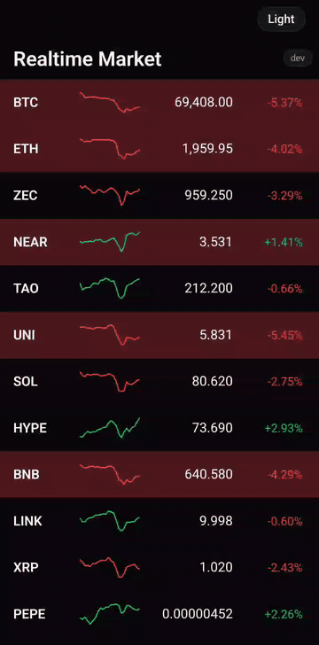
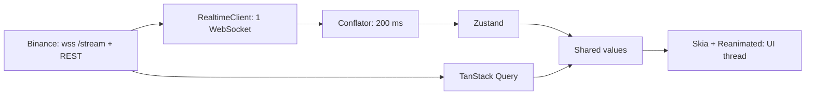
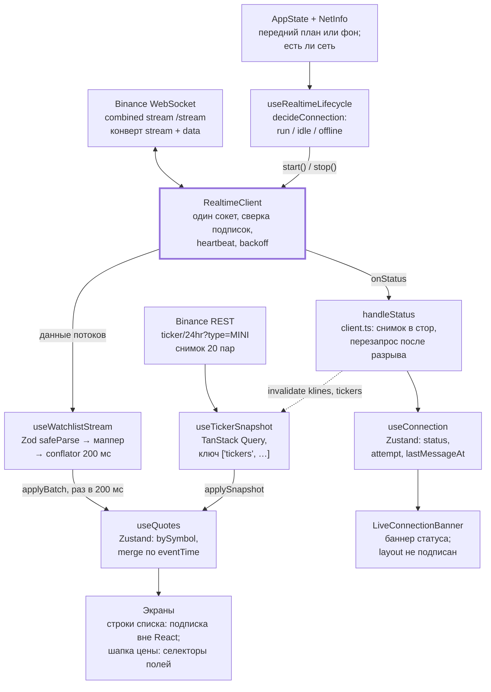
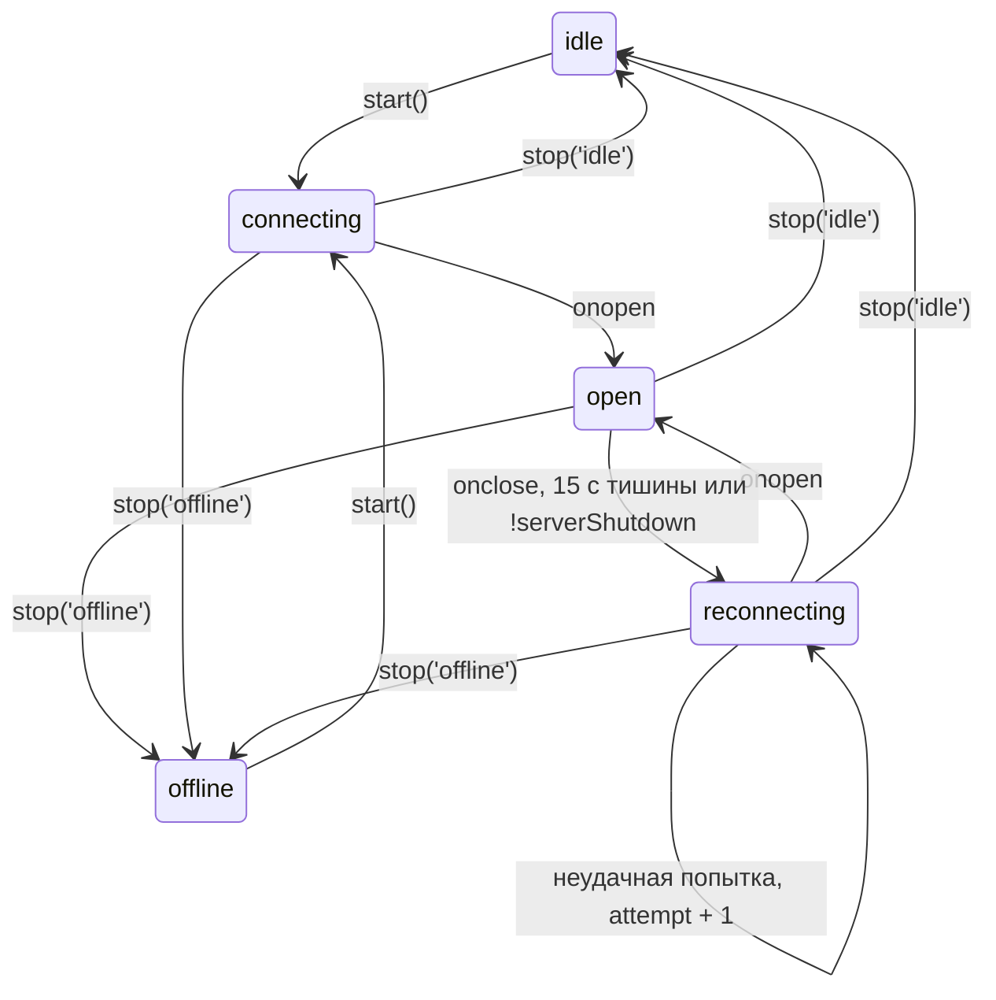

# rn-realtime-market

[EN](README.md) · **RU**

Рыночные данные в реальном времени на React Native (Expo SDK 58, development build): собственный WebSocket-клиент, список из 20 пар, строки которого обновляются без перерисовок React, и свечной график на Skia с панорамой, масштабированием щипком и перекрестием. Стили — Uniwind (Tailwind CSS 4), тёмная тема.

> Данные: публичный API Binance, без ключа.
> Проект не связан с Binance, не одобрен и не спонсируется Binance. Это не финансовый совет: цены могут запаздывать или быть неверными.
>
> То же предупреждение показано в приложении на экране символа: «Market data: Binance public API. Not affiliated with Binance. Not financial advice.»



Development build на Galaxy M23: список со вспышками цен, график BTCUSDT с панорамой и перекрестием по долгому нажатию, возврат к списку.

## Что показывает проект

- Realtime-клиент: один WebSocket вне React, подписки со счётчиком ссылок, пакетная подписка в пределах 5 управляющих сообщений в секунду (одно сообщение раз в 250 мс), full-jitter backoff, собственный heartbeat, обработка `serverShutdown`, жизненный цикл по AppState и NetInfo.
- Без перерисовок строк на тиках: конфляция на стороне сервера (`@miniTicker`, раз в секунду), одна запись в стор за 200 мс, строки читают стор вне React и обновляют shared values. Компонентный тест считает коммиты строк (цель: 0).
- График Skia на UI-потоке: 500 минутных свечей из REST плюс живая свеча, столбцы объёма, панорама с инерцией, масштабирование щипком, перекрестие с OHLC по долгому нажатию, ценовая шкала и линия последней цены.
- Чистая протестированная математика графика: шкалы, окно просмотра, «красивые» деления, upsert свечи (`src/chart`, без импортов React и Skia).
- Оверлей разработчика (development build, а также `preview` через `EXPO_PUBLIC_DEV_OVERLAY=1` в `eas.json`): сообщений в секунду, записей в стор в секунду, стоимость тика p50/p95 (JSON + Zod + запись в конфлятор на сообщение), невалидные сообщения, переподключения, пропуски, задержка p50/p95 и FPS.

## Архитектура



Хосты: `data-stream.binance.vision` (WebSocket) и `data-api.binance.vision` (REST). Живые котировки лежат в Zustand; свечи и история спарклайнов — в TanStack Query.

## Подсистема realtime

Всё приложение держит одно WebSocket-соединение с combined stream Binance (`wss://data-stream.binance.vision/stream`). Через него идут 24-часовые тикеры всех 20 пар и `@kline_1m` графика. Сокет живёт вне React, в `src/realtime/RealtimeClient.ts`, и открыт только пока приложение на переднем плане и сеть не отсутствует явно. Компоненты сокет не трогают: они подписываются на потоки и читают сторы. `start()` и `stop()` вызывает только хук жизненного цикла в корневом layout.

Одно соединение кормит два стора: статус соединения идёт в `useConnection` и баннер, данные потоков — через Zod и conflator в `useQuotes`. REST-снимок пишет в тот же `useQuotes`; пунктир — перезапрос снимка после переподключения.



Управление идёт одним путём: хук жизненного цикла вызывает `start()` / `stop()`.

| Правило | Значение |
|---|---|
| Управляющие сообщения (SUBSCRIBE, UNSUBSCRIBE, LIST_SUBSCRIPTIONS) | не чаще одного раза в 250 мс, не больше 4 в секунду (лимит Binance — 5; при превышении сервер закрывает соединение с кодом 1008) |
| Потоков на соединение | не больше 1024 (лимит Binance); символ строчными, тип потока в camelCase: `btcusdt@miniTicker` |
| Heartbeat | проверка раз в 5 с; 10 с тишины → `LIST_SUBSCRIPTIONS` вместо ping; 15 с → закрытие с кодом 4000 и переподключение (мёртвое соединение находится за 15–20 с) |
| Потерянная подписка | желаемый поток молчит 30 с, а другие идут → `LIST_SUBSCRIPTIONS`, повторная подписка на то, что сервер потерял |
| Задержка переподключения | full jitter: `random() · min(30 с, 0,5 с · 2^attempt)`; `attempt` сбрасывается после 10 с стабильного `open` и в `stop()` |
| `!serverShutdown` | переподключение сразу, без backoff |
| Записи в стор | одна пачка раз в 200 мс (не больше 5 в секунду) при любом потоке сообщений |
| Баннер «Data is stale» | сокет открыт, сообщений нет 30 с |

<details>
<summary>Карта модулей</summary>

Чистые модули — обычный TypeScript, они работают в Jest без React Native. ESLint считает ошибкой импорт React Native, Expo, Skia или Uniwind в `src/chart`, `src/binance`, `src/store` и чистых файлах `src/realtime`.

| Файл | Слой | Что делает | Чистый |
|---|---|---|---|
| `src/realtime/RealtimeClient.ts` | транспорт | Один сокет: статусы, подписки и их сверка, heartbeat, переподключение | да |
| `src/realtime/backoff.ts` | транспорт | `fullJitterDelay`: задержка перед повтором, 500 мс → 30 с | да |
| `src/realtime/decideConnection.ts` | жизненный цикл | Таблица решений: состояние приложения + сеть → `run` / `idle` / `offline` | да |
| `src/realtime/lifecycle.ts` | жизненный цикл | `useRealtimeLifecycle`: слушает AppState и NetInfo, вызывает `start()` / `stop()` | нет |
| `src/realtime/client.ts` | клей | Синглтон `realtime`; `handleStatus` пишет статус в стор и перезапрашивает данные после разрыва; `syncClock` и dev-метрики | нет |
| `src/binance/schemas.ts` | протокол | Zod-схемы: конверт `{ stream, data }`, miniTicker, trade, kline, REST-тикер | да |
| `src/binance/streams.ts` | протокол | Имена потоков: `btcusdt@miniTicker`, `btcusdt@trade`, `btcusdt@kline_1m` | да |
| `src/binance/queryKeys.ts` | протокол | Корни ключей TanStack Query: `['klines']`, `['tickers']` | да |
| `src/store/conflator.ts` | данные | Склеивает тики по символу и отдаёт пачку раз в 200 мс | да |
| `src/store/quotesStore.ts` | данные | Zustand-стор `useQuotes`: `bySymbol`, `applySnapshot`, `applyBatch` | да |
| `src/store/mappers.ts`, `types.ts` | данные | Типы `Ticker` / `TickerPatch` и перевод сообщений Binance в них | да |
| `src/store/connectionStore.ts` | данные | Zustand-стор `useConnection`: `status`, `attempt`, `lastMessageAt` | да |
| `src/features/watchlist/useWatchlistStream.ts` | потребитель | Подписывает символы, валидирует, кладёт в conflator | нет |
| `src/features/watchlist/useTickerSnapshot.ts` | потребитель | REST-снимок 24h через TanStack Query → `applySnapshot` | нет |
| `src/ui/LiveConnectionBanner.tsx`, `ConnectionBanner.tsx`, `getBannerState.ts`, `useNow.ts` | UI | Баннер состояния соединения | только `getBannerState` |
| `src/app/_layout.tsx` | корень | Запускает хук жизненного цикла и `setupQueryManagers()`, рисует баннер | нет |

</details>

<details>
<summary>Состояния соединения</summary>

Клиент отдаёт снимок `{ status, attempt, lastMessageAt }` в `onStatus`: при каждой смене статуса, при каждом планировании переподключения, при сбросе `attempt` и не чаще раза в секунду, пока идут сообщения (чтобы баннер заметил устаревшие данные).

| Статус | Что значит | Сокет |
|---|---|---|
| `idle` | Клиент остановлен: старт приложения или фон | нет |
| `connecting` | Первая попытка (`attempt` = 0) | открывается |
| `open` | Соединение открыто, данные идут | открыт |
| `reconnecting` | Соединение потеряно: ожидание backoff или повторная попытка (`attempt` > 0) | нет или открывается |
| `offline` | Остановлен из-за отсутствия сети, попыток нет | нет |



- `start()` идемпотентен. `stop(reason)` отменяет таймер переподключения, забывает сокет до `close(1000)`, сбрасывает `attempt` и не оставляет таймеров.
- `subscribe(stream, listener)` возвращает функцию отписки и работает на остановленном клиенте: поток уйдёт на сервер при следующем `open`.
- Каждый обработчик сокета начинается с `if (ws !== this.ws) return`, а клиент забывает сокет до его закрытия, поэтому поздний `onclose` старого сокета не создаст второе соединение.
- `onStatus`, `onError`, слушатели потоков и `ws.close()` вызываются в `try/catch`; таймер переподключения ставится до `onStatus`, так что упавший потребитель не остановит восстановление.

</details>

<details>
<summary>Подписки: сверка, а не очередь команд</summary>

Клиент держит два набора: `subs` (желаемое: поток → подписчики) и `serverStreams` (что знает сервер; очищается на каждом новом сокете). Отправляется только разница.

1. Новый поток или уход последнего подписчика вызывает `scheduleFlush()`: один таймер и только при открытом сокете.
2. Таймер срабатывает не раньше чем через 250 мс после прошлого управляющего сообщения.
3. `flush()` считает разницу в момент отправки: 20 вызовов `subscribe()` за один рендер — один `SUBSCRIBE` с 20 параметрами; поток, добавленный и тут же убранный, не отправляется вовсе.
4. За проход — одно сообщение: сначала `SUBSCRIBE` недостающего, на следующем проходе `UNSUBSCRIBE` лишнего.
5. Если Binance отклонил `SUBSCRIBE`, эти потоки убираются из `serverStreams` и уходят со следующим flush, а не в цикле немедленных повторов.
6. `LIST_SUBSCRIPTIONS` проверяет сервер: поток, который считался подписанным, но отсутствует в ответе, убирается из `serverStreams`, и следующий flush подписывает его снова. Потоки, добавленные после запроса, по этому ответу не судятся.

После переподключения `serverStreams` пуст, и один flush восстанавливает всё одним сообщением. Очереди пришлось бы переигрывать команды, часть которых уже не актуальна.

</details>

<details>
<summary>Жизненный цикл приложения</summary>

Решает `decideConnection(appState, isConnected)`, исполняет `useRealtimeLifecycle`, и клиент вызывается только при смене решения.

| AppState | NetInfo `isConnected` | Решение | Вызов клиента |
|---|---|---|---|
| `active` | `true` | run | `start()` |
| `active` | `null` (ещё не ответил) | run | `start()` |
| `active` | `false` | offline | `stop('offline')` |
| `inactive` (шторка, входящий звонок на iOS) | `true` | run | `start()` |
| `background` | любое | idle | `stop('idle')` |
| `null`, `unknown`, `extension` | как у `active` | как у `active` | — |

- Фон закрывает сокет: iOS вскоре приостанавливает приложение, Android в Doze отключает сеть. Переоткрыть дёшево, а полумёртвый сокет — это батарея и ложные данные.
- `inactive` длится секунды, соединение из-за него не рвётся.
- `isConnected === null` — «пробуем»: ждать NetInfo значит задержать холодный старт.
- В offline попыток нет: пользователь видит «No internet», а не растущий счётчик попыток.

</details>

<details>
<summary>От сообщения до стора</summary>

Валидация в два слоя. Клиент проверяет только конверт; содержимое проверяет подписчик схемой своего потока.

1. `JSON.parse`; не JSON → счётчик невалидных и `onError`, кадр отбрасывается.
2. Нет поля `stream` → ответ на управляющую команду (`{ id, result }` или ошибка во вложенной, плоской или `id: null` форме): отказ на `SUBSCRIBE` и ответ на `LIST_SUBSCRIPTIONS` идут в сверку.
3. Есть `stream` → конверт `{ stream, data }`; `!serverShutdown` → немедленное переподключение; иначе `data` уходит всем подписчикам потока, каждому в своём `try/catch`.
4. `useWatchlistStream` проверяет `data` схемой `MiniTickerSchema` или `TradeSchema` (`safeParse`), переводит маппером и кладёт в conflator. Невалидное сообщение отбрасывается и считается в dev-оверлее; следующий miniTicker через секунду принесёт полное состояние.

Цены остаются строками (`"84710.60000000"`, формат проверяет регулярное выражение) и становятся числами только на границе графика.

Conflator — не throttle: он сливает поля по символу (miniTicker приносит open/high/low/объём, сделка — только последнюю цену). При конфликте побеждает больший `eventTime`; более старое событие только дополняет недостающие поля. Таймер 200 мс ставится на первый push в пустую пачку, так что нет данных — нет пробуждений JS. `flushMs = 0` выключает пачки для замеров.

`useQuotes` сливает REST-снимок и пачки потока одной функцией:

| Ситуация | Результат |
|---|---|
| `eventTime` старше сохранённого | пропустить: старый снимок не перетрёт свежий тик |
| частичный patch (только цена), строки ещё нет | пропустить |
| новое событие с другими значениями | новый объект только для этого символа |
| ни у одного символа ничего не изменилось | тот же state: Zustand не уведомляет |

REST-снимок (`GET /api/v3/ticker/24hr?type=MINI`, ключ `['tickers', …]`) даёт цены при холодном старте до первого тика (живой запрос: 20 цен за 2,6 с). Его `closeTime` идёт с тех же часов биржи, что и `E` у тиков, поэтому гонку «снимок пришёл после тика» решает сравнение `eventTime`.

</details>

<details>
<summary>Баннер соединения и восстановление после разрыва</summary>

Цепочка: `RealtimeClient.onStatus` → `handleStatus` → `useConnection` → `LiveConnectionBanner` → `ConnectionBanner`. Корневой layout на стор не подписан: пока идут данные, `lastMessageAt` меняется раз в секунду, и перерисовывается только маленький компонент баннера.

| Снимок | Баннер |
|---|---|
| `idle` | нет |
| `connecting` | «Connecting» |
| `reconnecting`, attempt N | «Reconnecting (attempt N)» |
| `offline` | «No internet» |
| `open`, последнее сообщение старше 30 с | «Data is stale» |
| `open`, данные свежие или сообщений ещё не было | нет |

При каждом возврате в `open`, кроме первого за запуск, `handleStatus` инвалидирует `['klines']` и `['tickers']`: снимок тикеров перезапрашивается, а график заново грузит историю, потому что поток приносит только текущую свечу. Подписки восстанавливаются сами: новый сокет начинает с пустого набора сервера, и `onopen` → `flush()` отправляет один `SUBSCRIBE` на всё желаемое.

| Сценарий | Что происходит | Баннер |
|---|---|---|
| Авиарежим включён | NetInfo `false` → `stop('offline')`: сокет закрыт, таймеров и попыток нет | «No internet» |
| Авиарежим выключен | `start()` → `connecting` → `open` → один `SUBSCRIBE` → инвалидация | «Connecting», затем исчезает |
| Уход в фон | `stop('idle')`, сокет закрыт кодом 1000 | нет (приложение скрыто) |
| Возврат из фона | как после авиарежима; TanStack Query заодно получает focus | «Connecting», затем исчезает |
| Смена Wi-Fi → LTE без `isConnected: false` | полуоткрытый TCP: probe на 10 с, `close(4000)` на 15 с → backoff → новый сокет | «Reconnecting (attempt 1)», затем исчезает |
| Перезапуск сервера Binance | `!serverShutdown` → сразу connect; или `onclose` → backoff | коротко «Connecting» или «Reconnecting» |
| Лимит 24 ч на соединение | сервер закрывает сокет → обычный backoff | коротко «Reconnecting» |
| Сервер потерял одну подписку | поток молчит 30 с → `LIST_SUBSCRIPTIONS` → сверка → `SUBSCRIBE` | нет |

Проверено на телефоне (2026-11-13): авиарежим 20 с и фон 30 с; после переподключения график догружает историю без дыр.

</details>

<details>
<summary>Как подсистема тестируется</summary>

Всё работает в Jest без сети и устройства. `FakeSocket` (`src/test/FakeSocket.ts`) подменяет `WebSocket` через опцию `createSocket`: записывает, что отправил клиент, а тест решает, когда сокет откроется, что пришлёт сервер и когда закроет соединение. Его `close()` сам не вызывает `onclose`, поэтому тесты воспроизводят гонку с поздним `onclose`. Поддельные таймеры прокручивают минуты backoff и тишины за миллисекунды; `random: () => 0.5` делает jitter предсказуемым.

| Файл тестов | Тестов | Что проверяет |
|---|---|---|
| `RealtimeClient.test.ts` | 16 | Основной контракт: старт, склейка подписок, лимит отправки, backoff, heartbeat, `stop()` |
| `RealtimeClient.reconcile.test.ts` | 13 | Сверка с ответом `LIST_SUBSCRIPTIONS` (регистр, чужие и повторные id, поздние подписки), 1008, `stop()` без таймеров |
| `RealtimeClient.robustness.test.ts` | 17 | Тишина одного потока 30 с, отказ на `SUBSCRIBE`, бросающие колбэки и `close()`, сбой `send`, ответы с `id: null`, битые конверты |
| `RealtimeClient.guards.test.ts`, `.stop.test.ts`, `.onMessage.test.ts` | 4 + 1 + 3 | Защита от старого сокета, `stop()` при ожидании переподключения, хук на каждое сообщение (добавлены после проверки мутациями) |
| `backoff.test.ts`, `decideConnection.test.ts`, `lifecycle.test.tsx` | 3 + 2 + 9 | Формула full jitter, таблица решений (15 строк), AppState и NetInfo → вызовы клиента |
| `client.test.ts` | 16 | `handleStatus`: запись в стор, инвалидация только после разрыва, счётчик переподключений; синхронизация часов; импорт не открывает сокет |
| `conflator.test.ts`, `quotesStore.test.ts`, `mappers.test.ts`, `connectionStore.test.ts` | 11 + 12 + 3 + 3 | 1000 тиков → 1 пачка, слияние полей, ленивый таймер; новые объекты только у изменившихся; фикстуры |
| `useWatchlistStream.test.tsx`, `useTickerSnapshot.test.tsx` | 14 + 4 | Потоки на символ, Zod-фильтр, пачка через 200 мс, отписка при размонтировании; порядок снимка и перезапрос |
| `getBannerState`, `ConnectionBanner`, `LiveConnectionBanner`, `useNow` | 9 + 7 + 4 + 5 | Тексты баннера, порог 30 с, связка со стором, таймер только когда нужен |
| `src/test/connectionChain.test.tsx`, `symbolChain.test.tsx` | 9 + 7 | Цепочки целиком: жизненный цикл → клиент → стор → баннер; SUBSCRIBE / UNSUBSCRIBE свечей при входе и уходе, перезапрос истории после разрыва без дыр |

Живая проверка: `bunx tsx scripts/live-check.ts` запускает настоящий клиент против Binance в Node: `connecting → open → ticks → idle`, без ошибок. В CI не входит.

</details>

<details>
<summary>Известные слабые места и открытые вопросы</summary>

- Стор котировок создаёт новый объект тикера на каждый новый `eventTime`, даже при тех же ценах; `useConnection` при `open` получает новый объект раз в секунду. Строки и другие потребители читают поля, а не объекты.
- Переключение режима стресса или `flushMs` выбрасывает недосланную пачку.
- Нет таймаута на состояние `connecting`; нет минимального интервала для `!serverShutdown`; probe, отклонённый лимитом 250 мс, не повторяется до 15-секундной проверки.
- Лимит 24 ч на соединение обрабатывается только по факту закрытия: раз в сутки короткое «Reconnecting».
- Открыто: замолкает ли miniTicker на тихих парах (не будет ли 30-секундная проверка потока срабатывать зря)? Нужен ли debounce NetInfo при «мигающей» сети? Учитывать ли `Retry-After` в REST?

</details>

## Быстрый старт

Приложение работает в development build (expo-dev-client), не в Expo Go. Нужны Node 24 (см. `.nvmrc`), Bun и Android-телефон или эмулятор (Android 8 / API 26+ с Vulkan 1.1, этого требует Skia Graphite).

```sh
bun install --frozen-lockfile
bun run android      # собрать и установить development build локально (Android SDK, JDK, устройство или эмулятор)
bun start            # дальше каждый день: Metro для установленного development build
```

- Облачная сборка вместо локальной (после привязки к своему проекту Expo): `eas build -p android --profile development`.
- iOS (deployment target 16.4): `bun run ios` на Mac с подходящим Xcode или сборка EAS с `--profile development-simulator`. iOS только собирается и не измерялся.
- Release-APK для тестов: `eas build -p android --profile preview` (этот профиль также включает оверлей разработчика).
- Новый нативный пакет, плагин или правка `app.json` требуют нового development build; для JS достаточно Metro.

## Стили

Uniwind (Tailwind CSS 4): `className` на компонентах React Native, токены темы в `src/global.css` (по умолчанию тёмная, есть переключатель). Skia и Reanimated читают те же токены через хуки. Анимации — на Reanimated, а не через смену `className` на тиках.

## Скрипты

| Команда | Что делает |
|---|---|
| `bun start` | `expo start --dev-client`: Metro для development build |
| `bun run android` | `expo run:android`: сборка и запуск локально |
| `bun run ios` | `expo run:ios`: сборка и запуск локально |
| `bun run web` | `expo start --web` (web вне объёма и не поддерживается) |
| `bun run lint` | `expo lint --max-warnings 0` |
| `bun run test` | `jest`, без сети |
| `bun run test:watch` | `jest --watch` |
| `bun run uniwind:types` | сгенерировать типы Uniwind |
| `bun run typecheck` | типы Uniwind, затем `tsc --noEmit` |
| `bun run doctor` | `expo-doctor` |
| `bun run check` | typecheck, lint, тесты |
| `bun run eas:update` | опубликовать OTA-обновление через `scripts/publish-update.mjs` |
| `bunx tsx scripts/live-check.ts` | realtime-клиент против живого потока (не в CI) |
| `bun scripts/bench-chart.mjs` | бенч кадров графика через adb на release-сборке с оверлеем (`--manual` — прогон руками; не в CI) |

## Тесты

Jest 30 с jest-expo и React Native Testing Library: 403 теста в 53 файлах, все зелёные (2026-11-16). Юнит-тесты покрывают чистую логику; клиент проверяется на фейковом сокете с фейковыми таймерами; REST и CI работают без сети. Покрытие: `RealtimeClient.ts` — 98% строк, каждый файл `src/chart` — 100% функций (CI падает ниже 90% и 100%).

Проверка мутациями: 6 нарочных багов в ядре (клиент, конфлятор, серия свечей, зум), по одному за раз; каждый роняет от 1 до 3 тестов, то есть пойманы 6 из 6. Более широкий прогон около 40 мутаций оставил 7 значимых выживших; для 5 из них теперь есть отдельный тест, падающий на этой мутации.

Запуск: `bun run check`; с покрытием: `bun run test -- --ci --coverage --runInBand`.

## Производительность

Устройство: Samsung Galaxy M23 5G, Android 14, экран 120 Гц, Wi-Fi. iOS не измерялся.

**Список, 20 символов.** EAS-сборка `preview` (release, оверлей включён), 2026-11-14, 60 с, показания оверлея на 20, 40 и 60 с. Рендеры строк — из development build (2026-11-13): счётчик рендеров есть только в сборке для разработки.

| Режим | Сообщений/с | Записей в стор/с | Рендеров строк/с | Тик p50 / p95 (мс) | JS FPS |
|---|---|---|---|---|---|
| `@miniTicker`, пачки по 200 мс | 9–15 | 3–4 | 0,00 | 0,17 / 0,25–0,34 | 109–121 |
| Режим стресса (+ потоки `@trade`), пачки по 200 мс | не измерено | не измерено | 0,00 | не измерено | не измерено |
| Режим стресса, без пачек | не измерено | не измерено | 0,00 | не измерено | не измерено |

UI-поток на списке: 2,25% медленных кадров за 60 с (7 143 кадра, `dumpsys gfxinfo`). Режим стресса и переключатель пачек есть только в development build, поэтому в release измерен только режим по умолчанию.

Задержка от времени события биржи `E` до обработки сообщения в JS: p50 142–153 мс, p95 224–250 мс. Часы телефона поправлены по `/api/v3/time` (ошибка ± половина времени запроса). Сквозное время до отрисованной строки не измерено; пачки добавляют сверху до 200 мс.

**График: pan и pinch.** Локальная release-сборка, 2026-11-16. Медленный кадр — интервал между показами кадров 13 мс и больше (более 1,5 периода при 120 Гц), по `dumpsys SurfaceFlinger --timestats` слоя графика.

| Прогон | Медленных кадров | FPS слоя графика |
|---|---|---|
| Скрипт: 10 с pan со скоростью 1 500 px/с плюс pinch каждые 2 с, 8 прогонов (`scripts/bench-chart.mjs`) | 1,5–3,7% | 115–117 |
| Руками, 10 с, кадры, пока палец на экране | 2,7% | ~112 |
| Руками, все кадры, пока график движется (включая начало инерции) | 7,2–9,6% | 99–112 |

Цель: не больше 5% медленных кадров. Она выполнена в скрипте и пока палец на экране. Первые ~150 мс после паузы всё ещё медленные: частоты GPU и CPU разгоняются, и уменьшение объёма рисования не помогает. Первый release-замер графика дал 16% медленных кадров (`gfxinfo`); геометрия свечей в координатах данных и одна матрица на кадр привели к числам выше.

Цели: график — не больше 5% медленных кадров при жестах; 0 рендеров строк на тиках; обработка тика не дольше 1 мс p95; не больше 5 записей в стор в секунду; задержка от биржи до экрана p95 не больше 250 мс; мёртвое соединение находится за 20 с.

## Ограничения и план

- Только публичные рыночные данные: без ордеров, аккаунтов и приватных потоков. В некоторых регионах Binance может быть недоступен (HTTP 451).
- Фиксированный список из 20 пар и минутные свечи; без web, планшетов и публикации в сторах.
- Skia 3 (Graphite) требует Android 8+ с Vulkan 1.1 и iOS 15.1+; в приложении deployment target iOS — 16.4.
- Измерено только на одном Android-телефоне. Не измерены: iOS, режим стресса в release, сквозная задержка до отрисованной строки. В первые ~150 мс жеста после паузы график теряет часть кадров.
- Часть установленных пакетов приложение пока не импортирует: `expo-widgets` (его плагин добавляет лишний iOS-таргет виджета), `expo-secure-store`, `expo-linear-gradient`, `react-native-keyboard-controller`, `expo-image`, `react-native-mmkv` и `react-native-nitro-modules`.
- Дальше: стакан, лента сделок, переключение интервалов.

## Лицензия

MIT, см. [LICENSE](LICENSE). Для написания и ревью кода использовался AI (Claude Code). См. также [CONTRIBUTING.md](CONTRIBUTING.md), [SECURITY.md](SECURITY.md) и [CHANGELOG.md](CHANGELOG.md).

Рыночные данные берутся из публичных эндпоинтов Binance. Каждый телефон подключается к Binance напрямую; сервера-ретранслятора нет, в репозитории — только несколько маленьких фикстур для тестов, а не записи потока. Проект некоммерческий: без рекламы, платных функций, реферальных ссылок и кнопок «торговать». Он не связан с Binance и не использует логотипы, цвета и шрифты Binance. Для коммерческого использования или публикации в сторе нужно письменное согласие провайдера данных.
