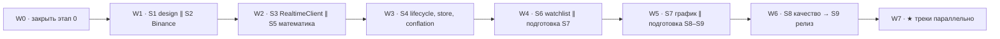

# План rn-realtime-market — входная точка

Обновлено: 2026-11-12. Источники: `AGENTS.md`, `Binance_Live.md` (требования), `training/06-websocket-demo-binance/*` (этапы 0–9, ★ A–H).

## Файлы

| Файл | Что внутри |
|---|---|
| [tasks.md](tasks.md) | Все задачи: ID, владелец, зависимости, критерии приёмки. Разбиты на волны: внутри волны — параллельно, волны — последовательно |
| [progress.md](progress.md) | Трекер статусов по задачам и этапам + журнал |
| [tech-debt.md](tech-debt.md) | Техдолг и расхождения: что, где, когда гасить |
| [decisions.md](decisions.md) | Журнал решений, принятых агентом самостоятельно |

## Правило решений

**Если по ходу работы нужно принять решение — агент принимает его сам, не спрашивая пользователя**, и сразу записывает в [decisions.md](decisions.md) (контекст → решение → почему → как откатить). Вопросы пользователю не задаются; спорное решается в пользу более простого и обратимого варианта.

Жёсткие границы (это не «решения», а правила репозитория — агент их не пересматривает):

- Ядро пишет ученик: `src/realtime/**`, `src/store/**`, `src/chart/**`, `src/binance/schemas.ts`. Агент — ревью, объяснения, лестница подсказок; не код решений.
- `docs/design.md` и ADR — упражнение ученика; агент не заполняет их готовыми решениями.
- Commit, push, PR, релиз, EAS cloud build — только по явной команде пользователя.
- Тесты не ослабляются и не удаляются.
- Стек закреплён: версии не обновляются.

## Легенда

- Владелец: 🧑 ученик (жёстко, ядро) · 🧑* ученик (мягко: в тренинге «сам», вне ядра — агент делает только если ученик явно делегирует) · 🤖 агент · 🤝 агент готовит, ученик проверяет.
- Режим: **∥** — параллельно с остальными в волне · **→** — строго после зависимостей.
- Статус: ⬜ не начато · 🟨 в работе · ✅ готово · ⛔ заблокировано · ➖ отменено.

## Текущее состояние

- Этап 0 — ✅ закрыт 2026-11-12: dev build (EAS) на телефоне, CI зелёный, PR #1 смёржен.
- Следующая волна: **W1** — design doc ∥ Binance на практике ∥ подготовка агентом.

## Граф волн

Критический путь (ядро ученика, последовательно): S2.2 схемы → S3 backoff → S3 RealtimeClient → S4 lifecycle → S4 store+conflator → S6 строка → S7 график → S8 замеры → S9 релиз. S1 и S5 идут параллельно ему.

## Как агент работает с планом

1. Открыть [progress.md](progress.md), найти текущую волну.
2. Взять задачи 🤖/🤝 этой волны, которые не ⛔; параллельные (**∥**) можно вести одновременно (subagents/worktrees — только если пользователь просит).
3. Перед завершением задачи: `bun run check`; после изменений зависимостей или `app.json` — ещё `bunx expo install --check` и `bun run doctor`; после нативных изменений — напомнить пересобрать development build.
4. Обновить статус и журнал в [progress.md](progress.md); новое решение → [decisions.md](decisions.md); найденный долг → [tech-debt.md](tech-debt.md).
5. Конец этапа: `/pr-ready` (описание PR), ревью `rn-reviewer` — при явном разрешении; commit/push — по команде.
