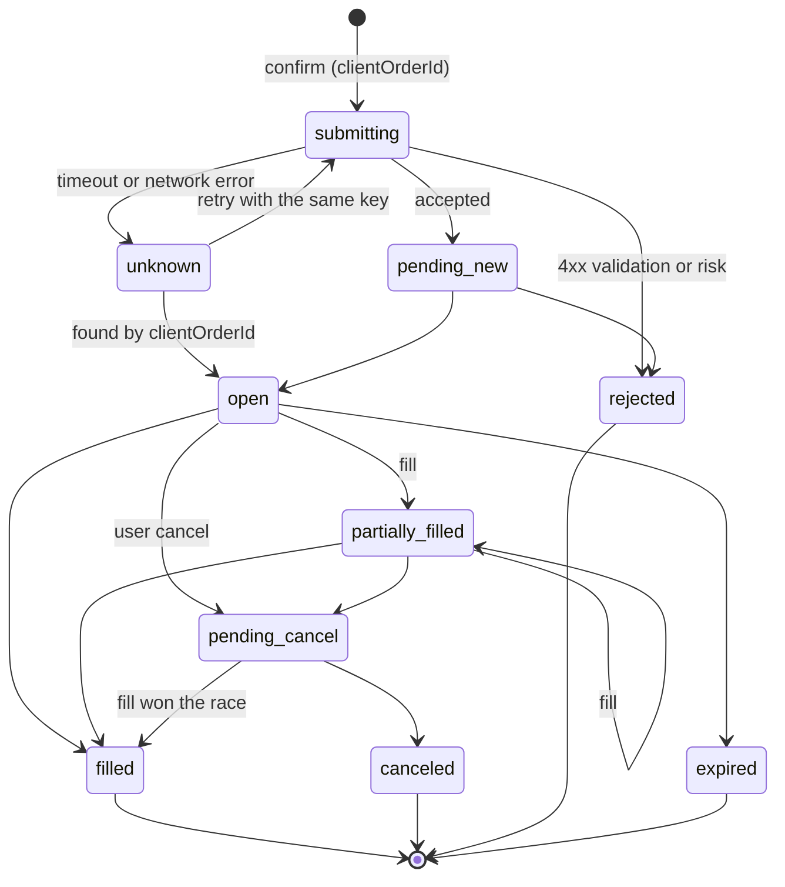
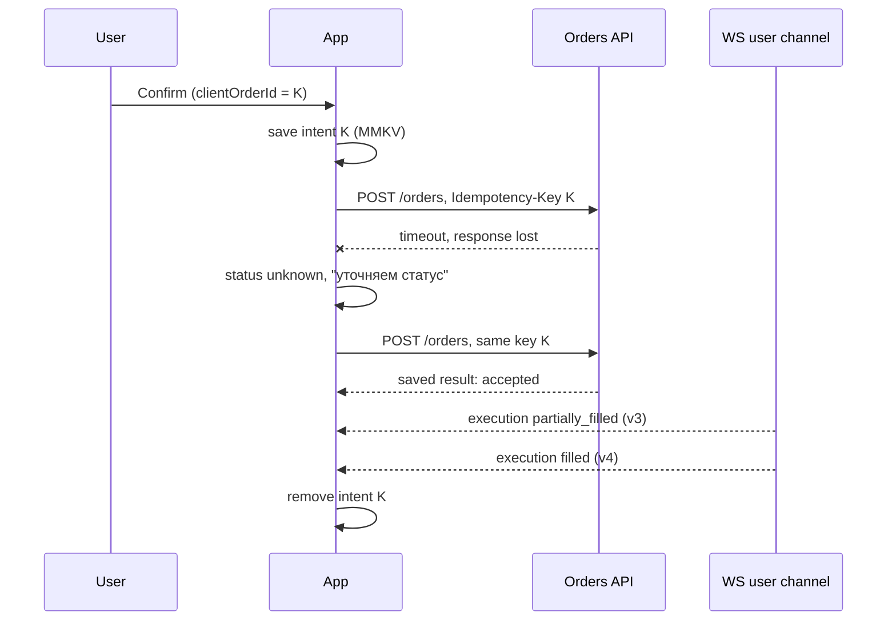
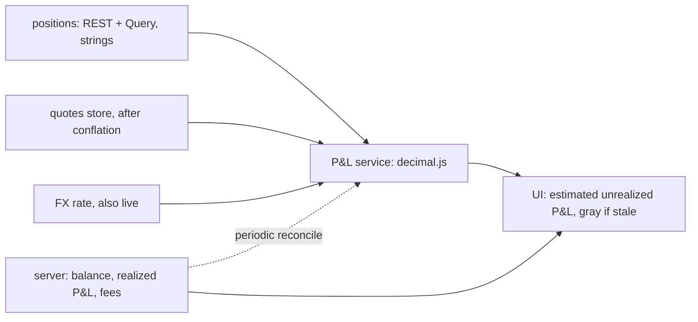

# Архитектура и system design трейдингового приложения на React Native

Обновлено: 2026-10-21 · Тренинг 2 из 6 · ≈ 16 часов · Вакансия: [карточка](../../card.ru.md)

Часть 2 из 3 · [часть 1](02-trading-app-architecture.md) · [часть 3](02-trading-app-architecture-part3.md) · блоки 4–7

## Блок 4. Ордера: жизненный цикл и идемпотентность (1,5 ч)

**Цель.** Спроектировать отправку ордера так, чтобы при любом сбое сети не было ни двойного, ни «потерянного» ордера.

**Что повторить**

Состояния — общая модель по Kraken, Binance и FIX плюс два клиентских состояния (`submitting`, `unknown`):



1. **Идемпотентность.** Клиент создаёт `clientOrderId` (UUID v4: `Crypto.randomUUID()` из `expo-crypto`) один раз на намерение пользователя и шлёт его как ключ идемпотентности. Ретраи — с тем же ключом. Новый ключ — только если пользователь изменил параметры или создаёт новый ордер, когда статус прежнего уже известен.
2. **Сервер.** Stripe (API v1) сохраняет статус и тело первого ответа по ключу и отдаёт их на повторы — даже ошибку 500; ключ хранится минимум 24 часа; другие параметры с тем же ключом — ошибка. Черновик IETF `Idempotency-Key` (истёк в 2026-04, но паттерн общепринятый): нет ключа → 400, тот же ключ с другим телом → 422, первый запрос ещё выполняется → 409. У Binance `newClientOrderId` уникален среди открытых ордеров.
3. **Таймаут ≠ ошибка.** После таймаута ордер мог исполниться. Состояние `unknown`: повтор с тем же ключом (автоматически — только в коротком окне, секунды) или запрос статуса по `clientOrderId`. Создать новый ордер автоматически — нельзя: через минуту это уже другое решение пользователя.
4. **Намерения переживают kill приложения.** Перед отправкой сохраняем намерение в MMKV; на старте сверяем все незакрытые намерения.
5. **Optimistic UI — только для намерения.** Строка «отправляется» появляется сразу; баланс, позиция и «исполнено» — только по подтверждению сервера.
6. **Несколько источников событий.** Ответ на POST, WebSocket user channel (исполнения), REST-сверка после переподключения. Событие из WebSocket может прийти раньше ответа на POST → матчим по `clientOrderId`, применяем только более новые версии и только разрешённые переходы.
7. **Что повторять.** Сеть, 5xx, 409 — с backoff и тем же ключом. 4xx (нет средств, риск-проверка, неверный шаг цены) — не повторять, показать причину.
8. **Гонки.** Cancel и fill могут разминуться: `pending_cancel` → `filled` — нормальный исход. Отмена не мгновенна, и UI это показывает.
9. **Продукты разные — принципы одни.** У биржевых ордеров, CFD и сделок с фиксированным временем свои состояния. Сервер — источник истины, время — серверное, команды — идемпотентные.

Редьюсер событий защищает от дублей, событий «из прошлого» и запрещённых переходов:

```ts
export type OrderStatus =
  | 'submitting' | 'unknown' // только на клиенте
  | 'pending_new' | 'open' | 'partially_filled' | 'pending_cancel'
  | 'filled' | 'canceled' | 'rejected' | 'expired';

const SERVER: OrderStatus[] = ['pending_new', 'open', 'partially_filled', 'pending_cancel', 'filled', 'canceled', 'rejected', 'expired'];

const NEXT: Record<OrderStatus, readonly OrderStatus[]> = {
  submitting: [...SERVER, 'unknown'],
  unknown: [...SERVER, 'submitting'],
  pending_new: ['open', 'partially_filled', 'filled', 'rejected', 'canceled', 'expired'],
  open: ['partially_filled', 'filled', 'pending_cancel', 'canceled', 'expired'],
  partially_filled: ['partially_filled', 'filled', 'pending_cancel', 'canceled', 'expired'],
  pending_cancel: ['canceled', 'partially_filled', 'filled'], // fill может обогнать cancel
  filled: [], canceled: [], rejected: [], expired: [], // терминальные
};

export interface OrderView { clientOrderId: string; status: OrderStatus; filledQty: string; version: number }
export interface OrderEvent { clientOrderId: string; status: OrderStatus; filledQty: string; version: number }

export function applyOrderEvent(o: OrderView, e: OrderEvent, log = console.warn): OrderView {
  if (e.version <= o.version) return o; // дубль или событие из прошлого
  if (!NEXT[o.status].includes(e.status)) {
    log('order: illegal transition', o.status, '->', e.status, o.clientOrderId); // + сверка по REST
    return o;
  }
  return { ...o, status: e.status, filledQty: e.filledQty, version: e.version };
}
```

Мутация на TanStack Query v5 (проверено по типам 5.104). `intents` — тонкая обёртка над `createMMKV({ id: 'order-intents' })`: `set`, `remove`, `getAllKeys`.

```ts
import { useMutation, useQueryClient, type QueryClient } from '@tanstack/react-query';
import { api, ApiError, type PlaceOrderRequest } from '@/core/api/client';
import { intents } from './intents';
import { reconcileLater } from './reconcile';
import type { OrderStatus, OrderView } from './order-machine';

const OPEN = ['orders', 'open'] as const;

// Повторять безопасно только с тем же ключом и только сеть / 5xx / 409 («ещё обрабатывается»).
const isRetryable = (e: unknown) =>
  e instanceof ApiError && (e.status === null || e.status >= 500 || e.status === 409);

export function usePlaceOrder() {
  const qc = useQueryClient();
  return useMutation({
    mutationFn: (req: PlaceOrderRequest) => api.placeOrder(req), // Idempotency-Key: req.clientOrderId
    networkMode: 'always', // без сети — сразу ошибка, а не скрытая очередь до появления сети
    retry: (count, err) => count < 3 && isRetryable(err),
    retryDelay: (attempt) => Math.min(500 * 2 ** attempt, 4_000), // по умолчанию до 30 с — слишком долго
    onMutate: (req) => {
      intents.save(req); // до отправки: переживёт kill приложения
      setLocal(qc, req.clientOrderId, 'submitting'); // optimistic: намерение, а не результат
    },
    onSuccess: (_res, req) => intents.remove(req.clientOrderId),
    onError: (err, req) => {
      if (isRetryable(err)) {
        setLocal(qc, req.clientOrderId, 'unknown'); // ордер мог пройти: не удаляем, сверяем
        reconcileLater(req.clientOrderId); // GET /orders?clientOrderId=… с backoff
      } else {
        intents.remove(req.clientOrderId); // 4xx: ордера нет, причину показываем в тикете
        qc.setQueryData<OrderView[]>(OPEN, (old = []) => old.filter((o) => o.clientOrderId !== req.clientOrderId));
      }
    },
    onSettled: (_res, err) => {
      if (!isRetryable(err)) qc.invalidateQueries({ queryKey: OPEN }); // источник истины — сервер
    },
  });
}

function setLocal(qc: QueryClient, clientOrderId: string, status: OrderStatus) {
  qc.setQueryData<OrderView[]>(OPEN, (old = []) => {
    if (old.some((o) => o.clientOrderId === clientOrderId && o.version > 0)) return old; // сервер важнее
    const rest = old.filter((o) => o.clientOrderId !== clientOrderId);
    return [{ clientOrderId, status, filledQty: '0', version: 0 }, ...rest];
  });
}
```

В тикете ключ создаётся один раз: `const [clientOrderId] = useState(() => Crypto.randomUUID())`. Почему `networkMode: 'always'`: в режиме по умолчанию (`'online'`) мутация без сети не отправляется и ждёт сеть — для ордера это скрытая офлайн-очередь.



**Практика** (75 мин; ещё 15 — на «Что повторить»)

1. **State machine** (20 мин, сам). Закрой диаграмму и нарисуй свою. Добавь гонку cancel и fill и случай «событие из WebSocket раньше ответа на POST». *Критерий:* все терминальные состояния, переходы для гонок.
2. **Редьюсер + тесты** (30 мин). Напиши `applyOrderEvent` и тесты: дубль, событие из прошлого, выход из терминального состояния, гонка cancel/fill, `unknown` → найден по `clientOrderId`. *Критерий:* 8+ тестов; запрещённые переходы логируются.
3. **Таблица отказов** (15 мин). Таймаут, 500, 409, 422, двойной тап, kill приложения сразу после отправки → что видит пользователь, что делает клиент, что делает сервер. Попроси AI добавить 2 сценария, которых нет. *Критерий:* 8 строк, ни одного сценария с двойным ордером.
4. **Ответ в 5 предложений** (10 мин). «Как не допустить двойной ордер?» *Критерий:* ключ от клиента, хранение результата на сервере, `unknown`, сверка, никакой офлайн-очереди.

**Самопроверка**

- Почему ключ идемпотентности создаёт клиент, а не сервер?
- Что ответит сервер на повтор с тем же ключом, но другим количеством?
- Чем `unknown` отличается от `rejected` для пользователя и для кода?
- Почему optimistic UI годится для строки «отправляется» и не годится для баланса?
- Что делаешь с событием из WebSocket, которое пришло раньше ответа на POST?
- Зачем `networkMode: 'always'` для мутации ордера?

**Готово, когда…** ты проходишь сценарий «таймаут при отправке» от тапа до финального статуса и показываешь, где именно гарантируется отсутствие дубля.

## Блок 5. Портфель и P&L: точная арифметика (1 ч)

**Цель.** Считать и показывать деньги без ошибок округления и чётко разделить, что считает клиент, а что сервер.

**Что повторить**

- `0.1 + 0.2` в JavaScript — `0.30000000000000004`: `number` (IEEE 754 double) не годится для денег.
- Варианты: целые в минимальных единицах (центы, сатоши) — `number` безопасен до `Number.MAX_SAFE_INTEGER` ≈ 9 × 10^15, дальше `BigInt` (например, 18 знаков у токенов); decimal-библиотеки — decimal.js, big.js, bignumber.js; Dinero.js — деньги вместе с валютой.
- Контракт с бэкендом: деньги и количества — строки в JSON (`"123.45"`); точность по инструменту (шаг цены, шаг лота); правило округления (half-even или half-up) — из спецификации, а не на вкус; метод учёта (average cost или FIFO) — решение бэкенда.
- Формулы (позиция long, метод average cost):
  - unrealized P&L = (mark − avgEntry) × qty; для short — (avgEntry − mark) × qty;
  - unrealized % = (mark − avgEntry) / avgEntry × 100;
  - realized P&L при продаже части = (sellPrice − avgEntry) × soldQty − fee;
  - средняя после докупки = (avgEntry × qty + price × addQty) / (qty + addQty);
  - стоимость портфеля = cash + Σ(mark × qty); для маржи и CFD добавляются маржа, своп или funding — уточни продукт на интервью.
- Кто считает: баланс, realized P&L, комиссии, маржа — сервер. Клиент пересчитывает только живой unrealized P&L от тика для показа, помечает как оценку и периодически сверяется с сервером. Устарела цена — устарел и P&L (серый, как котировка).
- Мультивалютность: стоимость в валюте счёта через курс; курс тоже «живой» и тоже устаревает.
- Показ: `Intl.NumberFormat` (проверь нужные опции на Hermes на обеих платформах); знак и стрелка, а не только цвет — доступность.
- Производительность: decimal-операции медленнее `number`. Пересчитывай P&L в сервисе после conflation, а не в `renderItem`.



```ts
import Decimal from 'decimal.js';

// Свой конструктор с явной точностью и округлением; глобальные настройки не трогаем.
const D = Decimal.clone({ precision: 34, rounding: Decimal.ROUND_HALF_EVEN });

export interface Position { qty: string; avgEntry: string } // строки из API

export const unrealizedPnl = (p: Position, mark: string) =>
  new D(mark).minus(p.avgEntry).times(p.qty); // long; для short — знак наоборот

export const realizedPnlOnSell = (p: Position, sellPrice: string, soldQty: string, fee: string) =>
  new D(sellPrice).minus(p.avgEntry).times(soldQty).minus(fee);

export function averageAfterBuy(p: Position, price: string, addQty: string): Position {
  const qty = new D(p.qty).plus(addQty);
  const cost = new D(p.avgEntry).times(p.qty).plus(new D(price).times(addQty));
  return { qty: qty.toString(), avgEntry: cost.div(qty).toString() };
}

// Округляем только на выходе, по правилам из спецификации (здесь — 2 знака, half-even).
export const toMoney = (x: Decimal.Value) => new D(x).toFixed(2);

// Проверка: позиция 0.015 по 64250.10, mark 65010.55 → unrealized 11.40675 → toMoney: "11.41".
// new D('0.1').plus('0.2').toString() === '0.3'; toMoney('2.345') === '2.34' (half-even).
```

**Практика** (50 мин; ещё 10 — на «Что повторить»)

1. **Функции + тесты** (20 мин, сам). `unrealizedPnl`, `realizedPnlOnSell`, `averageAfterBuy`, `portfolioValue` на decimal.js; тесты с «неудобными» числами: 0.1 + 0.2, 1e-8, большие объёмы. *Критерий:* 8+ тестов; ни одного `parseFloat` в расчётах.
2. **Граничные случаи** (10 мин). Попроси AI 10 граничных кейсов — без кода — и прогони свои функции. Опционально — property-based тест на fast-check: «купил и продал по той же цене без комиссии → realized P&L = 0». *Критерий:* все кейсы зелёные или есть issue с объяснением.
3. **Контракт** (10 мин). Zod-схема `Position`, где деньги — десятичные строки (`z.string().regex(/^-?\d+(\.\d+)?$/)`), и 5 правил точности и округления, которые ты согласовал бы с бэкендом. *Критерий:* схема компилируется, правила однозначны.
4. **Ответ «почему не float?»** (10 мин). 3 предложения + пример. *Критерий:* укладываешься в 30 секунд.

**Самопроверка**

- Почему `toFixed` на `number` не спасает?
- Когда хватает целых минимальных единиц, а когда нужен decimal или `BigInt`?
- Кто округляет комиссию и почему не клиент?
- Как показать P&L, если цена устарела?

**Готово, когда…** функции и тесты проходят, а ты объясняешь формулы и границу «клиент считает / сервер считает».

## Блок 6. Производительность (1,5 ч)

**Цель.** Знать бюджеты и приёмы, чтобы экран с живыми ценами держал 60 FPS, а приложение быстро стартовало — и уметь это измерить.

**Что повторить**

- **Бюджет кадра**: 16,67 мс при 60 FPS (документация React Native); на экранах 120 Гц — ≈8,3 мс (1000 / 120). JS-поток: рендер React, логика, обработка сообщений. UI-поток: нативный рендер, жесты, анимации Reanimated. JS занят → залипают тапы и JS-анимации, но нативный скролл и анимации на UI-потоке продолжают работать.
- **Что тормозит трейдинговый экран**: парсинг и валидация сотен сообщений в секунду, `setState` на каждый тик, перерисовка всего списка, тяжёлые вычисления в `renderItem`, `console.log` в релизе, график на тысячи точек на JS-потоке.

Приёмы:

1. **Conflation + батчинг** (блок 3): 4–10 обновлений стора в секунду, а не 500.
2. **Узкие селекторы**: строка подписана на свой символ (`useQuotes((s) => s.bySymbol[symbol]?.price)`), а не на весь словарь; для объектов — `useShallow`.
3. **Списки**: FlashList v2 — без `estimatedItemSize`; `getItemType` для разных типов строк; без `key` внутри элементов (для `.map` — `useMappingHelper`); локальное состояние строки — `useRecyclingState`. Альтернатива — Legend List. Профилируй только в release.
4. **Анимации на UI-потоке**: Reanimated 4 — «вспышка» цены не зависит от загрузки JS ([тренинг 4](../04-animations-reanimated-skia/04-animations-reanimated-skia.md)).
5. **Графики**: Skia (react-native-skia, victory-native) или WebView с TradingView Lightweight Charts. Trade-off: нативная плавность против готовых индикаторов и общего кода с вебом. Обновляй последнюю свечу, а не весь массив.
6. **Отложенная работа**: `requestIdleCallback` (`InteractionManager` удалён в 0.87); `startTransition` / `useDeferredValue` для неважных обновлений, например поиска по символам.
7. **React Compiler** (`experiments.reactCompiler: true`; Babel настроен автоматически с SDK 54) снимает часть ручной мемоизации, но не заменяет conflation и узкие селекторы.
8. **Неактивные экраны**: отписка в `useFocusEffect`; `subscribed: isFocused` в `useQuery`; в SDK 58 — экспериментальный `activityEnabled`.
9. **Тяжёлая математика** (индикаторы, агрегация стакана) — вне рендера; при необходимости — нативный или C++ Turbo Module (в стеке IBIT есть нативные и C++-модули).

Старт (TTI):

- Hermes V1 — движок по умолчанию (React Native 0.84, Expo SDK 56): в release JS уже скомпилирован в байткод, парсинга нет.
- Ленивая загрузка экранов (`React.lazy`), inline requires; мини-приложения не грузятся на старте.
- Старт не ждёт сеть: показываем кеш (MMKV, persisted Query через `@tanstack/query-async-storage-persister`) + skeleton, данные догружаем. Splash — до готовности сессии, а не всех данных.
- Измерять: EAS Observe (cold/warm launch, TTI, метрики маршрутов с SDK 56), Sentry, `performance.mark` / `measure` + `PerformanceObserver` (стабильны с React Native 0.83, работают в production).
- Инструменты: React Native DevTools (Performance, Network), React Profiler, Flashlight (Android), Reassure (регрессии рендера в CI).

Подписка по видимости в FlashList v2 (проверено по типам 2.3):

```tsx
import { FlashList, type ViewToken } from '@shopify/flash-list';
import { useCallback, useEffect, useRef } from 'react';
import { realtime } from '@/core/realtime/client';
import { QuoteRow, SectionHeader } from './quote-row';

type Row = { type: 'header'; title: string } | { type: 'quote'; symbol: string };

// viewabilityConfig нельзя менять на лету — объявляем вне компонента.
const VIEWABILITY = { itemVisiblePercentThreshold: 10, minimumViewTime: 250 }; // не дёргаем подписки при быстром скролле

export function Watchlist({ rows }: { rows: Row[] }) {
  const subs = useRef(new Map<string, () => void>()); // symbol -> unsubscribe

  const onViewableItemsChanged = useCallback(({ viewableItems }: { viewableItems: ViewToken<Row>[] }) => {
    const visible = new Set(viewableItems.flatMap((v) => (v.item.type === 'quote' ? [v.item.symbol] : [])));
    for (const [symbol, unsubscribe] of subs.current) {
      if (!visible.has(symbol)) { unsubscribe(); subs.current.delete(symbol); }
    }
    for (const symbol of visible) {
      if (!subs.current.has(symbol)) subs.current.set(symbol, realtime.subscribe(`ticker:${symbol}`));
    }
  }, []);

  useEffect(() => () => { subs.current.forEach((unsubscribe) => unsubscribe()); subs.current.clear(); }, []);

  return (
    <FlashList
      data={rows}
      keyExtractor={(r) => (r.type === 'quote' ? r.symbol : `header:${r.title}`)}
      getItemType={(r) => r.type} // заголовки и строки котировок переиспользуются раздельно
      renderItem={({ item }) => (item.type === 'quote' ? <QuoteRow symbol={item.symbol} /> : <SectionHeader title={item.title} />)}
      viewabilityConfig={VIEWABILITY}
      onViewableItemsChanged={onViewableItemsChanged}
    />
  );
}
```

`realtime.subscribe` — счётчик ссылок по теме ([WebSocket](../../../../../interview-prep/technical/websockets.ru.md)); сами subscribe-сообщения клиент копит 100–200 мс и шлёт пачкой.

**Практика** (75 мин; ещё 15 — на «Что повторить»)

1. **Бюджет экрана** (15 мин, сам). Для watchlist: сколько обновлений стора в секунду, сколько строк перерисовывается за один flush, где считается P&L. *Критерий:* цифры + схема «кто на кого подписан».
2. **Список под нагрузкой** (30 мин). В демо из [тренинга 6](../06-websocket-demo-binance/06-websocket-demo-binance.md) или своём проекте: FlashList v2, `getItemType`, узкие селекторы, подписка по видимости. Замерь в release (React Profiler или Performance panel), сколько компонентов рендерится за flush. *Критерий:* перерисовываются только изменившиеся строки.
3. **Старт** (15 мин). Чек-лист «что грузим до первого экрана, а что откладываем» для трейдингового приложения. Попроси AI найти лишнее. *Критерий:* до первого экрана — только сессия, кеш и каркас.
4. **Ответ «лагает стакан — как ищешь причину?»** (15 мин). Шаги: воспроизвести в release → измерить (FPS JS и UI, Profiler) → гипотезы → исправить → подтвердить метрикой. *Критерий:* 2 минуты вслух, без «наверное».

**Самопроверка**

- JS-поток занят 200 мс. Что продолжит работать, а что замрёт?
- Почему FlashList в dev-сборке может выглядеть медленнее FlatList?
- Почему `key` внутри элемента FlashList вредит?
- Зачем `minimumViewTime` для подписок по видимости?
- Что Hermes даёт для старта и чего не даёт?

**Готово, когда…** ты называешь 5 приёмов против лагов с живыми ценами и 4 приёма для быстрого старта — и инструмент измерения для каждого.

## Блок 7. Безопасность и compliance (1,5 ч)

**Цель.** Иметь чек-лист безопасности трейдингового клиента по OWASP MASVS и объяснить каждый пункт за 90 секунд.

**Что повторить**

OWASP MASVS v2.1.0 (2024-01-18) — требования; MASTG (v2.0.0, 2026-06-30) — как их тестировать. Группы: STORAGE, CRYPTO, AUTH, NETWORK, PLATFORM, CODE, RESILIENCE, PRIVACY. Принцип: **клиенту не доверяем.** Права, лимиты, баланс, античит проверяет сервер; защиты на клиенте (pinning, root detection) — дополнительные слои.

| MASVS | Что делаем в React Native / Expo | Типичная ошибка |
|---|---|---|
| STORAGE-1 | токены — `expo-secure-store` (Keychain / Keystore) с `keychainAccessible: WHEN_UNLOCKED_THIS_DEVICE_ONLY`; MMKV — только несекретный кеш; ключ шифрования MMKV — в SecureStore | refresh token в AsyncStorage или MMKV без шифрования |
| STORAGE-2 | без PII и токенов в логах; `beforeSend` в Sentry; маска Session Replay включена (по умолчанию маскирует текст и картинки); скрытие экрана в app switcher: `enableAppSwitcherProtectionAsync` (iOS), `preventScreenCaptureAsync` (Android, `FLAG_SECURE`) | баланс и документы KYC в превью задач |
| AUTH-1, AUTH-2 | биометрия, привязанная к ключу: SecureStore с `requireAuthentication: true` (ОС отдаёт секрет только после биометрии); при смене биометрии ключи инвалидируются → вход по паролю; если нужен `authenticateAsync` (expo-local-authentication) — на Android `biometricsSecurityLevel: 'strong'` | «биометрия» = `authenticateAsync()` + `if (success)` в JS: MASTG называет это event-bound, обходится хуком |
| AUTH-3 | step-up: вывод средств, смена 2FA или пароля, новый платёжный метод, отключение биометрии | вывод по одной старой сессии |
| AUTH-1 (сессия) | короткий access token, refresh rotation с детекцией повторного использования; авто-блокировка после N минут в фоне (AppState); logout чистит SecureStore, MMKV, кеш Query и закрывает WebSocket; сервер умеет отозвать сессию | «вечный» токен, logout только в UI |
| NETWORK-1 | только HTTPS и WSS; ATS без исключений; cleartext на Android выключен | `http://` для «внутреннего» API |
| NETWORK-2 | pinning публичного ключа своих доменов: react-native-ssl-public-key-pinning (OkHttp CertificatePinner / TrustKit), минимум 2 пина, дата истечения, план ротации | один пин — и после смены сертификата приложение «умерло» |
| PLATFORM-1, PLATFORM-2 | universal / app links; параметры deep link — через Zod; WebView мини-приложений и графиков: allowlist источников, схема для `postMessage`, токены в WebView не передаём | deep link, который ставит ордер без подтверждения |
| CODE-1…4 | актуальная ОС (SDK 56+: iOS 16.4+); принудительное обновление по `minSupportedVersion` с сервера; зависимости без известных уязвимостей; валидация всех входов; секреты не в бандле — `EXPO_PUBLIC_*` видны в открытом виде | `EXPO_PUBLIC_API_SECRET` |
| RESILIENCE-1…4 | `@expo/app-integrity` (Play Integrity / App Attest) — токен проверяет сервер; freeRASP или jail-monkey — сигналы root, jailbreak, hooks; R8 в Android release (по умолчанию в SDK 58) | «root обнаружен» → блок без сервера; или вера, что Hermes-байткод что-то прячет |
| CODE (OTA) | code signing для EAS Update (планы Production / Enterprise): неподписанное обновление не применяется | OTA без подписи для fintech |
| PRIVACY-1 | минимум данных; согласие на аналитику; документы KYC не кешируются; удаление аккаунта | вся анкета KYC в MMKV «на всякий случай» |

Важный нюанс pinning: README библиотеки говорит о стандартных Networking API React Native (`fetch`, `XMLHttpRequest`, значит и axios). С SDK 56 глобальный `fetch` — это `expo/fetch` (отключается `EXPO_PUBLIC_USE_RN_FETCH=1`), а WebSocket — отдельный стек. Покрывает ли pinning их — проверь тестом с неверными пинами (так советует README); это упражнение 3.

Compliance — без юридических деталей:

- **KYC / AML**: торговля доступна после верификации; статус приходит с сервера.
- **Предупреждения о рисках**: для CFD в ЕС — стандартизированное предупреждение с долей розничных счетов, теряющих деньги (ESMA, 2018).
- **Стимулы**: среди мер ESMA для CFD — ограничение стимулов к торговле (блок 9).
- **Аудит**: журнал действий — на сервере; клиент передаёт контекст: версию, устройство, `clientOrderId`.
- **Юрисдикции**: функции и тексты зависят от страны. Спроси на интервью, на какие рынки работает продукт и кто согласует механики.

**Практика** (75 мин; ещё 15 — на «Что повторить»)

1. **Threat model** (25 мин, сам). Одна страница для «вход → торговля → вывод»: активы (токены, PII, деньги), угрозы (кража телефона, MITM, root + Frida, фишинговый deep link, утечка в логах, скриншоты), меры. *Критерий:* 6+ угроз, у каждой — мера и группа MASVS.
2. **Модуль сессии** (20 мин). Где лежат токены; что происходит при фоне больше 5 минут, при 401, при logout, при смене биометрии. Потом попроси AI: «Ты пентестер. Найди 3 способа украсть или продлить сессию в этом дизайне». *Критерий:* закрыты все 3 находки или записаны как риск.
3. **Проверка pinning** (15 мин). В проекте на Expo (dev build) включи пины с неверными хешами: в идеале падают все три канала — `fetch`, axios и WebSocket. Запиши, что упало, а что нет. Нет проекта — опиши план проверки. *Критерий:* таблица «канал → защищён / нет».
4. **Ответ на 90 секунд** (15 мин). «Как бы ты защитил трейдинговое приложение?» — 6 пунктов по MASVS. *Критерий:* укладываешься в 90 секунд, называешь группы MASVS.

**Самопроверка**

- Почему `authenticateAsync()` сам по себе — слабая защита?
- Что станет с данными, сохранёнными с `requireAuthentication`, если пользователь добавил отпечаток?
- Зачем 2 пина и дата истечения?
- Почему root detection — сигнал для сервера, а не защита?
- Что не так с `EXPO_PUBLIC_API_SECRET`?

**Готово, когда…** у тебя чек-лист из 10+ пунктов с группами MASVS и готов рассказ на 90 секунд.

## Источники (часть 2)

- Kraken: жизненный цикл ордера — https://docs.kraken.com/exchange/guides/general/order-lifecycle — проверено 2026-10-21
- Binance: статусы ордеров — https://developers.binance.com/docs/binance-spot-api-docs/enums — проверено 2026-10-21
- Binance: `newClientOrderId` — https://developers.binance.com/docs/binance-spot-api-docs/rest-api — проверено 2026-10-21
- Stripe: идемпотентные запросы — https://docs.stripe.com/api/idempotent_requests — проверено 2026-10-21
- IETF draft: Idempotency-Key header (-07) — https://datatracker.ietf.org/doc/draft-ietf-httpapi-idempotency-key-header/ — проверено 2026-10-21
- TanStack Query: `useMutation` — https://tanstack.com/query/latest/docs/framework/react/reference/useMutation — проверено 2026-10-21
- TanStack Query: network mode — https://tanstack.com/query/latest/docs/framework/react/guides/network-mode — проверено 2026-10-21
- TanStack Query: persistQueryClient — https://tanstack.com/query/latest/docs/framework/react/plugins/persistQueryClient — проверено 2026-10-21
- expo-crypto (`randomUUID`) — https://docs.expo.dev/versions/latest/sdk/crypto/ — проверено 2026-10-21
- decimal.js — https://mikemcl.github.io/decimal.js/ — проверено 2026-10-21
- React Native: производительность — https://reactnative.dev/docs/performance — проверено 2026-10-21
- React Native: загрузка JavaScript — https://reactnative.dev/docs/optimizing-javascript-loading — проверено 2026-10-21
- React Native 0.83 (DevTools, `PerformanceObserver`) — https://reactnative.dev/blog/2025/12/10/react-native-0.83 — проверено 2026-10-21
- React Native 0.84 (Hermes V1) — https://reactnative.dev/blog/2026/02/11/react-native-0.84 — проверено 2026-10-21
- Expo SDK 56 (Hermes V1, `expo/fetch` по умолчанию) — https://expo.dev/changelog/sdk-56 — проверено 2026-10-21
- FlashList: производительность — https://shopify.github.io/flash-list/docs/fundamentals/performance — проверено 2026-10-21
- Expo: React Compiler — https://docs.expo.dev/guides/react-compiler/ — проверено 2026-10-21
- EAS Observe — https://docs.expo.dev/eas/observe/introduction/ — проверено 2026-10-21
- Flashlight — https://github.com/bamlab/flashlight — проверено 2026-10-21
- Reassure — https://github.com/callstack/reassure — проверено 2026-10-21
- OWASP MASVS (контроли, релизы) — https://github.com/OWASP/masvs — проверено 2026-10-21
- OWASP MASTG-BEST-0036: криптографическая привязка биометрии — https://mas.owasp.org/MASTG/best-practices/MASTG-BEST-0036/ — проверено 2026-10-21
- expo-secure-store — https://docs.expo.dev/versions/latest/sdk/securestore/ — проверено 2026-10-21
- expo-local-authentication — https://docs.expo.dev/versions/latest/sdk/local-authentication/ — проверено 2026-10-21
- expo-screen-capture — https://docs.expo.dev/versions/latest/sdk/screen-capture/ — проверено 2026-10-21
- @expo/app-integrity — https://docs.expo.dev/versions/latest/sdk/app-integrity/ — проверено 2026-10-21
- react-native-ssl-public-key-pinning — https://github.com/frw/react-native-ssl-public-key-pinning — проверено 2026-10-21
- freeRASP для React Native — https://github.com/talsec/Free-RASP-ReactNative — проверено 2026-10-21
- Expo: переменные окружения — https://docs.expo.dev/guides/environment-variables/ — проверено 2026-10-21
- EAS Update: code signing — https://docs.expo.dev/eas-update/code-signing/ — проверено 2026-10-21
- Sentry: Session Replay для React Native — https://docs.sentry.io/platforms/react-native/session-replay/ — проверено 2026-10-21
- ESMA: меры для CFD и бинарных опционов (2018-06-01) — https://www.esma.europa.eu/press-news/esma-news/esma-adopts-final-product-intervention-measures-cfds-and-binary-options — проверено 2026-10-21

[Дальше: часть 3 — релизы, геймификация, system design, мок-интервью →](02-trading-app-architecture-part3.md)
