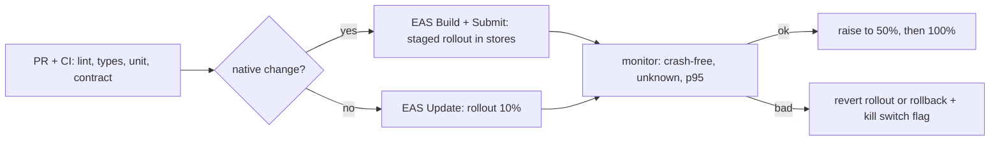

# Архитектура и system design трейдингового приложения на React Native

Обновлено: 2026-10-21 · Тренинг 2 из 6 · ≈ 16 часов · Вакансия: [карточка](../../card.ru.md)

Часть 3 из 3 · [часть 1](02-trading-app-architecture.md) · [часть 2](02-trading-app-architecture-part2.md) · блоки 8–11

## Блок 8. Наблюдаемость, релизы, тесты (1,5 ч)

**Цель.** Показать, что ты выпускаешь изменения в трейдинговое приложение безопасно: видишь проблемы раньше пользователей и откатываешься за минуты.

**Что повторить**

Что мерить (пороги — пример для обсуждения, не стандарт):

| Область | Метрики | Пример «стоп-крана» |
|---|---|---|
| Стабильность | crash-free users и sessions, ANR, JS-ошибки | crash-free ниже 99,5% на новой версии или OTA |
| Старт | cold / warm launch, TTI | p75 TTI хуже прошлой версии на 20% |
| Realtime | задержка «биржа → экран» p50 / p95, переподключения в час, gap и resync, доля stale | p95 больше 1 с или всплеск resync |
| Ордера | «тап → подтверждение» p50 / p95, ошибки по кодам, доля `unknown` | `unknown` больше 0,1% отправок |
| Геймификация | участие, выданные награды, жалобы, дисквалификации | хотя бы одна награда выдана дважды |

- **Инструменты**: Sentry (краши, трейсы, breadcrumbs, Session Replay с маской); EAS Observe (GA с 2026-08-20: старт, TTI, метрики маршрутов, загрузка OTA; JS-ошибки и нативные краши — в preview); продуктовая аналитика (PostHog и аналоги); логи бэкенда.
- **Корреляция**: `clientOrderId` и `X-Request-Id` во всех логах — от тапа до OMS.
- **Свои метрики**: `performance.mark` при получении котировки и `performance.measure` при рендере — задержка до экрана; собирает `PerformanceObserver`.

Конвейер релиза:



- **Что куда**: нативные изменения — в стор (EAS Build + Submit); JS и ассеты — EAS Update (OTA).
- **Runtime version** с политикой `fingerprint`: OTA не попадёт на несовместимую сборку (в SDK 58 пресет fingerprint по умолчанию — `balanced`).
- **Каналы и ветки**: сборка «смотрит» в канал (production, preview), канал указывает на ветку обновлений.
- **Staged OTA**: `eas update --channel production --environment production --message "fix: order ticket" --rollout-percentage 10` (`--environment` обязателен с SDK 55). Дальше `eas update:edit` — поднять процент, `eas update:revert-update-rollout` — вернуть прежнее, `eas update:rollback` — откат, в том числе к обновлению, встроенному в сборку. На ветке — один rollout одновременно.
- **Сторы**: Google Play — staged rollout, процент повышаешь вручную, можно остановить; App Store — phased release для автообновлений за 7 дней (1% → 2% → 5% → 10% → 20% → 50% → 100%), паузы суммарно до 30 дней.
- **Feature flags**: всё рискованное — за флагом с безопасным значением по умолчанию; kill switch для тикета и мини-приложений; флаги кешируются и работают офлайн; таргетинг по проценту, стране, версии. Сервисы из гайда Expo: PostHog, Statsig, LaunchDarkly, Firebase Remote Config.
- **Принудительное обновление** (MASVS-CODE-2): сервер отдаёт `minSupportedVersion`. Обязательных OTA «из коробки» нет — логика своя (`useUpdates`, `checkForUpdateAsync`, `fetchUpdateAsync`).
- **Правила сторов**: OTA — для исправлений; изменения поведения должны проходить ревью стора (так прямо пишет Expo).

Тестирование:

| Уровень | Что | Инструменты |
|---|---|---|
| Unit | state machine ордера, P&L, `applyDepth`, conflation, backoff | Jest (`jest-expo` или `@react-native/jest-preset`), fake timers |
| Integration | хуки + API, `RealtimeClient` против mock-сервера, экраны | React Native Testing Library, MSW, jest-websocket-mock |
| Contract | REST и WebSocket-сообщения соответствуют схеме | OpenAPI → типы и Zod; AsyncAPI 3.1 для WebSocket; Pact |
| E2E | вход, watchlist, тикет, отмена, турнир | Maestro (в EAS Workflows — job `type: maestro`), Detox |
| Performance | регрессии рендера, FPS | Reassure, Flashlight |
| Тестовые данные | детерминированный фид котировок (запись и воспроизведение), sandbox бэкенда | mock WebSocket-сервер |

```yaml
# .maestro/buy-pending.yml — на детерминированном тестовом фиде
appId: com.example.trading
---
- launchApp
- tapOn: "BTCUSDT"
- tapOn: "Buy"
- tapOn:
    id: "qty-input"
- inputText: "0.001"
- tapOn: "Confirm"
- assertVisible: "Pending"
```

**Практика** (75 мин; ещё 15 — на «Что повторить»)

1. **План выпуска** (20 мин, сам). Фича «новый тикет ордера»: флаг, сборка или OTA, этапы rollout, метрики-«стоп-краны», откат. *Критерий:* 5 этапов, у каждого — критерий перехода и кто решает.
2. **Дашборд** (15 мин). 10 метрик с порогами алертов. Попроси AI оспорить пороги. *Критерий:* у каждой метрики — источник данных.
3. **Тест-план тикета** (25 мин). Unit (5), integration (3), contract (2), E2E (3 сценария); один Maestro-flow «открыть символ → купить → увидеть pending». *Критерий:* flow запускается локально на демо или сверен с документацией Maestro.
4. **Ответ «как откатишь сломанный релиз?»** (15 мин). Для OTA и для стор-сборки. *Критерий:* команды и время реакции по минутам.

**Самопроверка**

- Чем канал отличается от ветки в EAS Update?
- Что защищает от OTA, которому нужен новый нативный модуль?
- Почему флаг должен работать офлайн и иметь безопасное значение по умолчанию?
- После OTA crash rate вырос с 0,3% до 2%. Твои действия по минутам?
- Зачем contract-тесты, если есть E2E?

**Готово, когда…** ты рисуешь конвейер «PR → CI → сборка или OTA → rollout → мониторинг → откат» и называешь метрики-стоп-краны.

## Блок 9. Геймификация: турниры, лидерборды, награды (1,5 ч)

**Цель.** Спроектировать мини-приложение «турнир» так, чтобы результат был честным, награды — без дублей, а механики — в рамках регуляторики.

**Что повторить**

С 2026-07 IBIT строит «trading mini-app platform»: tournaments, challenges, loyalty, achievements, education ([исследование IBIT](../../../../../research/companies/ibit.ru.md)). Твой опыт: HabitHero (лиги, очки, уровни, стрики, награды, челленджи — мобильная часть и бэкенд), My Way Club (рефералы, бонусы, кэшбек).

| Сущность | Ключевые поля | Комментарий |
|---|---|---|
| Tournament | id, rules (формула очков, инструменты, тип счёта: demo / real), registrationEnd, startAt, endAt (UTC), status, prizes | правила и время — только серверные |
| Participant | tournamentId, userId, joinedAt, status | join идемпотентен: UNIQUE (tournamentId, userId) |
| ScoreEvent | sourceEventId (id сделки), userId, tournamentId, delta, at | UNIQUE sourceEventId: повторная доставка не удвоит очки |
| Leaderboard | Redis sorted set `lb:{tournamentId}` | проекция; источник истины — БД |
| RewardGrant | userId, source, sourceId, kind, amount, status | UNIQUE (userId, source, sourceId, kind) |

Жизненный цикл: `scheduled → registration → live → settling → final` (и `canceled`). В `settling` досчитываем поздние события и закрытые сделки, проверяем анти-чит. Финальные места — только после `final`.

1. **Очки считает сервер** — из подтверждённых событий (исполнения, закрытые сделки). Клиент никогда не присылает «мои очки», даже подписанные.
2. **Формула устойчива к злоупотреблениям**: например, доходность в % от стартового виртуального баланса, а не объём или число сделок; минимум сделок; лимиты.
3. **Идемпотентное начисление**: в одной транзакции вставить ScoreEvent (уникальный `sourceEventId`) и, если вставился, обновить итог; `ZINCRBY` в Redis — после коммита. Упал Redis — пересобираем лидерборд из БД.
4. **Равные очки**: в Redis при равном score участники упорядочены лексикографически по member — это не «кто раньше». Тай-брейк задай явно (например, время достижения в составном score; score — double, следи за точностью).
5. **Live-лидерборд**: топ-N (например, 100) сервер публикует снимком раз в 1–5 секунд в топик `leaderboard:{id}` с `version`; клиент заменяет список целиком — проще и надёжнее дельт. «Моё место» — отдельно (`ZREVRANK`) + «вокруг меня» (±5 мест). Весь список на 100k участников клиент не грузит: курсорная пагинация.
6. **Время**: таймер до конца — по серверному времени (offset от сервера при подключении), не по часам телефона.
7. **Награды без дублей**: UNIQUE в БД + идемпотентный «забрать награду»; уведомление — через outbox после коммита.
8. **Анимация смены мест** — Reanimated layout animations на UI-потоке ([тренинг 4](../04-animations-reanimated-skia/04-animations-reanimated-skia.md)); праздничных эффектов на факт сделки нет (почему — ниже).

```text
ZINCRBY lb:t42 12.5 user:7          # после коммита ScoreEvent
ZRANGE lb:t42 0 99 REV WITHSCORES    # топ-100 (ZREVRANGE устарел с Redis 6.2)
ZREVRANK lb:t42 user:7               # моё место, 0 = первое
```

```sql
-- Одна награда на (пользователь, источник, тип): дубль невозможен на уровне БД.
CREATE TABLE reward_grants (
  id         uuid PRIMARY KEY DEFAULT gen_random_uuid(),
  user_id    uuid NOT NULL,
  source     text NOT NULL,        -- 'tournament' | 'challenge' | 'achievement'
  source_id  text NOT NULL,        -- id турнира или челленджа
  kind       text NOT NULL,        -- 'place_1', 'badge_first_course', ...
  amount     numeric(20, 8),
  created_at timestamptz NOT NULL DEFAULT now(),
  UNIQUE (user_id, source, source_id, kind)
);

INSERT INTO reward_grants (user_id, source, source_id, kind, amount)
VALUES ($1, 'tournament', $2, 'place_1', $3)
ON CONFLICT (user_id, source, source_id, kind) DO NOTHING
RETURNING id; -- пусто → награда уже выдана, повторно ничего не делаем
```

| Атака | Защита | Где |
|---|---|---|
| Клиент шлёт «свои» очки | очки только из серверных событий | сервер |
| Мультиаккаунты и сговор (один «сливает» другому) | KYC для призовых турниров; сигналы устройства (App Integrity); связи по устройству, IP, платёжным методам | сервер + risk |
| Боты и автокликеры | rate limits; App Attest / Play Integrity; сигнал UI automation (freeRASP) | сервер; клиент — только сигнал |
| Подкрутка времени на телефоне | только серверное время | сервер |
| Повтор «забрать награду» | ключ идемпотентности + UNIQUE в БД | сервер |
| Поздние события после конца | статус `settling`, окно досчёта | сервер |

Ответственный дизайн и регуляторные границы (это не юридическая консультация):

- **ЕС, CFD для розничных клиентов (ESMA, 2018).** Среди мер — «a restriction on the incentives offered to trade CFDs». Бонусы и призы за торговлю CFD — зона риска. Бинарные опционы для розничных клиентов в ЕС запрещены (ESMA — с 2018-07-02; на Кипре — национальная мера с 2019-07-07).
- **США, Массачусетс (2024-01-18).** Robinhood заплатил $7,5 млн. В постановлении — праздничные анимации, «скретч-карты» за бесплатные акции, push-уведомления и списки популярных акций. Компания обязалась не использовать праздничные эффекты за частую торговлю, push-уведомления про отдельные списки акций и механики, похожие на азартные игры; при этом Robinhood отвергает, что приложение «геймифицировано».
- **Великобритания, FCA (2024-06-20).** Эксперимент на 9 000+ участниках: мигающие цены, push-уведомления, лидерборды трейдеров, очки и розыгрыши призов меняют частоту и рискованность торговли; эффект сильнее у людей с низкой финансовой грамотностью, у женщин и в возрасте 18–34.
- **Кипр, CySEC (2022-07-20).** Кампания против gamification и финфлюенсеров: «Treating investment like a game… is not only unethical».
- **Сторы.** App Store 5.3: конкурсы спонсирует сам разработчик, официальные правила — в приложении, Apple в них не участвует. Google Play: игры и конкурсы с платным входом и реальными призами — только с лицензией и одобрением; в программе лояльности с реальными призами курс начисления описан в приложении.

Правила хорошего дизайна:

- Награждать за обучение и навыки (курс, демо-сделки, стоп-лосс), а не за объём и частоту сделок.
- Основной формат турниров — демо-счета (виртуальные деньги); призовые — по правилам юрисдикции и после KYC.
- Без праздничных эффектов на факт сделки; празднуем обучение и достижения, не связанные с риском.
- Предупреждение о рисках рядом с призывом торговать; лимиты и «охлаждение»; push можно отключить.
- Метрики вреда рядом с engagement: частота сделок после механики, доля участников в минусе, жалобы.
- 18+, гео-ограничения, правила турнира — в приложении. На интервью спроси, в каких юрисдикциях работает продукт и кто согласует механики.

**Практика** (75 мин; ещё 15 — на «Что повторить»)

1. **Модель и API** (20 мин, сам). Сущности, жизненный цикл, API: REST — список, детали, join, мой результат; WebSocket — топ-N и моё место. *Критерий:* ключи уникальности; ясно, какие операции идемпотентны.
2. **Сбои начисления** (20 мин). Псевдокод или тесты: повторная доставка события, два воркера на одном событии, падение Redis после коммита. Потом попроси AI сыграть хаос-инженера и предложить ещё 3 сбоя. *Критерий:* ни в одном сценарии очки или награда не удваиваются.
3. **Анти-чит** (20 мин). 6 атак → защита → где. *Критерий:* ни одна защита не держится только на клиенте.
4. **Ответственный дизайн** (15 мин). Пересобери механику «топ-10 по объёму торговли за неделю получают бонус на счёт» в безопасную. Объясни, почему исходная рискованна (ESMA, FCA, Robinhood). Подготовь 1 вопрос интервьюеру про compliance. *Критерий:* новая механика не поощряет объём и частоту сделок.

**Самопроверка**

- Почему клиент не присылает очки, даже подписанные?
- Что гарантирует, что награда не выдастся дважды при ретрае?
- Redis потерял данные лидерборда. Что делаешь?
- Почему топ-100 — снимок, а не дельты?
- Какие механики попали в постановление по Robinhood и почему?

**Готово, когда…** ты за 5 минут рисуешь турнир (клиент + сервер) и объясняешь честность, идемпотентность и ограничения механик.

## Блок 10. System design-интервью: фреймворк и 3 задачи (2 ч)

**Цель.** Уверенно вести 45-минутное интервью по дизайну мобильного клиента: уточнять, оценивать, рисовать, углубляться, называть trade-offs.

**Что повторить**

Фреймворк на 45 минут (по мотивам weeeBox и ByteByteGo):

| # | Шаг | Минуты | Что делаешь |
|---|---|---|---|
| 1 | Требования | 5–7 | функциональные (3–5 главных), нефункциональные (задержка, офлайн, безопасность), вне scope |
| 2 | Ограничения и оценки | 3–5 | пользователи, частота обновлений, размер сообщений, сеть, устройства |
| 3 | API и модель данных | 5–8 | REST, WebSocket, SSE или push; сущности; пагинация; идемпотентность |
| 4 | Архитектура клиента | 8–10 | слои, модули, состояние, навигация — диаграмма |
| 5 | Deep dive | 10–15 | 1–2 темы: realtime, ордера, офлайн, производительность, безопасность |
| 6 | Trade-offs | 3–5 | что выбрал, почему, что поменяешь при росте |
| 7 | Мониторинг и релиз | 2–3 | метрики, флаги, rollout, откат |

- Думай вслух и рисуй сразу; долгое молчание интервьюер читает как «застрял».
- Сначала широко, потом глубоко. Предлагай deep dive там, где ты сильный: ордера и идемпотентность, архитектура клиента, тесты и релизы.
- Каждое решение — с альтернативой и trade-off. Называй цифры: сообщения в секунду, байты, миллисекунды, проценты.
- Честно о пробелах: «WebSocket в продакшене не делал — вот как спроектировал бы».

**Задача 1. «Design the mobile client of a trading app».** Уточни: инструменты (акции, крипта, CFD), реальный или демо-счёт, рынки и регуляторика, масштаб (MAU), платформы, офлайн, есть ли бэкенд и API. Сильный ответ покрывает:

- карту доменов и scope MVP: watchlist, экран символа с графиком, тикет, портфель, история (блок 1);
- API: REST для снимков и команд, один WebSocket для котировок и событий по ордерам, push для фона;
- слои, модули, server / client / realtime state, Expo Router с Protected (блок 2);
- deep dive на выбор: realtime pipeline (блок 3) или ордер (блок 4);
- деньги в decimal и границу клиент / сервер (блок 5);
- безопасность: SecureStore, биометрия с ключом, pinning, step-up (блок 7);
- метрики, флаги, staged OTA (блок 8);
- trade-offs: Expo или bare (нативные и C++-модули в Expo — через dev build, config plugins, Expo Modules / Turbo Modules); графики на Skia или в WebView; TanStack Query или свой кеш.

**Задача 2. «Design a real-time watchlist for 500 symbols».** Уточни: сколько строк видно одновременно, нужна ли каждая сделка или хватит раза в секунду, сотовая сеть, есть ли серверный conflation, нужна ли сортировка по изменению цены. Сильный ответ покрывает:

- оценку: 500 × 10 обновлений в секунду = 5 000 сообщений в секунду; при 120 байтах — ≈600 КБ/с, ≈2,2 ГБ в час. Так нельзя. 20 видимых строк × 1 раз в секунду ≈ 2,4 КБ/с ≈ 8,6 МБ в час;
- серверный conflation (раз в секунду) + подписку только на видимые строки + снимок при скролле;
- pipeline: parse → validate → conflate → flush 4–10 раз в секунду → store → селектор на строку;
- FlashList v2, мемо-строки, анимация на UI-потоке, `minimumViewTime`, пачки subscribe-сообщений;
- живую сортировку по % изменения: дорого и список «прыгает» — пересортировка раз в N секунд или по кнопке;
- свежесть и офлайн; AppState: в фоне закрыть сокет, при возврате — новый снимок;
- метрики: p95 задержки, FPS, трафик, батарея, переподключения;
- trade-offs: точность против нагрузки; серверный против клиентского conflation.

**Задача 3. «Design a trading tournament mini-app with a live leaderboard».** Уточни: демо или реальные деньги, призы, число участников, формула очков, длительность, юрисдикции, как мини-приложение встраивается в основное. Сильный ответ покрывает:

- модель данных и жизненный цикл турнира; правила и время — серверные (блок 9);
- очки из серверных событий, идемпотентно; Redis sorted set — проекция, БД — источник истины;
- лидерборд: топ-N снимком раз в 1–5 секунд по WebSocket, «моё место» и «вокруг меня» отдельно, пагинация;
- награды: UNIQUE в БД, идемпотентный claim, outbox для уведомлений; анти-чит, KYC для призовых;
- ответственный дизайн: формула не про объём; демо-формат; без конфетти на сделки; правила в приложении (App Store 5.3); ESMA и FCA;
- встраивание: модуль в бандле за флагом (быстро и нативно, релизы вместе с приложением) / WebView (независимые релизы, но мост, безопасность и правило App Store 4.7 для HTML5- и JavaScript-mini-apps) / Re.Pack + Module Federation (загрузка по требованию, но сложность; совместимость с Expo проверь отдельно; правило App Store 2.5.2 запрещает скачивать код, который добавляет или меняет функции). Для MVP — модуль + флаг + OTA;
- метрики: участие, удержание, дисквалификации, вред (частота сделок).

Шаблон design doc (1–2 страницы):

```markdown
# <Название>: design doc
## 1. Контекст и цели (3–5 строк)
## 2. Требования: функциональные · нефункциональные · вне scope
## 3. Оценки нагрузки (цифры)
## 4. API и модель данных (REST, WebSocket-топики, сущности)
## 5. Архитектура клиента (диаграмма, слои, состояние)
## 6. Главный сценарий (sequence-диаграмма)
## 7. Надёжность и безопасность (сбои, идемпотентность, MASVS)
## 8. Наблюдаемость и релиз (метрики, флаги, rollout)
## 9. Альтернативы и trade-offs
## 10. Открытые вопросы
```

**Практика** (105 мин; ещё 15 — на «Что повторить»)

1. **Фреймворк** (15 мин). Проговори 7 шагов вслух с таймером, без шпаргалки; потом задача 1 «на скорость» за 10 минут. *Критерий:* все 7 шагов, ни одного пропуска.
2. **Свой design doc** (55 мин). 1–2 страницы по шаблону для задачи 3 (турнир) — или задачи 2, если хочешь закрыть WebSocket-пробел. 40 минут сам, затем 15 минут ревью с AI: «Ты — Senior Frontend-интервьюер. Найди 5 слабых мест в моём design doc и задай по ним вопросы. Решений не давай». *Критерий:* все 10 разделов; цифры в оценках; 2+ альтернативы с trade-offs.
3. **Диаграммы** (20 мин). 3 диаграммы mermaid для design doc: компоненты, sequence главного сценария, state machine (турнира или ордера). Проверь рендер в GitHub или превью VS Code. *Критерий:* рендерятся без ошибок и понятны без пояснений.
4. **Запись себя** (15 мин). Задача 2 за 10 минут вслух на диктофон, потом прослушай: где молчал, где не назвал trade-off или цифру. *Критерий:* список из 3 улучшений.

**Самопроверка**

- Какие 3 вопроса ты задашь первыми в любой задаче про трейдинг?
- Как перейти от обзора к deep dive и не потерять время?
- Что скажешь, если спросят про то, чего ты не делал?
- Как обоснуешь Expo для приложения с нативными и C++-модулями?

**Готово, когда…** design doc готов, 3 диаграммы рендерятся, а задача 3 укладывается в 45 минут на мок-интервью.

## Блок 11. Мок-интервью с AI и история на 2 минуты (1 ч)

**Цель.** Отрепетировать живой разговор: system design + «расскажи о своём опыте» — и получить честный разбор.

**Что повторить**

- Структура истории: кто я (1 фраза) → самый близкий к их продукту проект с цифрами → масштаб и надёжность → геймификация → мост к их продукту → честный пробел и что ты с ним сделал.
- «Я» — там, где делал сам. Каждую цифру называй вместе с проектом и не смешивай проекты.
- Пробел — по формуле: «в продакшене не делал → вот как спроектировал бы → вот демо».

**История на 2 минуты.** Только факты; детали добавляй своими словами, ничего не выдумывая:

> Я в мобильной разработке с 2014 года. С 2020 по 2025 был тимлидом React Native в Hotline.Finance — fintech-приложении, которое выросло со 100+ пользователей до 100k+ MAU. Я перевёл приложение на New Architecture (Fabric), заменил MobX-State-Tree на Zustand, перенёс валидацию на Zod, выстроил тестирование на Jest и Maestro и написал библиотеку для нативного платёжного SDK Portmone на Swift и Kotlin. В 2025–2026 вёл с нуля мобильную часть Siimply Trade — приложения для торговли акциями на Expo: 60+ экранов, 85% покрытия тестами, KYC через Smile ID. В HabitHero делал геймификацию целиком: лиги, очки, уровни, стрики, награды, челленджи — мобильную часть и бэкенд. Поэтому ваша платформа trading mini-apps — ровно пересечение моего опыта: трейдинговый клиент, надёжность fintech и геймификация. Честно скажу: WebSocket в продакшене я не делал, поэтому собрал демо с живыми котировками и могу показать, как спроектировал бы realtime-слой.

Это ≈1–1,5 минуты. Добавь одно архитектурное решение из Siimply Trade своими словами (20–30 секунд, см. [архитектурное решение](../../../../../interview-prep/behavioral/architecture-decision.ru.md)). Последнюю фразу говори, только когда демо из [тренинга 6](../06-websocket-demo-binance/06-websocket-demo-binance.md) готово.

**Промпт для мок-интервью** — вставь в Claude или ChatGPT:

```text
Ты — Senior Frontend-разработчик в компании с трейдинговой платформой: основное приложение на React Native и новые геймифицированные trading mini-apps (турниры, челленджи, лояльность, ачивки). Ты проводишь со мной техническое интервью на позицию React Native-разработчика. 45 минут, по-русски, термины — на английском.

Правила:
1. Начни с задачи по system design. Выбери одну: (а) мобильный клиент трейдингового приложения, (б) real-time watchlist на 500 символов, (в) мини-приложение «торговый турнир» с live-лидербордом.
2. Веди как настоящий интервьюер: не подсказывай, задавай уточняющие вопросы, проси цифры и trade-offs, возвращай меня к теме, если я ухожу в сторону.
3. Задавай по одному вопросу и жди моего ответа. Не отвечай за меня и не пиши готовых решений.
4. Обязательно углубись в 2 темы: realtime-данные (snapshot + delta, conflation, sequence gaps), ордера (state machine, idempotency), производительность React Native (JS thread, FlashList, Reanimated), безопасность (OWASP MASVS), релизы (EAS Update, feature flags, staged rollout), честность лидерборда и анти-чит, ограничения геймификации в fintech.
5. Последние 10 минут — вопросы по опыту: архитектурное решение, которое изменило проект; как я ревьюю код, написанный AI.
6. Когда я напишу «стоп» или время выйдет, дай разбор: оценка 1–5 по шагам (требования, оценки, API и данные, архитектура клиента, deep dive, trade-offs, мониторинг); 3 сильные стороны; 3 главных пробела; 5 вопросов, где я ответил слабо, и коротко — что сказал бы сильный кандидат.

Мой профиль: тимлид React Native в fintech; трейдинговое приложение на Expo с нуля; геймификация с бэкендом; WebSocket в продакшене не делал — проверь, как честно и уверенно я об этом говорю.

Начни с короткого приветствия и задачи.
```

Второй раунд — на английском: добавь в конец промпта «Run the same interview in English. After each of my answers, briefly correct my English». Английский — главный блокер в поиске: если интервьюер перейдёт на английский, ты будешь готов.

**Практика** (55 мин; ещё 5 — на «Что повторить»)

1. **История** (10 мин). Подготовь свою версию, добавь архитектурное решение, проговори 3 раза с таймером. Попроси AI: «Сократи до 2 минут, не добавляя фактов; отметь места, где звучит неуверенно». *Критерий:* 1:45–2:00 без бумажки.
2. **Мок-интервью** (40 мин). Промпт выше, одна задача, затем разбор. *Критерий:* разбор получен и сохранён в твоих заметках.
3. **План доработки** (5 мин). 3 главных пробела из разбора → какие блоки повторить. *Критерий:* у каждого пробела — блок и время.

**Самопроверка**

- Рассказываешь ли ты историю без «мы» там, где делал сам?
- Что ответишь на «почему React Native, а не native?» за 30 секунд?
- Как ответишь на вопрос о WebSocket, не уходя от ответа?

**Готово, когда…** история укладывается в 2 минуты без бумажки, а в разборе мока нет оценок ниже 3.

## Что дальше

- [Тренинг 1: JavaScript и TypeScript](../01-javascript-typescript/01-javascript-typescript.md) — к live coding.
- [Тренинг 3: AI-инструменты](../03-ai-tools-claude-code-codex/03-ai-tools-claude-code-codex.md) — ревью AI-кода.
- [Тренинг 4: анимации](../04-animations-reanimated-skia/04-animations-reanimated-skia.md) · [тренинг 5: управление состоянием](../05-state-management-zustand-mobx/05-state-management-zustand-mobx.md) · [тренинг 6: демо на WebSocket](../06-websocket-demo-binance/06-websocket-demo-binance.md).

## Источники (часть 3)

- EAS Update: rollouts — https://docs.expo.dev/eas-update/rollouts/ — проверено 2026-10-21
- EAS Update: runtime versions — https://docs.expo.dev/eas-update/runtime-versions/ — проверено 2026-10-21
- EAS Update: rollbacks — https://docs.expo.dev/eas-update/rollbacks/ — проверено 2026-10-21
- EAS Update: загрузка и критические обновления — https://docs.expo.dev/eas-update/download-updates/ — проверено 2026-10-21
- EAS Update: введение и правила сторов — https://docs.expo.dev/eas-update/introduction/ — проверено 2026-10-21
- EAS CLI 25.3: `eas update` и флаги — https://github.com/expo/eas-cli/blob/main/packages/eas-cli/README.md — проверено 2026-10-21
- Expo changelog (EAS Observe GA 2026-08-20) — https://expo.dev/changelog — проверено 2026-10-21
- Expo: feature flags — https://docs.expo.dev/guides/using-feature-flags/ — проверено 2026-10-21
- Expo: Maestro в EAS Workflows — https://docs.expo.dev/eas/workflows/examples/e2e-tests/ — проверено 2026-10-21
- App Store: phased release — https://developer.apple.com/help/app-store-connect/update-your-app/release-a-version-update-in-phases/ — проверено 2026-10-21
- Google Play: staged rollouts — https://support.google.com/googleplay/android-developer/answer/6346149 — проверено 2026-10-21
- AsyncAPI 3.1 — https://www.asyncapi.com/docs/reference/specification/latest — проверено 2026-10-21
- Redis: sorted sets — https://redis.io/docs/latest/develop/data-types/sorted-sets/ — проверено 2026-10-21
- Redis: ZREVRANGE (устарел с 6.2) — https://redis.io/docs/latest/commands/zrevrange/ — проверено 2026-10-21
- PostgreSQL: INSERT … ON CONFLICT — https://www.postgresql.org/docs/current/sql-insert.html — проверено 2026-10-21
- ESMA: меры для CFD и бинарных опционов (2018-06-01) — https://www.esma.europa.eu/press-news/esma-news/esma-adopts-final-product-intervention-measures-cfds-and-binary-options — проверено 2026-10-21
- CySEC: запрет бинарных опционов для розничных клиентов (меры с 2019-07-07) — https://www.mondaq.com/cyprus/securities/833316/permanent-prohibition-of-binary-options-trading — проверено 2026-10-21
- Robinhood и Массачусетс (2024-01-18) — https://www.wealthmanagement.com/regulation-compliance/robinhood-pays-7-5m-to-settle-massachusetts-gamification-charge — проверено 2026-10-21
- FCA: digital engagement practices, эксперимент (2024-06-20) — https://www.fca.org.uk/publications/research-notes/research-note-digital-engagement-practices-trading-apps-experiment — проверено 2026-10-21
- CySEC: кампания о gamification (2022-07-20) — https://financefeeds.com/cysec-launches-media-campaign-to-warn-of-gamification-and-finfluencers/ — проверено 2026-10-21
- App Store Review Guidelines (2.5.2, 4.7, 5.3) — https://developer.apple.com/app-store/review/guidelines/ — проверено 2026-10-21
- Google Play: Real-Money Gambling, Games, and Contests — https://support.google.com/googleplay/android-developer/answer/9877032 — проверено 2026-10-21
- Re.Pack (Module Federation v2) — https://re-pack.dev/ — проверено 2026-10-21
- weeeBox: mobile system design — https://github.com/weeeBox/mobile-system-design — проверено 2026-10-21
- ByteByteGo: framework for mobile system design interviews — https://bytebytego.com/courses/mobile-system-design-interview/a-framework-for-mobile-sd-interviews — проверено 2026-10-21
