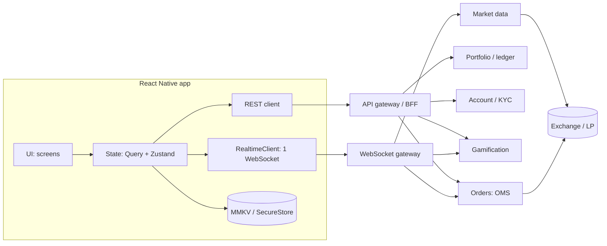
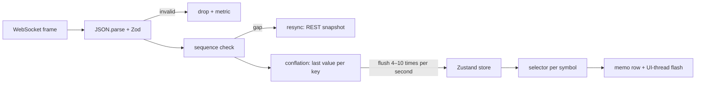
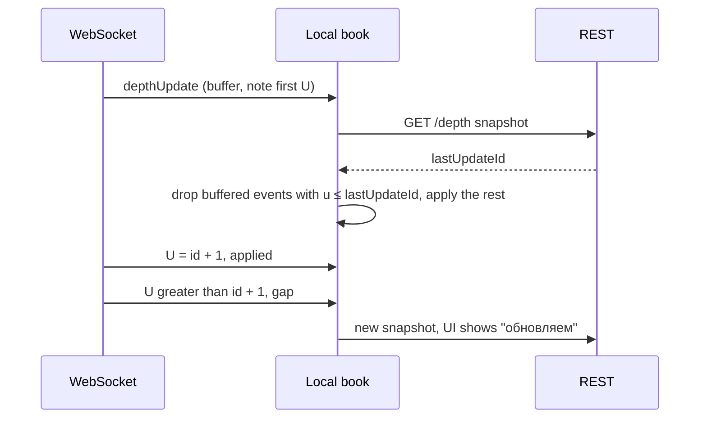

# Архитектура и system design трейдингового приложения на React Native

Обновлено: 2026-10-21 · Тренинг 2 из 6 · ≈ 16 часов · Вакансия: [карточка](../../card.ru.md)

Часть 1 из 3 · [часть 2](02-trading-app-architecture-part2.md) · [часть 3](02-trading-app-architecture-part3.md)

## Зачем этот тренинг

Следующий этап в IBIT (вероятный работодатель) — техническое интервью с Senior Frontend-разработчиком ([интервью](../../interviews.ru.md)). Роль — React Native-разработчик в трейдинговой платформе. Продукт — основное приложение на React Native и новые геймифицированные «trading mini-apps»: турниры, челленджи, лояльность, ачивки ([исследование IBIT](../../../../../research/companies/ibit.ru.md)). На таком интервью почти всегда есть «спроектируй…» и много вопросов «почему так, а не иначе?».

Цель — за ≈16 часов собрать цельную модель трейдингового клиента (домены, слои, потоки данных, производительность, безопасность, релизы, геймификация) и научиться защищать дизайн за 45 минут.

На что опираться — только факты из резюме:

- **Hotline.Finance** (2020–2025, тимлид React Native): fintech, 100+ → 100k+ MAU; переход на New Architecture (Fabric); MobX-State-Tree → Zustand; валидация на Zod; тесты Jest + Maestro; библиотека для нативного платёжного SDK Portmone (Swift, Kotlin).
- **Siimply Trade** (2025–2026): трейдинговое приложение на Expo с нуля — 60+ экранов, 85% покрытия тестами, KYC через Smile ID.
- **HabitHero**: геймификация — лиги, очки, уровни, стрики, награды, челленджи; мобильная часть и бэкенд. **My Way Club**: рефералы, бонусы, кэшбек.
- **Пробел**: WebSocket в продакшене почти не делал. Формула: «в продакшене не делал — вот как спроектировал бы и почему» ([WebSocket](../../../../../interview-prep/technical/websockets.ru.md), демо — [тренинг 6](../06-websocket-demo-binance/06-websocket-demo-binance.md)).

## Как заниматься с AI

Ты учишься вместе с Claude Code / Codex, но думаешь и пишешь сам ([тренинг 3](../03-ai-tools-claude-code-codex/03-ai-tools-claude-code-codex.md)). Правила:

1. **Сначала сам, потом сверь с AI.** В каждом упражнении 10–30 минут работаешь без AI (бумага, mermaid, код), потом отдаёшь результат на ревью.
2. **Попроси AI объяснить, а не решить.** Проси вопросы, критику, альтернативы — не готовый ответ.
3. **Проверяй AI по документации.** API меняются быстро. Где AI часто ошибается на 2026-10: `InteractionManager` удалён в React Native 0.87 (замена — `requestIdleCallback`); в MMKV v4 — `createMMKV()` и `remove()` вместо `new MMKV()` и `delete()`; в Expo Router SDK 58 удалён `initialRouteName`, а `freezeOnBlur` больше ни на что не влияет; FlashList v2 не использует `estimatedItemSize`.
4. **Формулируй так, как скажешь на интервью**: коротко, с цифрами и trade-offs.

| Зачем | Промпт |
|---|---|
| Объяснение | «Объясни <тема> на примере трейдингового приложения на React Native. Потом задай мне 3 вопроса и не отвечай за меня.» |
| Ревью дизайна | «Вот мой дизайн. Найди 3 самые серьёзные проблемы для продакшена в fintech. Не переписывай — укажи и спроси, как я исправлю.» |
| Ревью кода | «Сделай code review как senior. Только замечания с приоритетом, без исправленного кода.» |
| Альтернативы | «Дай 2 альтернативы моему решению с trade-offs. Выбирать буду я.» |
| Проверка фактов | «Сверь мой текст с документацией <ссылка>. Что устарело?» |

## Стек и версии на 2026-10-21

| Что | Версия (npm) | Что важно знать |
|---|---|---|
| React Native | 0.88 (2026-10-19) | с 0.82 — только New Architecture; с 0.84 — Hermes V1 по умолчанию; React 19.3 |
| Expo SDK | 58 (2026-10-15) | React Native 0.88; в шаблоне маршруты лежат в `src/app` |
| Expo Router | 58.x | `Stack.Protected` + `redirectTo`; `useRouter()`; экспериментальный `activityEnabled` |
| FlashList | 2.3 | без оценок размера; `getItemType`, `useRecyclingState`, `useMappingHelper` |
| Reanimated / Worklets | 4.7 / 0.13 | только New Architecture; worklets — отдельный пакет |
| MMKV | 4.3 | Nitro-модуль; `createMMKV()` |
| TanStack Query | 5.104 | `networkMode`, `scope`, `subscribed` |
| Zustand / Zod / decimal.js | 5.0 / 4.6 / 10.6 | селекторы; валидация на границе; деньги без float |

## План на 16 часов

| # | Блок | Часы | Где |
|---|---|---|---|
| 1 | Ментальная модель: домены и особенности fintech | 1 | часть 1 |
| 2 | Архитектура клиента: слои, модули, навигация, состояние, офлайн | 1,5 | часть 1 |
| 3 | Рыночные данные в реальном времени | 2 | часть 1 |
| 4 | Ордера: жизненный цикл и идемпотентность | 1,5 | [часть 2](02-trading-app-architecture-part2.md) |
| 5 | Портфель и P&L: точная арифметика | 1 | часть 2 |
| 6 | Производительность | 1,5 | часть 2 |
| 7 | Безопасность и compliance | 1,5 | часть 2 |
| 8 | Наблюдаемость, релизы, тесты | 1,5 | [часть 3](02-trading-app-architecture-part3.md) |
| 9 | Геймификация: турниры, лидерборды, награды | 1,5 | часть 3 |
| 10 | System design-интервью: фреймворк, 3 задачи, свой design doc | 2 | часть 3 |
| 11 | Мок-интервью с AI и история на 2 минуты | 1 | часть 3 |
| | **Итого** | **16** | |

Ритм: 4 сессии по ≈4 часа — блоки 1–3, 4–6, 7–9, 10–11. Заведи отдельную папку или репозиторий для заметок, диаграмм и кода (можно рядом с демо из [тренинга 6](../06-websocket-demo-binance/06-websocket-demo-binance.md)). Весь код ниже — учебный: проверяй его тестами.

## Блок 1. Ментальная модель трейдингового приложения (1 ч)

**Цель.** За 2 минуты нарисовать карту доменов и объяснить, чем трейдинг отличается от «обычного» приложения.

**Что повторить**

| Домен | Что внутри | Источник истины | Как часто меняется | Главный риск |
|---|---|---|---|---|
| Market data | котировки, сделки, стакан (order book), свечи | биржа или поставщик ликвидности → бэкенд | 1–100+ раз в секунду на символ | нагрузка, задержка, устаревшие данные |
| Watchlists | списки символов | бэкенд | редко | синхронизация между устройствами |
| Charts | свечи (OHLC), таймфреймы, индикаторы | REST-история + WebSocket для последней свечи | раз в 1–2 с | производительность рендера |
| Orders | тикет, открытые ордера, история | OMS (order management system) | события по ордеру | двойной или «потерянный» ордер |
| Portfolio | позиции, баланс, P&L, маржа | бэкенд (учёт) + живые цены | на каждый тик | ошибки округления |
| Account / KYC | профиль, верификация, лимиты | бэкенд + KYC-провайдер | редко | персональные данные, регуляторика |
| Payments | депозиты, выводы, методы оплаты | платёжный провайдер + бэкенд | события | мошенничество, вывод через украденную сессию |
| Notifications | push, in-app, алерты по цене | бэкенд | события | доставка в фоне, спам |
| Mini-apps | турниры, челленджи, лояльность, ачивки, обучение | сервис геймификации | от событий до 1 раза в секунду | честность, регуляторика |

Что особенного в fintech — четыре оси:

- **Корректность.** Деньги считает сервер; клиент показывает и не «додумывает». Ни одного двойного ордера. Деньги — decimal, не float.
- **Задержка и свежесть.** Пользователь решает по цене на экране. Старая цена, показанная как живая, — баг уровня инцидента. Показывай возраст данных и состояние соединения.
- **Безопасность.** Токены, биометрия, целостность устройства, сессия — по OWASP MASVS (блок 7).
- **Compliance.** KYC, предупреждения о рисках, ограничения на стимулы и геймификацию, юрисдикции (блоки 7 и 9).

Главный принцип: **сервер — источник истины, клиент — быстрый и честный экран.** Клиент считает только оценки для показа (стоимость ордера «≈», живой P&L) и помечает их как оценки.



**Практика** (50 мин; ещё 10 — на «Что повторить»)

1. **Карта доменов** (15 мин, сам). Закрой таблицу выше и нарисуй домены трейдингового приложения IBIT: основное приложение + mini-apps. Для каждого: источник истины, частота, что кешируем, что нельзя показывать устаревшим. *Критерий:* 9 доменов, у каждого 4 поля; отмечены 3 самых опасных места.
2. **Ревью с AI** (15 мин). Промпт: «Вот моя карта доменов трейдингового приложения. Какие домены или связи я упустил? Не добавляй сам — задай вопросы, которые меня подтолкнут». *Критерий:* найденное добавлено, и ты можешь объяснить каждое добавление.
3. **Связь с опытом** (10 мин). Выпиши, какие домены ты уже делал в Siimply Trade, Hotline.Finance и HabitHero. Только факты. *Критерий:* 4–6 строк «домен → проект → что делал».
4. **Оси fintech** (10 мин). Для каждой оси — пример бага и как архитектура его предотвращает. *Критерий:* 4 пары «баг → решение».

**Самопроверка**

- Почему клиент может считать P&L для показа, но не для отчётности?
- Чем задержка отличается от свежести? Как показать, что цена устарела?
- Какие действия требуют повторной аутентификации (step-up)?
- Что общего у баланса счёта и места в турнире с точки зрения источника истины?

**Готово, когда…** ты рисуешь схему из 9 доменов за 2 минуты и объясняешь 4 оси fintech на примерах.

## Блок 2. Архитектура клиента (1,5 ч)

**Цель.** Спроектировать структуру React Native-приложения: слои, границы модулей, навигация, состояние, ошибки, офлайн.

**Что повторить**

Слои и правило зависимостей — только сверху вниз:

| Слой | Что внутри | Правило |
|---|---|---|
| UI | маршруты `src/app` (Expo Router), компоненты | экран тонкий: параметры → хук фичи → компоненты |
| Features | `watchlist`, `symbol`, `order-ticket`, `portfolio`, `tournaments` | фича не импортирует другую фичу; общее — в `core` / `shared` |
| State | TanStack Query (server state), Zustand (client и realtime state) | серверные данные не копируем в Zustand |
| Data / realtime | API-клиент (типы из OpenAPI + Zod), `RealtimeClient` (один WebSocket) | граница с сетью — здесь валидация |
| Persistence | MMKV (кеш, настройки, флаги), SecureStore (токены), SQLite при необходимости | секреты — только в SecureStore |
| Core | сессия, флаги, аналитика, логи, деньги (decimal), i18n | не зависит от фич |

Доменная логика — чистые функции без React: state machine ордера, P&L, применение дельт стакана. Их легко тестировать и легко показать на интервью. Границы модулей проверяет линтер (например, `import/no-restricted-paths` или `eslint-plugin-boundaries`).

```text
src/
  app/                          # только маршруты (Expo Router)
    _layout.tsx                 # провайдеры + Stack.Protected
    (auth)/sign-in.tsx
    (app)/_layout.tsx           # Stack: вкладки, экран символа
    (app)/(tabs)/_layout.tsx    # watchlist, markets, portfolio, tournaments, profile
    (app)/symbol/[symbol].tsx   # deep link: myapp://symbol/BTCUSDT
    order-ticket.tsx            # formSheet
  features/  watchlist/ order-ticket/ portfolio/ tournaments/
  core/      api/ realtime/ auth/ flags/ money/ telemetry/
  shared/    ui/ lib/
```

Корневой layout: доступ по сессии и модальный тикет (по образцу гайда Expo Router по аутентификации; проверено по типам `expo-router` 58):

```tsx
// src/app/_layout.tsx
import { SplashScreen, Stack } from 'expo-router';
import { QueryClientProvider } from '@tanstack/react-query';
import { queryClient } from '@/core/api/query-client';
import { useSession } from '@/core/auth/session';

SplashScreen.preventAutoHideAsync(); // splash виден, пока читаем сессию из SecureStore

export default function RootLayout() {
  const status = useSession((s) => s.status); // 'loading' | 'signedIn' | 'signedOut'
  if (status !== 'loading') SplashScreen.hide();
  const signedIn = status === 'signedIn';

  return (
    <QueryClientProvider client={queryClient}>
      <Stack screenOptions={{ headerShown: false }}>
        <Stack.Protected guard={!signedIn}>
          <Stack.Screen name="(auth)" />
        </Stack.Protected>
        <Stack.Protected guard={signedIn}>
          <Stack.Screen name="(app)" />
          <Stack.Screen name="order-ticket" options={{ presentation: 'formSheet' }} />
        </Stack.Protected>
      </Stack>
    </QueryClientProvider>
  );
}
```

Навигация — что важно:

- `Stack.Protected` / `Tabs.Protected` прячут маршруты по условию; с SDK 58 есть `redirectTo`. Это только клиентская защита: сервер всё равно проверяет токен и права.
- Мини-приложение за фичефлагом: `<Tabs.Protected guard={flags.tournaments}>` — вкладка исчезает без релиза.
- Deep links бесплатны (маршрут = URL), поэтому параметры валидируй Zod. Deep link не выполняет действие (ордер, вывод) без подтверждения пользователя.
- Навигация из компонента — `useRouter()`; `initialRouteName` удалён, вместо него `unstable_settings.anchor`.
- Подписки экрана живут, пока экран в фокусе: `useFocusEffect` из `expo-router` (cleanup при потере фокуса). В SDK 58 есть экспериментальный `activityEnabled` (React `<Activity>`): скрытый экран сохраняет состояние, а эффекты очищаются.
- Ошибки: `ErrorBoundary` на уровне маршрута (экспорт из файла маршрута, получает `error` и `retry`) — упавший график не роняет тикет.

Где живёт состояние:

| Данные | Пример | Где | Почему |
|---|---|---|---|
| Server state | позиции, ордера, история, профиль, турниры | TanStack Query | кеш, устаревание, ретраи, инвалидация |
| Realtime | котировки, стакан, live-лидерборд | Zustand: store вне React, пишет сервис | 4–10 обновлений в секунду после conflation, селектор на строку |
| События по ордерам из WebSocket | fill, cancel | `queryClient.setQueryData` + инвалидация | редкие, важно каждое |
| Client state | статус сессии, UI, фильтры, черновик тикета | Zustand / `useState` | не приходит с сервера |
| Persisted | кеш watchlist, настройки, флаги | MMKV | быстрый синхронный доступ |
| Secret | refresh token | SecureStore (Keychain / Keystore) | шифрование на уровне ОС |

Почему котировки не в TanStack Query: каждый `setQueryData` — structural sharing и уведомление наблюдателей; на десятках обновлений в секунду это лишняя работа на JS-потоке. Сторы подробно — в [тренинге 5](../05-state-management-zustand-mobx/05-state-management-zustand-mobx.md), слой API — в [api-layer](../../../../../interview-prep/technical/api-layer.ru.md).

Состояние экрана — явный тип, а не набор булевых флагов:

```ts
type Loadable<T> =
  | { status: 'loading' }
  | { status: 'empty' }
  | { status: 'error'; message: string; retry: () => void }
  | { status: 'ready'; data: T; updatedAt: number; stale: boolean }; // stale: показываем, но честно
```

Офлайн — решение по каждой функции:

| Функция | Без сети | Почему |
|---|---|---|
| Портфель | последний снимок + «обновлено 12:03» | полезно, но честно |
| Котировки | серые, «нет соединения» | старая цена ≠ живая |
| Отправка ордера | запрещена: кнопка неактивна, объяснение | рынок уйдёт; никаких офлайн-очередей для ордеров |
| Правка watchlist | разрешена, синхронизация позже | некритично и идемпотентно |
| Турниры | рейтинг из кеша с меткой времени | не влияет на деньги |

**Практика** (75 мин; ещё 15 — на «Что повторить»)

1. **Структура** (20 мин, сам). Дерево папок для 5 фич + 3 правила импорта. Реши, где живут state machine ордера, P&L, `RealtimeClient`, флаги. *Критерий:* у каждого решения — фраза «почему».
2. **Таблица состояния** (15 мин). 15 сущностей приложения → server / realtime / client / persisted / secret. *Критерий:* ни одного токена в MMKV; котировки не в Query.
3. **Навигация** (25 мин). Набросай `src/app`: группы, Protected, модальный тикет, deep link на символ, вкладка турниров за флагом. Потом дай AI ссылку на документацию Expo Router SDK 58 и попроси сверить — не писать. *Критерий:* устаревших API не найдено.
4. **Офлайн-матрица** (15 мин). 8 функций × поведение без сети. *Критерий:* для ордеров — запрет и обоснование.

**Самопроверка**

- Почему котировки не в TanStack Query, а события по ордерам — туда?
- Что ломается, когда фича импортирует другую фичу?
- Почему Protected routes не заменяют проверку на сервере?
- Почему лайк можно поставить в офлайн-очередь, а ордер — нет?
- Где проходит граница валидации данных и почему там?

**Готово, когда…** ты рисуешь слои и объясняешь, куда ляжет новая фича «турнир», что ей можно импортировать и где её состояние.

## Блок 3. Рыночные данные в реальном времени (2 ч)

**Цель.** Спроектировать путь котировок и стакана от WebSocket до пикселя и объяснить каждую ступень: валидацию, порядок, conflation, свежесть.

Основы (одно соединение, переподключение, heartbeat, AppState, NetInfo) — в [WebSocket-подготовке](../../../../../interview-prep/technical/websockets.ru.md), живое демо — в [тренинге 6](../06-websocket-demo-binance/06-websocket-demo-binance.md). Здесь — архитектура и корректность.

**Что повторить**



1. **Snapshot + delta.** Начальное состояние — снимок (REST или первое сообщение), дальше только изменения. Цепочка порвалась — новый снимок.
2. **Порядок и пропуски.** Binance: у события стакана есть `U` (первый id) и `u` (последний); `u` ≤ id локальной книги — игнор, `U` > id + 1 — пропуск: выбросить книгу и начать заново. Coinbase: `sequence_num` растёт на 1; скачок больше чем на 1 — потеря сообщения. Kraken v2: CRC32-checksum топ-10 уровней — сверка, что локальная книга совпадает с биржевой.
3. **Conflation.** Для котировки важна только последняя цена: копим «последнее значение по ключу» и сбрасываем в стор 4–10 раз в секунду. Для событий по ордерам conflation запрещён: важно каждое.
4. **Серверный conflation лучше клиентского.** Для списков проси канал «раз в секунду» (у Binance `<symbol>@miniTicker` и `!miniTicker@arr` — 1000 мс), а real-time (`@trade`, `@depth@100ms`) — только для открытого экрана символа.
5. **Подписка по видимости.** Подписываемся на видимые строки (+ небольшой запас), отписываемся при уходе экрана из фокуса. Подписки шлём пачкой: у Binance лимит — 5 входящих сообщений в секунду на соединение, включая subscribe.
6. **Свежесть.** Храним время биржи и время получения. Нет обновлений N секунд или нет соединения → «устарело»: серый цвет, иконка, предупреждение в тикете.
7. **Числа — строками.** Binance шлёт цены и объёмы строками, Kraken советует decimal- или string-декодер. Для расчётов денег — decimal (блок 5), для графика — `number`.
8. **Backpressure.** JS не успевает (буфер растёт, задержка «биржа → экран» растёт) → сбрасываем реже, отписываемся от невидимого, просим сервер реже. Метрики: размер буфера, p95 задержки.
9. **Лимиты провайдера — часть дизайна.** У Binance соединение живёт максимум 24 часа, ping каждые 20 секунд, до 1024 потоков на соединение. Переподключение — штатная ситуация, а не авария.

Partial depth или diff + snapshot? Для мобильного экрана часто хватает топ-20 уровней раз в 100 мс (`<symbol>@depth20@100ms`): нет локальной книги и нет resync. Diff + snapshot нужен, когда важна вся глубина или сверка checksum.

Локальная книга по алгоритму Binance — чистая функция, легко тестировать:

```ts
type Level = [price: string, qty: string];
export interface DepthEvent { U: number; u: number; b: Level[]; a: Level[] }
export interface Book { lastUpdateId: number; bids: Map<string, string>; asks: Map<string, string> }
export type ApplyResult = 'applied' | 'ignored' | 'gap';

export function applyDepth(book: Book, e: DepthEvent): ApplyResult {
  if (e.u <= book.lastUpdateId) return 'ignored'; // старое или уже применённое событие
  if (e.U > book.lastUpdateId + 1) return 'gap'; // пропустили события → resync
  for (const [price, qty] of e.b) setLevel(book.bids, price, qty);
  for (const [price, qty] of e.a) setLevel(book.asks, price, qty);
  book.lastUpdateId = e.u;
  return 'applied';
}

function setLevel(side: Map<string, string>, price: string, qty: string) {
  if (Number(qty) === 0) side.delete(price); // qty "0.00000000" → уровень удалён
  else side.set(price, qty); // строки, не number: точность не теряем
}
```



Свежесть — одна функция и один глобальный «тик» времени раз в секунду, а не таймер в каждой строке:

```ts
export type Freshness = 'live' | 'stale' | 'offline';

export function freshnessOf(receivedAt: number | undefined, connected: boolean, now: number): Freshness {
  if (!connected) return 'offline';
  if (receivedAt === undefined || now - receivedAt > 5_000) return 'stale';
  return 'live';
}
```

**Практика** (100 мин; ещё 20 — на «Что повторить»)

1. **Pipeline** (25 мин, сам). Нарисуй в mermaid путь от кадра WebSocket до строки списка с ветками invalid / gap / stale. *Критерий:* 7+ ступеней; у каждой — что делаем при ошибке и какая метрика.
2. **`applyDepth` + тесты** (35 мин). Напиши функцию сам, потом сравни с примером. Тесты Jest: обычное применение, старое событие, пропуск, удаление уровня с qty 0, отбрасывание буфера до snapshot. Потом попроси AI назвать недостающие кейсы — без кода. *Критерий:* 6+ зелёных тестов; на gap — resync.
3. **Оценка нагрузки** (25 мин). Watchlist: 500 символов × 10 обновлений в секунду × 120 байт. Сколько сообщений в секунду и гигабайт в час? А если подписаться только на 20 видимых строк с серверным conflation раз в секунду? *Критерий:* цифры и вывод для дизайна (сверка — в задаче 2 блока 10).
4. **Свежесть** (15 мин). Правила `live / stale / offline`: пороги, как это видно в списке, на экране символа и в тикете. Попроси AI сыграть product owner и оспорить пороги. *Критерий:* таблица правил + аргумент для каждого порога.

**Самопроверка**

- Пришло событие стакана с `U` больше ожидаемого на 50. Что делаешь и что видит пользователь?
- Почему conflation годится для котировок и не годится для событий по ордерам?
- Зачем хранить и время биржи, и время получения? Как мерить задержку, если часы телефона врут?
- Когда partial depth лучше diff + snapshot?
- Почему цены приходят строками и что с ними делать?

**Готово, когда…** ты на доске проходишь сценарий resync и объясняешь, где теряются данные и как система восстанавливается.

## Источники (часть 1)

- React Native 0.88 — https://reactnative.dev/blog/2026/10/19/react-native-0.88 — проверено 2026-10-21
- React Native 0.87 (удалён `InteractionManager`) — https://reactnative.dev/blog/2026/08/11/react-native-0.87 — проверено 2026-10-21
- React Native: все релизы (0.82 — только New Architecture, 0.84 — Hermes V1) — https://reactnative.dev/blog — проверено 2026-10-21
- Expo SDK 58 — https://expo.dev/changelog/sdk-58 — проверено 2026-10-21
- Expo Router: protected routes — https://docs.expo.dev/router/advanced/protected/ — проверено 2026-10-21
- Expo Router: аутентификация и splash — https://docs.expo.dev/router/advanced/authentication/ — проверено 2026-10-21
- Expo Router: миграция SDK 57 → 58 — https://docs.expo.dev/router/migrate/sdk-57-to-58/ — проверено 2026-10-21
- Expo Router: React Activity — https://docs.expo.dev/router/advanced/react-activity/ — проверено 2026-10-21
- Expo Router API (`useFocusEffect`, `ErrorBoundary`) — https://docs.expo.dev/versions/v58.0.0/sdk/router/ — проверено 2026-10-21
- MMKV v4 — https://github.com/mrousavy/react-native-mmkv — проверено 2026-10-21
- FlashList v2 — https://shopify.github.io/flash-list/docs/v2-changes — проверено 2026-10-21
- Версии пакетов — https://registry.npmjs.org (react-native, expo, expo-router, @shopify/flash-list, react-native-reanimated, react-native-mmkv, @tanstack/react-query, zustand, zod, decimal.js) — проверено 2026-10-21
- Binance: WebSocket-потоки, лимиты, локальный стакан — https://developers.binance.com/docs/binance-spot-api-docs/web-socket-streams — проверено 2026-10-21
- Coinbase Advanced Trade WebSocket (`sequence_num`) — https://docs.cdp.coinbase.com/coinbase-app/advanced-trade-apis/websocket/websocket-overview — проверено 2026-10-21
- Kraken WebSocket v2: checksum стакана — https://docs.kraken.com/api/docs/guides/spot-ws-book-v2/ — проверено 2026-10-21
- TanStack Query и React Native (`onlineManager`, `focusManager`, `subscribed`) — https://tanstack.com/query/latest/docs/framework/react/react-native — проверено 2026-10-21

[Дальше: часть 2 — ордера, P&L, производительность, безопасность →](02-trading-app-architecture-part2.md)
