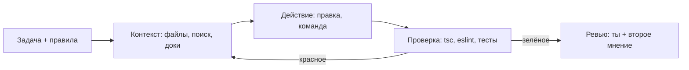

# Современная разработка с AI-инструментами: Claude Code и Codex

Обновлено: 2026-10-21 · Тренинг 3 из 6 · ≈ 16 часов · Вакансия: [карточка](../../card.ru.md)

Часть 1 из 4 · [часть 2](03-ai-tools-claude-code-codex-part2.md) · [часть 3](03-ai-tools-claude-code-codex-part3.md) · [часть 4](03-ai-tools-claude-code-codex-part4.md)

## Зачем этот тренинг

> **Это спрашивали на интервью:** скрининг IBIT 2026-10-21 — как ты используешь AI-инструменты (Claude Code / Codex) и как проверяешь AI-код.

Две строки из [описания вакансии](../../job-description.ru.md):

- «Проводить code review, включая глубокую проверку AI-generated code»
- «Активно использовать Cursor, Claude Code, Codex и другие современные AI-инструменты в ежедневной разработке»

Следующий этап — техническое интервью с Senior Frontend-разработчиком ([интервью](../../interviews.ru.md)). Роль — React Native-разработчик в трейдинговой платформе: основное приложение и новые геймифицированные «trading mini-apps» (турниры, челленджи, лояльность, ачивки). Тема AI почти наверняка вернётся, и уже глубже: «покажи, как настроен агент», «как ловишь ошибки AI», «чем Codex отличается от Cursor».

На скрининге ты сказал ([вопросы 15 и 16](../../screening-qa.ru.md)): AI-код проверяешь как код нового коллеги, даже строже; задаёшь агенту правила проекта; Cursor — инструмент того же класса. Это верные тезисы. Здесь ты превратишь их в конкретику: файлы, команды, чек-листы и один свой реальный пример.

На что опираться в ответах — только факты:

- Claude Code и Codex — каждый день; Cursor — не каждый день.
- **Covenant Desk:** AI-копилот с tool calling; меняет данные только после подтверждения пользователя; персональные данные токенизируются до отправки в модель.
- **PathoAICode:** Python FastAPI + RAG (Qdrant, реранкер, валидатор правил); точность 48% → 92%.
- **Hotline.Finance** (тимлид React Native 2020–2025): ревью кода команды, тесты Jest + Maestro, валидация на Zod. **Siimply Trade:** 85% покрытия тестами.
- Стек: TypeScript, Expo, EAS, Zustand, TanStack Query, Reanimated, Jest, Detox, Maestro.

Цель: за ≈16 часов собрать рабочий сетап Claude Code + Codex для Expo-проекта, сделать одну фичу «по-взрослому», научиться глубоко ревьюить AI-код и спокойно рассказать об этом за 2 минуты.

## Как заниматься с AI

Ты учишься вместе с Claude Code и Codex, но думаешь и пишешь сам.

1. **Сначала сам, потом сверь с AI.** Конфиг, хук, чек-лист, ответ — сначала твоя версия, потом ревью у AI.
2. **Попроси AI объяснить, а не решить.** Проси вопросы, критику, альтернативы — не готовый файл.
3. **Проверяй AI по документации.** Эти инструменты меняются каждую неделю. Модель могла учиться на старых версиях (см. таблицу ниже).
4. **Записывай ошибки** в журнал `ai-journal.md` в песочнице: дата, что не знал, правильная идея, когда повторить.

| Зачем | Промпт |
|---|---|
| Объяснение | «Объясни <тема> на примере Expo-проекта. Потом задай мне 3 вопроса и не отвечай за меня.» |
| Ревью конфига | «Вот мой <CLAUDE.md / хук / агент>. Найди 3 главные проблемы. Не переписывай — укажи и спроси, как я исправлю.» |
| Проверка фактов | «Сверь мой текст с документацией <ссылка>. Что устарело или неверно?» |
| Квиз | «Задай 5 вопросов по <тема> уровня senior-интервью. По одному. Оценивай ответы 1–5.» |

## Что изменилось к 2026-10 — где AI часто ошибается

Проверено по документации на 2026-10-21. Если AI советует иначе — это старые данные.

| Тема | Как сейчас |
|---|---|
| Claude Code: режим по умолчанию | С v2.1.283 интерактивная сессия стартует в **auto mode**: отдельная модель-классификатор проверяет действия вместо тебя. `claude -p` (v2.1.302+) стартует в Manual и отклоняет вызовы, которым нужно подтверждение |
| Claude Code: модели | Алиасы `opus` / `sonnet` / `haiku` → Opus 5.5 / Sonnet 5.5 / Haiku 5.5 (Anthropic API). Модель по умолчанию на Pro, Max, Team, Enterprise — Opus 5.5. Уровни effort: `low`, `medium`, `high`, `xhigh`, `max` |
| Claude Code: команды | `/review` — алиас `/code-review` (с v2.1.223). `/agents` больше не открывает мастер: агентов создаёт Claude по просьбе или ты — файлами в `.claude/agents/`. `/ultraplan` удалён. Флаг `--enable-auto-mode` удалён |
| Claude Code: custom commands | Слиты со skills: `.claude/commands/deploy.md` и `.claude/skills/deploy/SKILL.md` создают одну и ту же `/deploy` |
| Claude Code: AGENTS.md | С v2.1.277 читает `AGENTS.md`, но только если нет `CLAUDE.md`. Надёжный способ для обоих инструментов — `CLAUDE.md` с импортом `@AGENTS.md` |
| Claude Code: `.claudeignore` | Не работает. Закрывай файлы правилами `Read` в `deny` |
| MCP | Транспорт SSE устарел — используй HTTP |
| Codex | `--full-auto` больше не поддерживается. `approval_policy = "untrusted"` выведен из обращения (может не дать Codex стартовать). С входом через ChatGPT модель GPT-5.5 в Codex выключена 2026-10-14; рекомендована `gpt-6.1-sol` |
| Cursor | Файл `.md` в `.cursor/rules` игнорируется — нужен `.mdc` с frontmatter |
| TypeScript | `npm i typescript` ставит 7.0, шаблон Expo SDK 58 — `~6.0.3`, а `typescript-eslint` 8.72 требует TypeScript < 6.1. Не давай агенту «обновить TypeScript до последней» без проверки |

## План на 16 часов

| # | Блок | Часы | Где |
|---|---|---|---|
| 0 | Старт: диагностика, песочница, журнал | 0,5 | часть 1 |
| 1 | Ментальная модель: чат и агент, контекст, когда не использовать AI | 1 | часть 1 |
| 2 | Claude Code: установка, модели, CLAUDE.md, права и режимы, команды | 2 | часть 1 |
| 3 | Расширения: hooks, subagents, skills, MCP для mobile | 2,5 | [часть 2](03-ai-tools-claude-code-codex-part2.md) |
| 4 | Масштаб: headless, CI, worktrees, контекст и стоимость | 1,5 | часть 2 |
| 5 | Codex: CLI, IDE, cloud, AGENTS.md, sandbox и approvals, review | 1,5 | часть 2 |
| 6 | Cursor: короткий обзор и сравнение трёх инструментов | 0,5 | часть 2 |
| 7 | Workflow на одной фиче: spec → план → тесты → маленькие диффы → ревью | 2,5 | [часть 3](03-ai-tools-claude-code-codex-part3.md) |
| 8 | Риски: выдуманные API и пакеты, уязвимости, пустые тесты, секреты, лицензии | 1 | часть 3 |
| 9 | Глубокое ревью AI-кода: чек-лист и упражнение с ошибками | 1,5 | часть 3 |
| 10 | Ответы для интервью: рассказ на 2 минуты и уточняющие вопросы | 1 | [часть 4](03-ai-tools-claude-code-codex-part4.md) |
| 11 | Mock-интервью с AI | 0,5 | часть 4 |
| | **Итого** | **16** | |

Ритм: 4 сессии по ≈4 часа — блоки 0–2 (3,5 ч), 3–4 (4 ч), 5–7 (4,5 ч), 8–11 (4 ч). Блок 7 удобно делать на демо из [тренинга 6](../06-websocket-demo-binance/06-websocket-demo-binance.md).

## Блок 0. Старт (0,5 ч)

**Цель.** Понять, что ты уже помнишь, и подготовить песочницу.

**Что повторить** — разделы «Как заниматься с AI» и «Что изменилось к 2026-10» выше.

**Практика**

1. **Диагностика** (10 мин, без AI). Оцени себя 0 / 1 / 2 (не знаю / примерно / уверенно объясню):
   - чем агент отличается от чата; что лежит в контекстном окне;
   - иерархия `CLAUDE.md`; что такое `AGENTS.md`;
   - режимы прав в Claude Code; правила allow / ask / deny;
   - hooks: события, формат, exit codes; subagents; skills; MCP;
   - sandbox и approvals в Codex; `codex exec`; `/review`;
   - как ты проверяешь AI-код по шагам; когда не используешь AI.
   *Критерий:* таблица с оценками в журнале. Всё, что на 0–1, — главный фокус.
2. **Песочница** (15 мин). Создай учебный проект и git-репозиторий: worktrees и ревью диффов опираются на git.
   ```bash
   npx create-expo-app@latest ai-lab --template default@sdk-58
   cd ai-lab
   git rev-parse --verify HEAD >/dev/null 2>&1 || { git init; git add -A; git commit -m "init"; }
   npx expo lint            # шаблон SDK 58 без ESLint: первый запуск ставит его и создаёт eslint.config.js
   npx expo install jest-expo jest @types/jest @testing-library/react-native --dev
   npx expo install zustand @tanstack/react-query decimal.js
   claude --version && codex --version
   ```
   В `package.json` добавь `"jest": { "preset": "jest-expo" }` — Jest в шаблоне тоже нет. Если Claude Code или Codex не установлены — см. блоки 2 и 5. *Критерий:* проект запускается (`npx expo start`), `npx jest` и `npx eslint .` работают, есть коммит.
3. **Журнал** (5 мин). Создай `ai-journal.md`: таблица «дата · тема · что не знал · правильная идея · повторить». *Критерий:* файл в песочнице, первая строка из диагностики.

**Самопроверка**

- Какие 3 темы у тебя на 0? С какого блока начнёшь?
- Что из таблицы «Что изменилось к 2026-10» ты бы сделал по-старому?

**Готово, когда…** есть песочница с git, журнал и список слабых тем.

## Блок 1. Ментальная модель агентной разработки (1 ч)

**Цель.** Объяснить за минуту, как работает агент, что он видит и почему правила проекта так важны. Знать, когда AI лучше не использовать.

**Что повторить**

| | Чат (claude.ai, ChatGPT) | Агент (Claude Code, Codex, Cursor Agent) |
|---|---|---|
| Что делает | отвечает текстом | работает в цикле: собирает контекст → действует → проверяет → повторяет |
| Доступ к проекту | только то, что ты вставил | читает файлы, ищет по коду, запускает команды и тесты, правит много файлов |
| Проверка | ты сам копируешь и запускаешь | агент запускает `tsc`, тесты, линтер и читает результат |
| Риски | неверный ответ | неверное **действие**: правка не того, команда с побочным эффектом, утечка данных |
| Твоя роль | спрашивающий | постановщик задачи, архитектор и ревьюер |



**Что видит агент.** Только то, что лежит в контекстном окне. При старте сессии там: системный промпт, `CLAUDE.md` (или `AGENTS.md`), auto memory, имена MCP-инструментов, описания skills. Потом добавляется всё по ходу работы: твои сообщения, каждый прочитанный файл, каждый вывод команды. Агент **не видит** твою голову, Slack, Figma, устройство — пока ты не дашь инструмент (MCP, симулятор) или текст.

**Почему важны файлы правил.** Каждая сессия начинается с чистого контекста. `CLAUDE.md` / `AGENTS.md` — это онбординг нового коллеги: команды, архитектура, запреты. Без него агент угадывает и делает «как в среднем по интернету». Но правила — это **совет**, не гарантия: модель может их не выполнить. Что обязано выполняться всегда — переводи в hooks, permissions и CI.

Лестница надёжности: промпт в чате < `CLAUDE.md` / `AGENTS.md` < skill (инструкция по запросу) < hook / permission / CI (выполняются кодом, не моделью).

**Контекст — главный ресурс.** Чем больше окно заполнено, тем хуже качество: модель «забывает» ранние инструкции. Отсюда правила: одна задача — одна сессия (`/clear`), тяжёлое чтение — в subagent, короткий `CLAUDE.md` (до 200 строк).

**Когда НЕ использовать AI**

- Ты не можешь проверить результат: незнакомый домен, нет тестов, нет критерия «готово». Сначала разберись сам.
- Критичная логика без тестов: деньги, ордера, авторизация, криптография. AI можно звать только с тестами и твоим полным пониманием кода.
- Конфиденциальные данные и чужой код без разрешения: персональные данные клиентов, секреты, NDA-код в личном аккаунте.
- Мелкая правка на одну строку: руками быстрее, чем объяснять.
- Live coding на интервью: там AI нет, и проверяют твою голову.

Факт для реализма: в исследовании METR (2025-07-10) опытные open-source-разработчики с AI делали задачи на 19% **дольше**, хотя считали, что ускорились на 20%. В обновлении 2026-02-24 METR оценивает, что ускорение уже есть, но данные называет слабым доказательством. Вывод: эффект надо мерить, а не предполагать.

**Практика** (40 мин; ещё 20 — на «Что повторить»)

1. **Цикл агента** (15 мин, сам). Нарисуй цикл для задачи «добавить баннер статуса соединения в демо котировок»: какие файлы агент прочитает, какие команды запустит, где проверяешь ты. *Критерий:* 5–7 шагов и 2 точки твоего контроля (план и дифф).
2. **AI или руками** (15 мин). Реши для каждой задачи: агент / чат / руками — и как проверишь результат: (а) переименовать проп в 40 файлах; (б) расчёт P&L по открытым позициям; (в) тесты для готового хука переподключения; (г) хотфикс краша в продакшене по стектрейсу из Sentry; (д) выбор библиотеки графиков; (е) поправить отступ в одном файле. *Критерий:* у каждой — решение, причина и способ проверки. Потом сверь с AI: «Где ты не согласен и почему?»
3. **Квиз** (10 мин). Промпт: «Задай 5 вопросов про контекстное окно агента и файлы правил. По одному. Оценивай 1–5». *Критерий:* средний балл ≥ 4, ошибки в журнале.

**Самопроверка**

- Что агент видит в начале сессии и что добавляется по ходу?
- Почему длинный `CLAUDE.md` работает хуже короткого?
- Почему «никогда не трогай `.env`» в `CLAUDE.md` — недостаточная защита? Что надёжнее?
- Назови 3 ситуации, где ты не используешь AI, и почему.

**Готово, когда…** ты за минуту объясняешь цикл агента, лестницу надёжности и 3 случая «без AI».

## Блок 2. Claude Code: установка, модели, CLAUDE.md, права, команды (2 ч)

**Цель.** Настроить Claude Code для Expo-проекта: правила, права, режимы. Знать ключевые команды.

**Что повторить** — четыре темы ниже: установка и модели, `CLAUDE.md`, права и режимы, команды.

### Установка и модели

```bash
curl -fsSL https://claude.ai/install.sh | bash   # нативный установщик, обновляется сам
brew install --cask claude-code                  # или Homebrew: stable-канал, обновлять вручную
claude --version
cd ai-lab && claude                              # при первом запуске — вход
```

- Нужна подписка Claude (Pro, Max, Team, Enterprise) или аккаунт Claude Console (API).
- Где работает: терминал, расширение для VS Code (ставится и в Cursor), JetBrains, Desktop-приложение, web (claude.ai/code), мобильное приложение. Конфиги (`CLAUDE.md`, settings, MCP) общие.
- Модель: `/model` в сессии, `claude --model sonnet` при старте, ключ `model` в settings. `opusplan` — Opus в plan mode, потом Sonnet для реализации. `fable` / `best` — самая сильная модель, если доступна на твоём плане.
- Глубина рассуждений: `/effort high` или `--effort`. Больше effort — дольше и дороже.

### CLAUDE.md: память проекта

| Уровень | Где | Для чего |
|---|---|---|
| Managed policy | macOS: `/Library/Application Support/ClaudeCode/CLAUDE.md` | правила компании |
| Пользователь | `~/.claude/CLAUDE.md` | твои привычки во всех проектах |
| Проект | `./CLAUDE.md` или `./.claude/CLAUDE.md` | правила команды, коммитится в git |
| Локально | `./CLAUDE.local.md` | личное по проекту, добавь в `.gitignore` |

Как это работает:

- Файлы из текущей папки и всех папок выше загружаются при старте и **склеиваются**, не перекрывают друг друга. Ближайший к рабочей папке читается последним.
- `CLAUDE.md` в подпапках грузится по требованию — когда Claude читает файлы в этой подпапке.
- Импорт: `@docs/testing.md` в тексте подключает файл (до 4 уровней вложенности). Импорт не экономит контекст — файл тоже грузится при старте.
- `.claude/rules/*.md` — правила по темам. С frontmatter `paths:` правило грузится, только когда Claude работает с подходящими файлами. Это экономит контекст.
- Размер: до 200 строк на файл. Для каждой строки спроси: «Если удалить — Claude ошибётся?» Нет — удаляй.
- `/init` создаёт стартовый `CLAUDE.md` по коду проекта; `/memory` открывает файлы памяти; `/context` показывает, что загрузилось.
- **Auto memory:** Claude сам пишет заметки в `~/.claude/projects/<project>/memory/MEMORY.md` (в каждую сессию грузятся первые 200 строк или 25 КБ). Проверяй их через `/memory`.
- Важно: `CLAUDE.md` доходит до модели как сообщение после системного промпта. Это контекст, не принуждение.

Пример `CLAUDE.md` для Expo-проекта (учебный; в своём проекте пиши только то, что правда):

```markdown
# ai-lab — Expo trading demo

## Stack
- Expo SDK 58, React Native (New Architecture), TypeScript strict, Expo Router (routes in src/app)
- State: Zustand for client state, TanStack Query v5 for server state
- Tests: Jest + @testing-library/react-native; E2E: Maestro flows in .maestro/

## Commands
- Typecheck: `npx tsc --noEmit` (must pass)
- Lint: `npx eslint . --max-warnings=0`
- Unit tests: `npx jest --findRelatedTests <files>`; all: `npx jest`
- E2E: `maestro test .maestro/` (needs a running simulator)
- Native deps only via `npx expo install <pkg>`; check versions: `npx expo install --check`

## Architecture
- Features in src/features/<name>/ (ui, hooks, api, store); shared code in src/shared/
- Server data only through TanStack Query hooks in src/features/*/api; never copy it into Zustand
- Zustand: select with selectors; for objects or arrays use useShallow
- One WebSocket connection manager in src/shared/ws/; screens subscribe to topics, never open sockets

## Rules
- Money and prices: no float math; use helpers from src/shared/money.ts (decimal.js)
- Ask me before adding any dependency; check that the package exists, is maintained, has a compatible license
- Never read or print .env* files; secrets come from EAS environment variables
- Reanimated: code inside worklets calls only worklets; JS work goes through scheduleOnRN
- Every effect that subscribes (socket, AppState, timers) must clean up

## Workflow
- Changes in more than 2 files: plan first, wait for my OK
- Small diffs, one logical change per commit
- Before saying "done": run typecheck, lint and related tests; show the commands and their output
- Write the failing test first; never weaken or delete existing tests to make them pass
```

Пример правила по путям — `.claude/rules/testing.md`:

```markdown
---
paths:
  - "**/*.test.ts"
  - "**/*.test.tsx"
---
# Testing rules
- Test behaviour, not implementation; assert concrete values, not toBeDefined/toBeTruthy
- Query by role, text or testID; no snapshots of whole screens
- Mock only boundaries: network and native modules; never mock the unit under test
- A test must fail when the code under test is broken
```

### Права и режимы

| Режим (Shift+Tab) | Что без вопросов | Когда |
|---|---|---|
| `default` (в UI — Manual) | только чтение | чувствительная работа, незнакомый код |
| `acceptEdits` | чтение, правки файлов, `mkdir`, `mv`, `cp` и т. п. в рабочей папке | итерации, когда ревьюишь `git diff` после |
| `plan` | чтение и исследование; правки заблокированы до одобрения плана | перед большой правкой |
| `auto` | всё, но классификатор блокирует рискованное | длинные задачи, меньше «кликов» |
| `dontAsk` | только заранее разрешённое, остальное — отказ | CI, скрипты |
| `bypassPermissions` | всё | только изолированный контейнер или VM |

- Переключение: `Shift+Tab` (из auto: Manual → acceptEdits → plan → auto), флаг `--permission-mode plan`, ключ `permissions.defaultMode`. Значения `auto` и `bypassPermissions` из проектных settings не применяются.
- **Plan mode:** `Shift+Tab` или `/plan <задача>`. Claude читает код и пишет план. `Ctrl+G` открывает план в редакторе — правь его. Дальше: «Yes, and use auto mode», «Yes, manually approve edits» или «No, keep planning».
- Auto mode снижает число вопросов, но **не гарантирует безопасность** (так пишет документация). Для учёбы начни с Manual: увидишь каждое действие агента.

Правила: `allow` — без вопроса, `ask` — всегда спросить, `deny` — запрет. Порядок проверки: **deny → ask → allow**; первое совпадение решает, узкий `allow` не отменяет широкий `ask`.

- `Bash(npm run *)` — все npm-скрипты; пробел перед `*` важен: `Bash(ls *)` не совпадёт с `lsof`.
- `Read(./.env)` — запрет чтения; блокирует и Edit/Write того же пути, и `cat` / `head` в Bash. Косвенное чтение (`grep -r` по папке, скрипт на Node) правило не закрывает — для этого нужна OS-песочница (`/sandbox`).
- `WebFetch(domain:docs.expo.dev)` — доступ к домену; `mcp__expo__*` — все инструменты MCP-сервера `expo`.
- Права проверяет Claude Code, а не модель. Это и есть принуждение, в отличие от `CLAUDE.md`.

Где лежат settings (сверху — сильнее): managed → флаг `--settings` → `.claude/settings.local.json` (личное, не в git) → `.claude/settings.json` (команда, в git) → `~/.claude/settings.json`. Списки (`allow`, `deny`) из разных файлов **объединяются**.

Пример `.claude/settings.json`:

```json
{
  "$schema": "https://json.schemastore.org/claude-code-settings.json",
  "permissions": {
    "allow": [
      "Bash(npx tsc --noEmit)",
      "Bash(npx eslint *)",
      "Bash(npx jest *)",
      "Bash(git diff *)",
      "Bash(git log *)",
      "WebFetch(domain:docs.expo.dev)",
      "WebFetch(domain:reactnative.dev)"
    ],
    "ask": ["Bash(npm install *)", "Bash(npx expo install *)", "Bash(git push *)"],
    "deny": ["Read(./.env)", "Read(./.env.*)", "Read(./secrets/**)"]
  }
}
```

Обрати внимание: `ask` для `npx expo install *` сработает и для `npx expo install --check` — `ask` сильнее `allow`. Это нормально.

### Команды, которые стоит знать

| Команда | Зачем |
|---|---|
| `/init`, `/memory` | создать и править `CLAUDE.md`; включить или выключить auto memory |
| `/context` | что занимает контекст: память, MCP, файлы |
| `/clear` | новая задача — чистый контекст (память проекта остаётся) |
| `/compact <фокус>` | сжать историю, сохранив важное: `/compact focus on the reconnect bug` |
| `/plan <задача>` | сразу в plan mode |
| `/model`, `/effort` | модель и глубина рассуждений |
| `/permissions`, `/hooks`, `/mcp`, `/skills` | права, хуки, MCP-серверы, skills |
| `/diff` | что изменилось в рабочем дереве |
| `/code-review [effort] [--fix]` | ревью текущего диффа на баги в отдельном subagent |
| `/security-review` | ревью изменений ветки на уязвимости (нужен remote `origin`) |
| `/rewind` или `Esc` `Esc` | откатить код и/или разговор к checkpoint |
| `/btw <вопрос>` | побочный вопрос, который не попадёт в историю |
| `/usage` | стоимость сессии и лимиты плана (`/cost` — алиас) |
| `/resume`, `claude -c` | вернуться к прошлой сессии |
| `/doctor` | проверить установку, settings и `CLAUDE.md` |
| `/import codex` | перенести конфигурацию Codex (инструкции, MCP, skills) |

Checkpoints ловят только правки через инструменты Claude, не через Bash. Это не замена git: коммить маленькими шагами.

**Практика** (80 мин; ещё 40 — на «Что повторить»)

1. **Настрой Claude Code для Expo-проекта** (40 мин). В песочнице: `/init` → сравни результат с примером выше → напиши свой `CLAUDE.md` (до 80 строк) + `.claude/rules/testing.md` + `.claude/settings.json`. Создай `.env` с фейковым ключом. *Критерии:* `/context` показывает твои файлы памяти; `/permissions` показывает правила; на просьбу «прочитай .env» — отказ; `npm install` спрашивает разрешения; `npx jest` идёт без вопроса.
2. **Три режима** (20 мин). Одна задача — «добавь в `src/shared/money.ts` функцию `formatPrice` и тест» — три раза: Manual, plan, acceptEdits. После каждого прогона откати изменения: `git stash -u` или `/rewind`. *Критерий:* в журнале по строке: сколько было вопросов, где ты контролировал, что выбрал бы для работы.
3. **Команды в деле** (20 мин). Выполни `/context`, `/compact` с фокусом, `/rewind`, `/btw`, `/diff`, `/usage`. *Критерий:* для каждой — одна строка в журнале «когда использую».

**Самопроверка**

- Где лежат 4 уровня `CLAUDE.md`? Что будет, если правила в двух файлах противоречат друг другу?
- Чем `.claude/rules/` с `paths:` лучше раздела в `CLAUDE.md`?
- Порядок проверки allow / ask / deny? Почему `allow: Bash(git push origin main)` не сработает при `ask: Bash(git push *)`?
- Чем plan mode отличается от «сначала напиши план» в обычном промпте?
- Что попадает в `.claude/settings.local.json` и почему его не коммитят?

**Готово, когда…** в песочнице есть `CLAUDE.md`, правило по путям и settings с правами; ты объясняешь режимы и порядок правил без подсказки.

---

Дальше: [часть 2 — hooks, subagents, skills, MCP, headless, worktrees, Codex, Cursor](03-ai-tools-claude-code-codex-part2.md)
