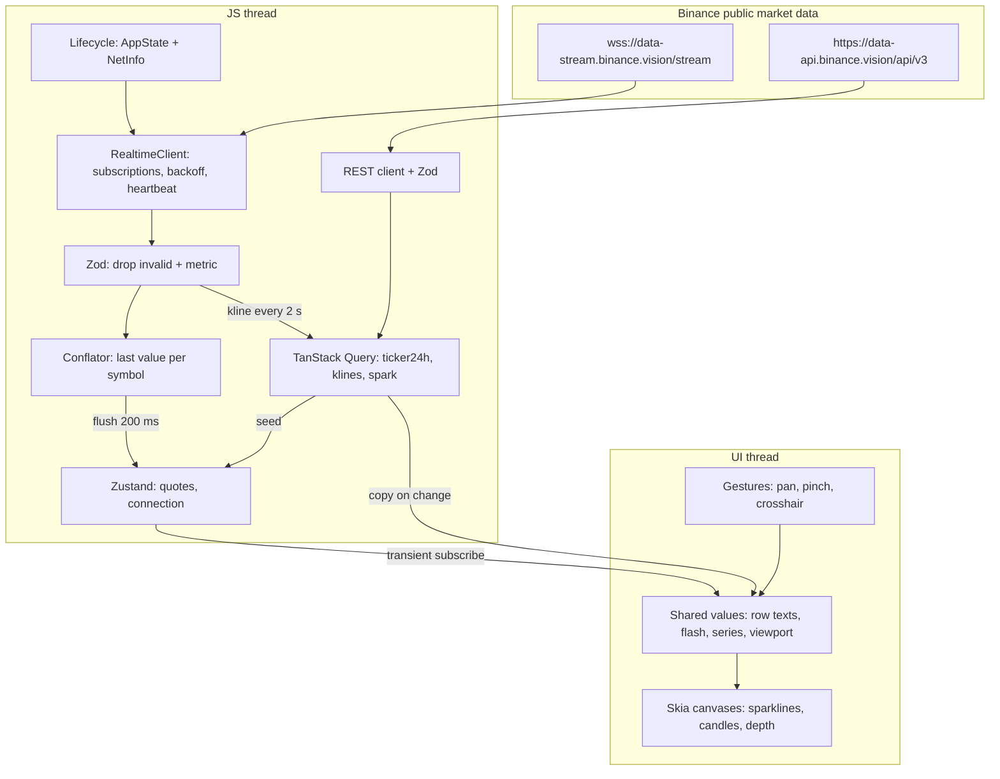
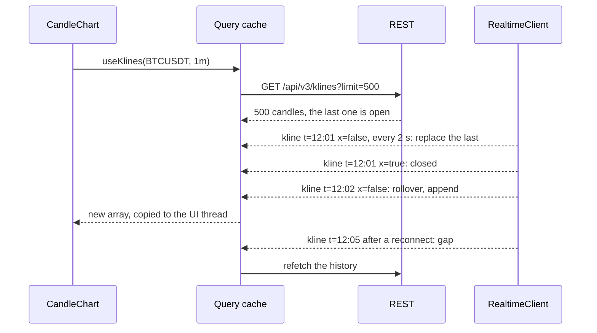
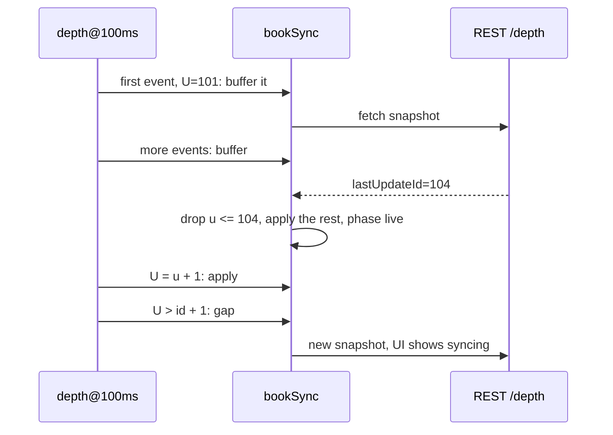

# Итоговый проект: живой рынок на Expo — system design, WebSocket, графики на Skia

Обновлено: 2026-10-21 · Тренинг 6 из 6 · ≈ 16 часов (+ ★ 13 часов) · Вакансия: [карточка](../../card.ru.md)

[1](06-websocket-demo-binance.md) · [2](06-websocket-demo-binance-part2.md) · Часть 3 из 11 · [4](06-websocket-demo-binance-part4.md) · [5](06-websocket-demo-binance-part5.md) · [6](06-websocket-demo-binance-part6.md) · [7](06-websocket-demo-binance-part7.md) · [8](06-websocket-demo-binance-part8.md) · [9](06-websocket-demo-binance-part9.md) · [10](06-websocket-demo-binance-part10.md) · [11](06-websocket-demo-binance-part11.md)

Этап 1 — главный для интервью. Дизайн пишешь до кода. Здесь — порядок работы, шаблон и разбор разделов 1–6. В [части 4](06-websocket-demo-binance-part4.md) — разделы 7–14, ADR и приёмка.

## Этап 1. System design: `docs/design.md` и ADR — до кода (2 ч)

**Цель.** Документ на 2–4 страницы. По нему другой разработчик построит то же приложение, а ты за 5–7 минут объяснишь интервьюеру каждое решение и его цену.

**Что нужно знать**

- Design doc фиксирует решения, пока они дешёвые. Код потом сверяется с документом, а не наоборот.
- ADR (Architecture Decision Record) — короткая запись одного решения: контекст, решение, последствия. Формат предложил Michael Nygard (2011); шаблоны — [adr.github.io](https://adr.github.io/). ADR не переписывают: решение поменялось — новый ADR со статусом «Supersedes 0003».
- Фреймворк интервью из 7 шагов и шаблон design doc — в [тренинге 2, блок 10](../02-trading-app-architecture/02-trading-app-architecture-part3.md). Здесь тот же каркас, но для твоего проекта и с настоящими цифрами.
- Документ — на простом английском: репозиторий публичный. AI может поправить язык, но не факты и не числа.

**Шаги** (120 мин). Первые 10–15 минут каждого шага — без AI и без разбора ниже.

| # | Мин | Что делаешь |
|---|---|---|
| 1 | 20 | Требования: функциональные, нефункциональные с числами, вне scope |
| 2 | 10 | Ограничения Binance — таблица «правило → решение» |
| 3 | 10 | Оценки нагрузки: сообщения, байты, кадры |
| 4 | 20 | Архитектура: диаграмма, слои, JS-поток и UI-поток |
| 5 | 20 | Потоки данных: тикеры, свечи, ★ стакан |
| 6 | 10 | Модель состояния; сбои и восстановление |
| 7 | 10 | Производительность, наблюдаемость, тесты |
| 8 | 15 | Trade-offs → 4 ADR |
| 9 | 5 | Design review с AI в чистой сессии (промпт — в части 1) |

> ⛔ **Сначала сам.** Разбор ниже — сверка, а не шпаргалка. Твои формулировки ценнее: на интервью их и скажешь.

### Шаблон `docs/design.md`

```markdown
# rn-realtime-market: design
Status: draft · Updated: 2026-10-xx

## 1. Context and goals
## 2. Requirements: functional · non-functional · out of scope
## 3. Provider constraints (Binance)
## 4. Capacity estimates
## 5. Architecture: diagram, layers, threads
## 6. Data flows: tickers · klines · ★ order book
## 7. State model
## 8. Failure modes and recovery
## 9. Performance strategy
## 10. Observability
## 11. Testing strategy
## 12. Trade-offs (links to ADRs)
## 13. Scaling and next steps
## 14. Open questions
```

### 1. Контекст и цели

3–5 строк: учебное open-source приложение; живые рыночные данные без ключа; цель — показать production-подход к realtime-слою и графикам в React Native. Цели проверяемые: «строки не перерисовываются на тиках», «график держит 60 FPS при pan и zoom в release-сборке (EAS-профиль `preview`)», «после обрыва сети данные восстанавливаются без перезапуска».

### 2. Требования

Функциональные:

| # | Требование |
|---|---|
| F1 | Watchlist 20 пар: цена, изменение за 24 ч, sparkline за 24 ч, вспышка на изменение цены |
| F2 | Экран символа: 500 минутных свечей, живая последняя свеча, объём, шкала цен, линия последней цены |
| F3 | Жесты графика: pan с инерцией, pinch-zoom вокруг пальцев, удержание — перекрестие с OHLC |
| F4 | Статус соединения: подключаемся, переподключение (попытка N), нет интернета, данные устарели |
| F5 | ★ Стакан и график глубины; ★ лента сделок; ★ «прогноз цены» |

Нефункциональные — каждое с числом, иначе его нельзя проверить:

| Что | Цель | Как проверить |
|---|---|---|
| Кадр | 60 FPS (16,7 мс); на 120 Гц — 8,3 мс | `PerformanceMonitor` в release-сборке `preview`; Profile HWUI rendering в настройках разработчика Android |
| Ре-рендеры | строки списка на тиках — 0 в секунду; стор — ≤ 5 обновлений в секунду | `<Profiler>` (этап 6) |
| Задержка «биржа → JS» | p95 — смотри dev-оверлей; бюджет ниже | `E` биржи + поправка часов |
| Батарея | в фоне сокета нет; нет поллинга; нет бесконечных анимаций | AppState, ручная проверка |
| Офлайн | без сети — честный баннер, без шторма переподключений | режим полёта |
| Надёжность | обрыв, смена сети, `serverShutdown` — восстановление без перезапуска | тесты клиента + ручная матрица |
| Безопасность | только `wss://` и `https://`; ключей и секретов нет | ревью, push protection |
| Доступность | Reduce Motion: без вспышек и инерции; подписи у кнопок | [тренинг 4, блок 10](../04-animations-reanimated-skia/04-animations-reanimated-skia-part5.md) |
| Платформы | Android 7+ (API 24) и iOS 16.4+ — минимумы Expo SDK 58; графики без требования Vulkan | ADR 0003, `app.json` |
| Тема | тёмная по умолчанию, светлая — переключателем; смена темы не трогает поток тиков | кнопка Theme в dev-режиме: переключить тему под нагрузкой, Profiler |

Бюджет задержки «событие на бирже → пиксель» (оценка; проверишь в dev-оверлее, этап 8):

| Звено | Бюджет | Как держим |
|---|---|---|
| Сеть: биржа → телефон | измерь (`E` + поправка часов) | одно соединение, без лишних хопов |
| `JSON.parse` + Zod | < 1 мс на сообщение | сообщения 0,2–1,3 КБ |
| Ожидание conflation | ≤ 200 мс | flush раз в 200 мс — главный «рычаг» задержки |
| Стор → shared values | < 5 мс на пачку | подписка без React |
| Кадр на UI-потоке | ≤ 16,7 мс | анимации и Skia на UI-потоке |

Частоты обновлений:

| Данные | Источник | Частота у Binance | На UI |
|---|---|---|---|
| Цены списка | `<symbol>@miniTicker` | 1 с на символ | ≤ 5 пачек в секунду |
| Sparkline | REST `klines` 1h × 24 + тик | 1 с | последняя точка раз в пачку |
| Свечи | REST 500 × 1m + `<symbol>@kline_1m` | 2 с (у `kline_1s` — 1 с) | копия на UI-поток раз в 2 с |
| ★ Стакан | `<symbol>@depth@100ms` + REST `/depth` | 100 мс | ≤ 4 раза в секунду, топ 50 |
| ★ Сделки | `<symbol>@aggTrade` | real-time | пачка раз в 250 мс |

Вне scope: ордера и приватные потоки, аккаунт, push, web. Скажи это первым — интервьюер сразу видит границы.

### 3. Ограничения Binance

Проверено 2026-10-21 по документации и на живом сервере. Это часть дизайна, а не сноска.

| Правило | Значение | Решение в дизайне |
|---|---|---|
| Хосты только для рыночных данных | `wss://data-stream.binance.vision`, `https://data-api.binance.vision` | ключей нет; приватных потоков там нет |
| Срок жизни соединения | ≤ 24 ч | переподключение — штатная ситуация |
| Ping / pong | ping каждые 20 с; нет pong минуту → отключение | pong — нативный слой; свой heartbeat в JS |
| Входящие сообщения | ≤ 5 в секунду (ping, pong, JSON) → иначе `1008` | 1 управляющее сообщение на 250 мс; подписки пачкой |
| Потоков на соединение | ≤ 1024 | проверка в `subscribe` |
| Соединения | ≤ 300 попыток за 5 минут с IP | backoff с full jitter, сброс только после 10 с стабильности |
| `serverShutdown` | событие перед отключением | сразу новое соединение, без backoff |
| Имена потоков | символ строчными; ошибка регистра — тишина | имена строят только хелперы |
| Удалённые потоки | `!ticker@arr` удалён 2026-03-26 | `<symbol>@miniTicker` |
| REST | 6000 weight в минуту на IP; 429 → `Retry-After`; повторы → 418 (бан от 2 минут до 3 дней) | Query не повторяет 4xx, кроме 429 |
| Регион | HTTP 451 в части стран и облаков | хосты `*.binance.vision`; тесты и CI без сети |

### 4. Оценки нагрузки

Числа — живой замер 2026-10-21 (Node, Краков, 70–80 с; частота сделок зависит от рынка). Строки «× 20» — расчёт от замера одного символа.

| Поток | Сообщений в секунду | Размер | Трафик |
|---|---|---|---|
| `@miniTicker` × 20 | 20 | ≈ 224 Б | ≈ 4,5 КБ/с ≈ 16 МБ/ч |
| `@kline_1m` × 1 | 0,5 (раз в 2 с; медиана 2002 мс) | ≈ 364 Б | ≈ 0,2 КБ/с |
| `@trade` BTCUSDT | 15–30 | ≈ 169 Б | до ≈ 5 КБ/с |
| ★ `@depth@100ms` | ≈ 9,5 | ≈ 840 Б | ≈ 8 КБ/с ≈ 29 МБ/ч |
| ★ `@depth20@100ms` | ≈ 9,3 | ≈ 1,3 КБ | ≈ 12 КБ/с |

| REST | Размер | Weight |
|---|---|---|
| `ticker/24hr?type=MINI` × 20 символов | ≈ 5,8 КБ | 2 (21–100 символов — 40) |
| `klines` 1m × 500 | ≈ 85 КБ, gzip ≈ 25 КБ | 2 |
| `klines` 1h × 24 × 20 строк (sparklines) | ≈ 4,3 КБ × 20 | 2 × 20 = 40 |
| ★ `depth` limit 100 | ≈ 6,4 КБ | 5 (до 5000 уровней — 250) |

Выводы для дизайна:

- Холодный старт watchlist: снимок, до 20 sparklines и время сервера ≈ 92 КБ и 43 weight; экран символа — ещё ≈ 85 КБ (25 КБ в gzip) и 2 weight. До лимита 6000 в минуту далеко.
- Watchlist на серверном conflation (`@miniTicker` раз в секунду) — 20 сообщений в секунду. JS справится и без клиентского батчинга. Клиентский conflation нужен для стресс-режима (`@trade`) и для честной цифры «≤ 5 обновлений стора в секунду».
- Стакан — самый тяжёлый поток (≈ 29 МБ в час). Подписка — только пока открыт экран стакана. Для маленького виджета хватит `@depth20` раз в секунду: ≈ 1,3 КБ/с, без локальной книги.
- 500 символов × 10 обновлений в секунду × 120 Б ≈ 600 КБ/с ≈ 2,2 ГБ в час — так нельзя. Это задача 2 из [тренинга 2, блок 10](../02-trading-app-architecture/02-trading-app-architecture-part3.md): подписка по видимости и серверный conflation.
- Кадр: при зуме до 3 px на свечу на телефоне видно ≈ 100 свечей → ≈ 300 прямоугольников в 4 путях за кадр на UI-потоке. Это дёшево, если не создавать Paint и шрифты в кадре.

### 5. Архитектура



| Слой | Папка | Правило |
|---|---|---|
| Экраны | `src/app` | тонкие: параметры → хуки фичи → компоненты |
| Фичи | `src/features/*` | фича не импортирует другую фичу; общее — в `chart`, `store`, `ui` |
| Состояние | `src/store` + TanStack Query | котировки — Zustand; снимки и свечи — Query; серверные данные не копируем в Zustand |
| Данные | `src/realtime`, `src/binance` | одно соединение; граница с сетью — Zod |
| Математика | `src/chart` | чистые функции-worklets: без React, RN и Skia |
| UI-поток | Reanimated, Skia, GH | кадры, жесты, геометрия; JS только задаёт цель |
| Стили | `src/global.css`, `src/ui` | Uniwind `className` на токенах; анимации — Reanimated; цвета Skia — `useThemeColors` (ADR 0004) |

Два потока — главный тезис производительности. JS-поток: сеть, разбор, стор, React. UI-поток: жесты, анимации, геометрия графика, отрисовка Skia. Между ними — shared values: JS пишет раз на пачку (≤ 5 раз в секунду), UI читает каждый кадр. Стили к потокам не относятся: `className` разрешается при рендере, а рендеров на тиках нет.

### 6. Потоки данных

**Тикеры: snapshot + поток.** REST `ticker/24hr?type=MINI` «засевает» стор за 1–3 с. Дальше `@miniTicker` раз в секунду приносит полное состояние символа. Это не дельта: потерянное сообщение «лечит» следующее, номера последовательности не нужны. Стор сливает по времени биржи `E`: старый снимок не перетирает свежий тик.

**Свечи: REST-история + живая свеча.** История — 500 свечей по REST, последняя ещё открыта. Поток `@kline_1m` раз в 2 с присылает текущую свечу целиком.



- Та же `t` → заменить последнюю свечу. `x: true` — свеча закрыта (проверено вживую: финальное событие приходит сразу после `T`, через ≈ 2 с — уже новая `t`).
- `t` = последняя + интервал → rollover: добавить, хвост обрезать до 1000.
- `t` дальше чем на интервал → дыра (обрыв, фон) → перезапросить историю. После `reconnecting → open` — тоже.
- `t` меньше последней → опоздавшее событие: игнор, та же ссылка, без ре-рендера.
- Всё это — одна чистая функция `upsertCandle` с тестами (этап 6).

**★ Стакан: snapshot + diff с проверкой последовательности.** Алгоритм Binance «How to manage a local order book correctly»:



- Снимок старше первого `U` в буфере → взять снимок ещё раз.
- Уровень с количеством `0` → удалить.
- `U` больше id книги + 1 → пропуск: выбросить книгу и начать заново. Пользователь видит «обновляем», а не неверный стакан.
- Проверено вживую 2026-10-21: книга синхронизирована через ≈ 6 с после запуска, 641 событие за 70 с без единой дыры, `lastUpdateId` локальной книги совпал с REST.

[Дальше: часть 4 — модель состояния, сбои, trade-offs и ADR; этап 2 →](06-websocket-demo-binance-part4.md)
