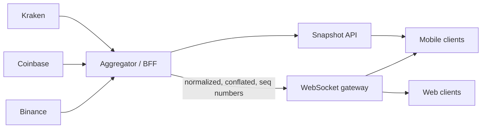

# Итоговый проект: живой рынок на Expo — system design, WebSocket, графики на Skia

Обновлено: 2026-10-21 · Тренинг 6 из 6 · ≈ 16 часов (+ ★ 13 часов) · Вакансия: [карточка](../../card.ru.md)

[1](06-websocket-demo-binance.md) · [2](06-websocket-demo-binance-part2.md) · [3](06-websocket-demo-binance-part3.md) · Часть 4 из 11 · [5](06-websocket-demo-binance-part5.md) · [6](06-websocket-demo-binance-part6.md) · [7](06-websocket-demo-binance-part7.md) · [8](06-websocket-demo-binance-part8.md) · [9](06-websocket-demo-binance-part9.md) · [10](06-websocket-demo-binance-part10.md) · [11](06-websocket-demo-binance-part11.md)

Продолжение этапа 1: разделы 7–14 design doc, ADR, приёмка. Потом этап 2 — Binance на практике.

### 7. Модель состояния

| Данные | Где живут | Кто пишет | Почему там |
|---|---|---|---|
| Котировки 20 символов | Zustand `useQuotes.bySymbol` | `applyBatch` раз в 200 мс | частый поток вне React; узкие подписки |
| Статус соединения | Zustand `useConnection` | `onStatus` клиента | вход баннера: `status`, `attempt`, `lastMessageAt` |
| Снимок 24 ч, свечи, sparklines | TanStack Query | REST; свеча — `setQueryData` из потока | кэш, retry, перезапрос при возврате и в сеть |
| Тексты строки, вспышка, цвет, точки sparkline | shared values строки | подписка на стор вне React | UI-поток, 0 ре-рендеров |
| Окно графика, перекрестие | shared values графика | жесты (worklets) | ни одного ре-рендера во время жеста |
| ★ Книга заявок | замыкание хука `useOrderBook` | события потока | 10 событий в секунду; на UI — топ 50 раз в 250 мс |
| Метрики | модуль `dev/metrics` | клиент, хуки потоков | читает dev-оверлей раз в секунду |
| ★ Настройки (интервал, список) | MMKV | экран настроек | переживают перезапуск |

### 8. Сбои и восстановление

| Сбой | Как заметим | Что делаем | Что видит пользователь |
|---|---|---|---|
| Режим полёта | NetInfo `isConnected: false` | `stop('offline')`, без попыток | баннер «Нет интернета» |
| Полуоткрытый TCP после смены Wi-Fi ↔ LTE | тишина 10 с → probe; 15 с → мёртв | `close(4000)` и reconnect с backoff | «Переподключение, попытка N» |
| Сервер закрыл (1006), 24 ч, рестарт | `onclose` | backoff с jitter, после `open` — одна пачка подписок | баннер на секунды |
| `serverShutdown` | событие в потоке | новое соединение сразу | ничего |
| `1008 Too many requests` | код закрытия | ошибка в лог: это баг клиента | баннер |
| Пропуск свечей | `upsertCandle` → `gap`; `reconnecting → open` | REST-история заново | ничего |
| ★ Дыра в стакане | `U > id + 1` | выбросить книгу, новый снимок | «Обновляем» |
| Битое сообщение, новая схема | Zod `safeParse` | выбросить, `metrics.invalid++` | ничего; счётчик в dev-оверлее |
| REST 429 / 418 | HTTP-статус | повтор только 429 и 5xx, максимум 3 | экран ошибки и «Повторить» |
| HTTP 451 (регион) | статус | запасной хост; если нет — честная ошибка | сообщение |
| JS не успевает (стресс) | растёт p95 задержки | реже flush, отписка от невидимого, серверный conflation | цены реже, но плавно |
| Приложение в фоне | AppState `background` | `stop('idle')`: сокета нет | при возврате — снимок и reconnect |
| Часы телефона врут | — | поправка по `GET /api/v3/time` | честная задержка в оверлее |

### 9. Производительность

1. **Серверный conflation лучше клиентского.** Список — `@miniTicker` раз в секунду, real-time потоки — только на открытом экране.
2. **Клиентский conflation**: последнее значение по символу, один `set` в стор раз в 200 мс.
3. **Строки не рендерятся на тиках.** Строка подписана на стор вне React и пишет shared values: текст — `AnimatedTextInput`, вспышка и цвет — Reanimated, sparkline — путь Skia. `data` у FlashList — символы, а не тикеры.
4. **Геометрия графика — на UI-потоке.** `useDerivedValue` + `usePathValue`: свечи одного цвета — один путь. Число делений сетки меняется при зуме → `Picture`. Paint и шрифты — один раз на модуль.
5. **Данные на UI-поток копируются при изменении, а не в кадре**: 500 свечей раз в 2 с.
6. **Замеры, а не ощущения**: `<Profiler>` для рендеров; `PerformanceMonitor` из Reanimated для FPS обоих потоков; честный FPS — только в release-сборке.

### 10. Наблюдаемость

- `src/dev/metrics.ts`: сообщения в секунду, невалидные, переподключения, дыры (gap), задержка «биржа → JS» p50 / p95. Задержка = время получения + поправка часов − `E` биржи. Поправка — как в NTP: `serverTime − (отправили + получили) / 2`.
- Dev-оверлей (только `__DEV__`): эти цифры и FPS JS / UI.
- В продакшене — то же в Sentry или EAS Observe плюс «стоп-краны» релиза ([тренинг 2, блок 8](../02-trading-app-architecture/02-trading-app-architecture-part3.md)).

### 11. Стратегия тестирования

| Уровень | Что | Чем |
|---|---|---|
| Чистые функции | backoff, `decideConnection`, `merge`, conflator, схемы, форматтеры, математика графика, ★ `bookSync`, ★ раунд | Jest, без моков |
| Клиент | 16 тестов `RealtimeClient`: подписки, лимиты, reconnect, heartbeat, `stop` | `FakeSocket` + fake timers |
| REST | URL, маппинг, ошибки Binance, retry | подмена `fetch` |
| Интеграция | клиент ↔ сервер: подписка, падение, повторная подписка | ★ `jest-websocket-mock` |
| Живая проверка | клиент и стакан против настоящего Binance | `npx tsx scripts/live-*.ts` (не в CI) |
| Компонент | тик доходит до строки без рендера | ★ Jest + RNTL, resolver Reanimated |
| E2E | открыть список → экран символа | ★ Maestro на dev build (тот же `appId`) |
| Ручная матрица | режим полёта, фон, смена сети, жесты, Reduce Motion | чек-лист этапов 4 и 7 |
| Качество тестов | мутации: сломал код — тест упал | этап 8 |

CI без сети: раннеры GitHub — в США, Binance оттуда отвечает 451.

### 12. Trade-offs

| Решение | Выбор | Почему | Цена |
|---|---|---|---|
| Транспорт | WebSocket | двусторонний поток, подписки на лету, частые обновления | свой reconnect и heartbeat |
| | SSE | односторонний поток по HTTP; в RN нет `EventSource`, но `expo/fetch` умеет стриминг | подписки только через новый запрос |
| | polling | просто, кэшируется | задержка = период, лишний трафик и weight |
| Стор котировок | Zustand | узкие селекторы, `subscribe` без React; твой опыт MobX-State-Tree → Zustand | два пути обновления (React и shared values) |
| | MobX `observable.map`, `deep: false` | тоже подходит ([тренинг 5, задача 4](../05-state-management-zustand-mobx/05-state-management-zustand-mobx-part4.md)) | `observer` и React Compiler — осторожно |
| График | свой на `react-native-skia` 2.15 | жесты и геометрия на UI-потоке, полный контроль live-свечи | оси, зум и перекрестие — твой код и твои тесты |
| | victory-native | `Candlestick`, pan / zoom, press state; 43.0.1 требует `react-native-skia` ≥ 2.15.1 и < 3 — встал бы рядом с нашей Skia | хорошо для продакшена; механику и rollover скрывает |
| | TradingView Lightweight Charts 5.2 в WebView | индикаторы и UX «из коробки» | `postMessage` на каждое обновление, память WebView, конфликт жестов; Apache-2.0 с обязательной атрибуцией и ссылкой на tradingview.com |
| | react-native-svg | иконки и простые формы | каждый элемент — нативный view: сотни свечей тормозят |
| Список | FlashList v2 | переиспользует строки, без оценок размера | сбрасывай состояние строки при смене символа |
| Сборка | development build (CNG) + EAS | свои нативные модули, честный release, облачная сборка вместо слабого Mac | ожидание сборок; iPhone — только с платным Apple Developer Program |
| | Expo Go | старт за минуту | только встроенные модули; для SDK 58 в сторах ещё нет |
| Стили | Uniwind (Tailwind CSS 4) | `className` и токены: один источник цветов для UI, Skia и worklets | `className` не анимируется; обёртки для сторонних компонентов → ADR 0004 |

### 13. Масштабирование и дальше



- **BFF / агрегатор.** Сервер подписывается на биржи один раз, нормализует события, делает conflation и отдаёт клиентам один поток с номерами последовательности и снимками. Плюсы: лимиты IP и 451 — проблема сервера, а не телефона; авторизация; одна схема для всех бирж. Минусы: свой сервер, его масштаб и стоимость.
- **Несколько бирж в клиенте.** Интерфейс `MarketDataSource` (`subscribe(symbol, channel) → нормализованные события`) и адаптеры. У Coinbase порядок — `sequence_num`, у Kraken — CRC32-checksum стакана ([тренинг 2, блок 3](../02-trading-app-architecture/02-trading-app-architecture.md)).
- **500 символов.** Подписка по видимости: `onViewableItemsChanged` + `minimumViewTime` ([тренинг 2, блок 6](../02-trading-app-architecture/02-trading-app-architecture-part2.md)); пересортировка раз в N секунд.
- **Приватные потоки (ордера).** Токен первым сообщением, без conflation — важно каждое событие; идемпотентность ([тренинг 2, блок 4](../02-trading-app-architecture/02-trading-app-architecture-part2.md)).

### 14. Открытые вопросы

Пример: «Нужен ли офлайн-кэш свечей? Какой порог "данные устарели": 5 или 10 секунд? Показывать ли стакан глубже 50 уровней?» Открытые вопросы на интервью — плюс: ты видишь границы.

### ADR: шаблон и четыре решения проекта

```markdown
# 0001. One WebSocket connection, managed outside React
Status: Accepted · 2026-10-xx
## Context
Several screens need live data. Binance: ≤ 5 incoming messages/s per connection, ≤ 1024 streams,
≤ 300 connection attempts per 5 min per IP, connections live ≤ 24 h. JS cannot see ping/pong in React Native.
## Decision
One RealtimeClient (module singleton). Screens call subscribe(stream, listener) and get an unsubscribe
function. The client counts references, reconciles desired vs server subscriptions (one control message
per 250 ms), reconnects with full-jitter backoff, runs its own heartbeat, and AppState + NetInfo start/stop it.
## Consequences
+ Reconnects, limits and metrics live in one place; no duplicate subscriptions; testable without network.
− A bug in the client affects every screen → 16 spec tests and a mutation check.
## Alternatives
A socket per screen (N connections, N heartbeats); a generic reconnecting socket library (no Binance limits).
```

Ещё три ADR — сам, по тому же шаблону, 10–15 строк:

- **0002. Котировки в Zustand, строки обновляются на UI-потоке.** Контекст: 20–100 сообщений в секунду, ре-рендер строк на каждый тик дорог; `setQueryData` на каждое сообщение — structural sharing и уведомления. Решение: conflation → `applyBatch` раз в 200 мс → строки подписаны на стор вне React и пишут shared values; снимки и свечи — в TanStack Query. Последствия: 0 рендеров строк на тиках (замер), но два пути обновления. Альтернатива: MobX `observable.map` — тоже работает.
- **0003. Свой график на `react-native-skia` 2.15.1.** Контекст: 500+ свечей, live-свеча, pan, pinch, перекрестие, 60 FPS; приложение — dev build, поэтому Expo Go выбор не ограничивает. Варианты: `@shopify/react-native-skia` 2.14.0 — её ставит SDK 58, но это имя заморожено (2026-10-01), исправлений не будет. `react-native-skia` 2.15.1 (ветка `release-2.x`, 2026-10-08) — тот же нативный Skia m154 и тот же API, OpenGL ES на Android и Metal на iOS. `react-native-skia` 3.x (Graphite) — Android API 26+ и Vulkan 1.1 (без Vulkan Canvas пустой, Play Store не показывает приложение таким устройствам), iOS 15.1+, у `<Canvas>` удалены `onSize` и ещё 4 пропа, `Atlas` рисуется по одному спрайту; 25 релизов за 19 дней (2026-10-02…20), среди исправлений — падения на эмуляторе и без Vulkan. Решение: 2.15.1 с точной версией, размер Canvas — через `onLayout`. Последствия: работает на любом Android 7+, эмуляторе и iOS 16.4+; наш код без правок проходит `tsc` и с типами 3.7.2 — миграция = версия пакета и `minSdkVersion` 26 (★ D). Цена: `npx expo install --check` эту версию не проверяет — Skia обновляешь вручную. Альтернативы — таблица выше.
- **0004. Стили на Uniwind.** Сначала напиши сам, потом сверь с образцом:
  ```markdown
  # 0004. Styling with Uniwind (Tailwind CSS 4)
  Status: Accepted · 2026-10-xx
  ## Context
  Dark-first trading UI, a light theme as an option. Rows must not re-render on ticks; animations run on the UI thread.
  Colors are needed in three places: component styles, Skia paints and Reanimated worklets. The app runs in a development build.
  ## Decision
  Uniwind 1.13 (free, MIT): Tailwind CSS 4 classes via className. Theme tokens are CSS variables in src/global.css
  (@layer theme, @variant dark / light). Skia, worklets and navigation read the same tokens with useCSSVariable.
  Static styles only in className; animated styles only via Reanimated useAnimatedStyle; className never changes per tick.
  ## Consequences
  + One source of colors; Uniwind.setTheme switches dark / light; no Babel preset; types are generated from the CSS.
  − A theme switch re-renders themed components (free version); className does not animate; third-party components
    need withUniwind, and FlashList loses its generic item type; Jest sees no styles: Metro compiles the CSS.
  ## Alternatives
  | Option | Facts (2026-10) | Why not here |
  |---|---|---|
  | StyleSheet + theme context | built in, no dependency | colors and dark mode by hand; a theme change re-renders all consumers |
  | NativeWind 4.2.7 | stable on Tailwind CSS 3, Babel preset, tailwind.config.js; v5 (Tailwind 4) is 5.0.0-rc.0 | Tailwind 3 today, v5 is not stable yet |
  | Unistyles 3.6 | StyleSheet.create-like API, C++ core, no re-renders; RN 0.81+, New Architecture, no Expo Go | no className / Tailwind |
  | Uniwind Pro | same API on the Unistyles C++ engine: zero re-renders, className animations with Reanimated 4 | commercial licence, not needed for a demo |
  ```

**Критерии приёмки этапа 1**

- [ ] `docs/design.md`: все 14 разделов; в разделах 2–4 — числа; 2 диаграммы mermaid рендерятся на GitHub.
- [ ] Таблица сбоев: 10+ строк, у каждой «как заметим» и «что видит пользователь».
- [ ] 4 ADR в `docs/adr/` по шаблону; в каждом — альтернатива и цена решения.
- [ ] Design review с AI: 5 слабых мест записаны, решения по ним — в «Открытых вопросах» или в тексте.

**Самопроверка**

- Почему miniTicker не нужны номера последовательности, а стакану нужны?
- Какое звено бюджета задержки ты контролируешь лучше всего и чем платишь за его уменьшение?
- Что изменится в архитектуре, если появится свой BFF?
- Когда ты выбрал бы victory-native или TradingView вместо своего графика?
- Почему dev build, а не Expo Go, и чем ты за это платишь?

**Готово, когда…** ты за 5 минут проходишь документ вслух — требования, лимиты, схема, потоки, сбои, trade-offs — и не заглядываешь в разбор.

## Этап 2. Binance на практике: поток в Node, схемы Zod, REST-снимки (1 ч)

**Цель.** Своими глазами увидеть сообщения, описать их схемами Zod и засеять стор REST-снимком.

**Что нужно знать**

- Адреса — в таблице лимитов (часть 3). Raw: `/ws/<stream>` — сообщение и есть payload. Combined: `/stream` — каждое сообщение `{"stream":"<имя>","data":{…}}`. Мы подключаемся к `/stream` и подписываемся сообщениями.
- Управление подписками — JSON; `id` — целое, строка до 36 символов или `null`:
  ```text
  → {"method":"SUBSCRIBE","params":["btcusdt@miniTicker","btcusdt@kline_1m"],"id":1}
  ← {"result":null,"id":1}
  → {"method":"LIST_SUBSCRIPTIONS","id":2}
  ← {"result":["btcusdt@miniTicker","btcusdt@kline_1m"],"id":2}
  ```
- Проверено на живом сервере 2026-10-21: 8 запросов подряд → ответы на первые 5, потом `1008 Too many requests`; не-JSON → `{"error":{"code":3,…}}` и `1008 Invalid request`; `BTCUSDT@miniTicker` и `nosuchcoin@miniTicker` → `result: null`, но данных нет.
- Kline: `k.t` — открытие (ключ свечи), `k.T` — закрытие, `k.x` — закрыта ли. REST `/api/v3/klines` — массив из 12 полей: `[openTime, open, high, low, close, volume, closeTime, …]`; числа — строками.
- REST-снимок `GET /api/v3/ticker/24hr?type=MINI&symbols=[…]`: символы заглавными; порядок ответа не совпадает с запросом — сопоставляй по `symbol`.

**Шаги**

1. **Поток в Node** (10 мин). В Node 24 `WebSocket` встроен. `scripts/peek.mjs`, запуск — `node scripts/peek.mjs btcusdt@miniTicker btcusdt@kline_1m`:
   ```js
   const streams = process.argv.slice(2);
   const ws = new WebSocket(`wss://data-stream.binance.vision/stream?streams=${streams.join('/')}`);
   let n = 0;
   ws.onopen = () => console.log('open');
   ws.onmessage = (e) => {
     console.log(String(e.data).slice(0, 200));
     if (++n >= 10) ws.close(1000);
   };
   ws.onclose = (e) => console.log('close', e.code, e.reason);
   ```
   Потом сам: подключись к `/stream` и пошли `SUBSCRIBE`, `LIST_SUBSCRIPTIONS`, подписку с ошибкой регистра. Не шли шесть сообщений подряд: за повторы IP могут забанить.
2. **Схемы Zod** (25 мин, сам). `src/binance/schemas.ts`. Образец — miniTicker, остальные по нему:
   ```ts
   import { z } from 'zod';

   // Binance шлёт числа строками: "84710.60000000". Храним строки — точность не теряем
   const Decimal = z.string().regex(/^-?\d+(\.\d+)?$/);

   export const MiniTickerSchema = z.object({
     e: z.literal('24hrMiniTicker'),
     E: z.number(), // время события на бирже, мс
     s: z.string(), // BTCUSDT
     c: Decimal, o: Decimal, h: Decimal, l: Decimal, v: Decimal, q: Decimal,
   });
   export type MiniTickerMsg = z.infer<typeof MiniTickerSchema>;

   // TODO TradeSchema: e 'trade', E, s, t, p, q, T, m (boolean)
   // TODO KlineSchema: e 'kline', E, s, k: { t, T, i, o, c, h, l, v, x }
   // TODO Ticker24hSchema (REST, type=MINI): symbol, openPrice, highPrice, lowPrice, lastPrice, volume, quoteVolume, openTime, closeTime
   // TODO KlineRowSchema (REST): z.tuple([number, Decimal × 5, number]).rest(z.unknown())
   ```
   Хелперы имён — `src/binance/streams.ts`: `miniTickerStream`, `tradeStream`, `klineStream(symbol, interval = '1m')`, ★ `aggTradeStream`, `depthStream`. Фикстуры — по одному настоящему сообщению из вывода `peek.mjs` в `src/binance/fixtures.ts`.
3. **Тесты схем** (5 мин) — готовые, `src/binance/schemas.test.ts`:
   ```ts
   import { kline, klineRow, miniTicker, trade } from './fixtures';
   import { KlineRowSchema, KlineSchema, MiniTickerSchema, TradeSchema } from './schemas';
   import { klineStream, miniTickerStream, tradeStream } from './streams';

   test('real messages pass the schemas; unknown fields are dropped', () => {
     expect(MiniTickerSchema.parse(miniTicker).s).toBe('BTCUSDT');
     expect(TradeSchema.parse(trade)).not.toHaveProperty('M');
     expect(KlineSchema.parse(kline).k.i).toBe('1m');
     expect(typeof KlineRowSchema.parse(klineRow)[0]).toBe('number');
   });

   test('a price as a number or a wrong event type is rejected', () => {
     expect(MiniTickerSchema.safeParse({ ...miniTicker, c: 84710.6 }).success).toBe(false);
     expect(MiniTickerSchema.safeParse({ ...miniTicker, e: 'trade' }).success).toBe(false);
   });

   test('stream names: lowercase symbol, camelCase type', () => {
     expect(miniTickerStream('BTCUSDT')).toBe('btcusdt@miniTicker');
     expect(tradeStream('ETHUSDT')).toBe('ethusdt@trade');
     expect(klineStream('SOLUSDT')).toBe('solusdt@kline_1m');
   });
   ```
4. **REST и снимок** (20 мин). REST-клиент — не ядро, его можно написать с AI и проверить ревью. `src/binance/rest.ts`: `BinanceHttpError` (поля `status` и `code` Binance), `fetchTickers24h(symbols, signal)`, `fetchKlines(symbol, interval, limit = 500, signal)` → `ChartCandle[]` (числа: `Number()` на границе), `fetchServerTime()`, `shouldRetry(failureCount, error)` — 4xx, кроме 429, не повторять, максимум 3 попытки. `src/queryClient.ts` — `onlineManager` через NetInfo и `focusManager` через AppState ([документация TanStack Query для React Native](https://tanstack.com/query/latest/docs/framework/react/react-native)). `useTickerSnapshot(symbols)` — `useQuery`, а в `useEffect` по `data` — `useQuotes.getState().applySnapshot(data)` (стор — этап 4). Тесты REST без сети (`src/binance/rest.test.ts`, подмена `globalThis.fetch`) пусть напишет AI по твоему списку: в URL — `type=MINI` и закодированный JSON-массив; ответ в другом порядке сопоставлен по `symbol`; HTTP 400 с `{"code":-1121}` → `BinanceHttpError`; `shouldRetry` — нет для 4xx, да для 429, нет после 3 попыток; ответ другой формы → ошибка Zod. Проверь, что каждый тест падает, если сломать код.

**Критерии приёмки**

- [ ] `peek.mjs` печатает настоящие сообщения; ты объясняешь каждое поле miniTicker и kline.
- [ ] Схемы и 3 теста зелёные; имена потоков строят только хелперы.
- [ ] Холодный старт показывает 20 цен из REST за 1–3 с, порядок — как в `WATCHLIST`.

**Самопроверка**

- Чем raw-поток отличается от combined и почему клиенту удобнее combined?
- Почему цены — строки, а свечи для графика — `number`?
- Что будет на шестом управляющем сообщении за секунду?

**Готово, когда…** ты без шпаргалки рассказываешь правила Binance и тесты схем зелёные.

[Дальше: часть 5 — RealtimeClient: требования и тесты-спецификация →](06-websocket-demo-binance-part5.md)
