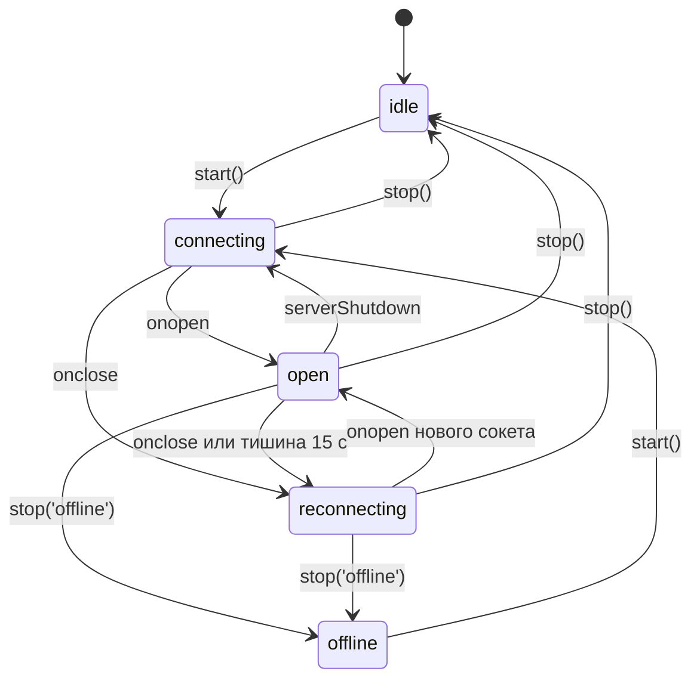

# Итоговый проект: живой рынок на Expo — system design, WebSocket, графики на Skia

Обновлено: 2026-10-21 · Тренинг 6 из 6 · ≈ 16 часов (+ ★ 13 часов) · Вакансия: [карточка](../../card.ru.md)

[1](06-websocket-demo-binance.md) · [2](06-websocket-demo-binance-part2.md) · [3](06-websocket-demo-binance-part3.md) · [4](06-websocket-demo-binance-part4.md) · Часть 5 из 11 · [6](06-websocket-demo-binance-part6.md) · [7](06-websocket-demo-binance-part7.md) · [8](06-websocket-demo-binance-part8.md) · [9](06-websocket-demo-binance-part9.md) · [10](06-websocket-demo-binance-part10.md) · [11](06-websocket-demo-binance-part11.md)

Этап 3 — ядро realtime-слоя, он занимает части 5 и 6. Здесь: требования, идеи, backoff, тестовый двойник и тесты-спецификация. В [части 6](06-websocket-demo-binance-part6.md) — каркас клиента, подсказки, проверка вживую и ревью.

## Этап 3. RealtimeClient по тестам-спецификации (3 ч)

**Цель.** Одно WebSocket-соединение на приложение: подписки со счётчиком ссылок, переподключение с backoff, свой heartbeat, лимиты Binance, чистый `stop()`. 16 unit-тестов без сети — зелёные, и ты объясняешь каждую строку.

**Шаги**

1. Требования и state diagram — сам (20 мин). Это же — раздел 8 твоего design doc.
2. `backoff.ts` сам, тесты готовые (15 мин). Та же формула, что в T13 ([тренинг 1, блок 4](../01-javascript-typescript/01-javascript-typescript-part4.md)).
3. `FakeSocket` и тесты-спецификация: скопировать, прочитать каждый тест, запустить — все красные (20 мин).
4. `RealtimeClient.ts` по каркасу, TODO 1 → 8, тесты зеленеют по одному (95 мин, часть 6).
5. Проверка вживую против Binance: `npx tsx scripts/live-check.ts` (10 мин).
6. Ревью: сам по чек-листу → Claude → Codex; таблица находок (20 мин).

**Требования.** Из них сделаны тесты; номер — порядок тестов ниже.

| # | Поведение | Зачем |
|---|---|---|
| 1 | `start()` идемпотентен: второй вызов не создаёт сокет | AppState и NetInfo зовут его много раз |
| 2 | подписки до `open` уходят одним `SUBSCRIBE` после `open` | лимит 5 сообщений в секунду |
| 3 | счётчик ссылок: 2 подписчика → один `SUBSCRIBE`; `UNSUBSCRIBE` — когда ушёл последний | одна подписка на сервере на поток |
| 4 | подписка и отписка до отправки → ничего не шлём | быстрый скролл |
| 5 | не чаще одного управляющего сообщения на 250 мс | лимит Binance; pong тоже считается |
| 6 | `{ stream, data }` — только подписчикам потока; ошибка одного не ломает других | изоляция |
| 7 | неожиданный close → reconnect с backoff; после `open` — заново все подписки | устойчивость |
| 8 | `attempt` растёт, пока сервер лежит, и сбрасывается после 10 с стабильного соединения | без шторма переподключений |
| 9 | сервер «принял и сразу закрыл» — задержки всё равно растут | лимит 300 соединений за 5 минут |
| 10 | тишина 10 с → `LIST_SUBSCRIPTIONS` как ping; 15 с → `close(4000)` и reconnect сами | «полуоткрытый» TCP на мобильных |
| 11 | пока идут данные, ping не нужен | лишний трафик |
| 12 | `serverShutdown` → новое соединение сразу | Binance предупреждает о рестарте |
| 13 | `stop()`: `close(1000)`, без reconnect, ноль таймеров | фон, офлайн, утечки |
| 14 | `stop()` отменяет ожидающий reconnect | иначе сокет «воскреснет» в фоне |
| 15 | события старого сокета игнорируются | иначе два соединения |
| 16 | заглавный символ и больше `maxStreams` потоков → ошибка сразу | ошибка регистра у Binance молчит; лимит 1024 |

**Ключевые идеи**

- **Full jitter.** `delay = random() × min(cap, base × 2^attempt)`, base 500 мс, cap 30 с ([AWS: Exponential Backoff and Jitter](https://aws.amazon.com/blogs/architecture/exponential-backoff-and-jitter/)). Экспонента бережёт сервер, jitter разводит тысячи клиентов во времени. При `random = 0.5`: 250, 500, 1000, 2000, 4000 мс…
- **Сверка вместо очереди команд.** Клиент хранит желаемое (`subs`: поток → подписчики) и то, что знает сервер (`serverStreams`). `flush()` шлёт разницу одним сообщением. После переподключения `serverStreams` пуст — уходит один `SUBSCRIBE` со всеми потоками. Идея как у React: желаемое состояние → минимальные изменения.
- **Heartbeat в JS.** Ping и pong JS не видит: их обрабатывают OkHttp (Android) и SocketRocket (iOS). Признак жизни — любое сообщение. Тишина 10 с → probe `LIST_SUBSCRIPTIONS`: ответ — тоже сообщение. Тишина 15 с → сокет мёртв: закрываем сами и не ждём `onclose`, его может не быть.
- **Старый сокет.** Каждый обработчик начинается с `if (ws !== this.ws) return`. `dropSocket()` обнуляет `this.ws` до `close()` — поздние события старого сокета упираются в эту проверку.
- **Коды закрытия** ([RFC 6455, раздел 7.4](https://www.rfc-editor.org/rfc/rfc6455#section-7.4)): 1000 — норма (наш `stop`); 1006 — аварийно, без close-кадра; 1008 — нарушение правил (у Binance — «Too many requests», «Invalid request»: баг клиента); 4000–4999 — коды приложения (наш 4000 = «тишина»).
- **Статус для UI**: `idle | connecting | open | reconnecting | offline` + `attempt` + `lastMessageAt` — вход баннера из [тренинга 3, блок 7](../03-ai-tools-claude-code-codex/03-ai-tools-claude-code-codex-part3.md) плюс `idle` (клиент остановлен). `onStatus` зовём при смене статуса и не чаще раза в секунду на сообщениях.

**Попробуй сам** (без AI). Нарисуй в mermaid state diagram статусов. События: `start()`, `stop()`, `stop('offline')`, `onopen`, `onclose`, тишина 15 с, `serverShutdown`.

> ⛔ **Не подсматривай, пока не нарисуешь.** Ниже — сверка.



### Backoff (15 мин, сам)

`src/realtime/backoff.ts` — экспортируй `BackoffOptions = { baseMs; maxMs }`, `DEFAULT_BACKOFF = { baseMs: 500, maxMs: 30_000 }` и `fullJitterDelay(attempt, opts = DEFAULT_BACKOFF, random = Math.random): number`. Подсказка: `2 ** 10_000` — это `Infinity`; при `baseMs = 0` получится `0 × Infinity = NaN` — ограничь показатель степени (например, 30).

```ts
// src/realtime/backoff.test.ts
import { fullJitterDelay } from './backoff';

const opts = { baseMs: 500, maxMs: 30_000 };

test('the cap doubles with every attempt and stops at maxMs', () => {
  const half = () => 0.5;
  expect([0, 1, 2, 3, 5, 6, 20].map((a) => fullJitterDelay(a, opts, half))).toEqual([
    250, 500, 1000, 2000, 8000, 15_000, 15_000, // 500 × 2^6 = 32 000 → потолок 30 000
  ]);
});

test('full jitter: from 0 up to (not including) the cap', () => {
  expect(fullJitterDelay(3, opts, () => 0)).toBe(0);
  expect(fullJitterDelay(3, opts, () => 0.999_999)).toBe(3999);
});

test('a huge attempt number does not produce Infinity or NaN', () => {
  expect(fullJitterDelay(10_000, opts, () => 0.5)).toBe(15_000);
});
```

### Тестовый двойник: FakeSocket (готовый)

Клиент получает фабрику сокетов (`createSocket`). В тестах это `FakeSocket`: сети нет, события вызывает сам тест.

```ts
// src/test/FakeSocket.ts
export class FakeSocket {
  static instances: FakeSocket[] = [];
  readyState = 0; // CONNECTING
  sent: unknown[] = []; // что клиент отправил (уже JSON.parse)
  closedWith: { code?: number; reason?: string } | null = null;
  onopen: ((ev: unknown) => void) | null = null;
  onmessage: ((ev: { data: string }) => void) | null = null;
  onerror: ((ev: unknown) => void) | null = null;
  onclose: ((ev: { code: number; reason: string }) => void) | null = null;
  readonly url: string;

  constructor(url: string) {
    this.url = url;
    FakeSocket.instances.push(this);
  }

  static last(): FakeSocket {
    const s = FakeSocket.instances.at(-1);
    if (!s) throw new Error('no socket was created');
    return s;
  }

  send(data: string) {
    this.sent.push(JSON.parse(data));
  }

  close(code?: number, reason?: string) {
    this.closedWith = { code, reason };
    this.readyState = 2; // CLOSING; onclose придёт, только если тест вызовет serverClose()
  }

  // --- управление из теста ---
  serverOpen() {
    this.readyState = 1;
    this.onopen?.({});
  }

  serverSend(msg: unknown) {
    this.onmessage?.({ data: JSON.stringify(msg) });
  }

  serverSendRaw(data: string) {
    this.onmessage?.({ data });
  }

  serverClose(code = 1006, reason = '') {
    this.readyState = 3;
    this.onclose?.({ code, reason });
  }
}
```

### Тесты-спецификация (готовые)

Как читать: `jest.useFakeTimers()` подменяет `setTimeout`, `setInterval` и `Date.now()` — время идёт только в `jest.advanceTimersByTime(ms)`. `random: () => 0.5` делает jitter предсказуемым. `jest.getTimerCount()` ловит утечки таймеров. Сообщения об ошибках, которые ждут тесты: `'Not JSON'`, `…lowercase…`, `…max 2…`.

```ts
// src/realtime/RealtimeClient.test.ts
import { FakeSocket } from '../test/FakeSocket';
import { RealtimeClient, type ConnectionSnapshot } from './RealtimeClient';

const URL = 'wss://example.test/stream';
const BTC = 'btcusdt@miniTicker';
const ETH = 'ethusdt@miniTicker';

function setup() {
  const statuses: ConnectionSnapshot[] = [];
  const errors: string[] = [];
  const client = new RealtimeClient({
    url: URL,
    createSocket: (url) => new FakeSocket(url) as unknown as WebSocket,
    random: () => 0.5, // jitter без случайности: задержка = половина «потолка»
    onStatus: (s) => statuses.push(s),
    onError: (e) => errors.push(e.message),
  });
  return { client, statuses, errors };
}

const sentMethods = (s: FakeSocket) => s.sent.map((m) => (m as { method: string }).method);

beforeEach(() => {
  jest.useFakeTimers();
  FakeSocket.instances = [];
});
afterEach(() => jest.useRealTimers());

test('start(): one socket, connecting → open; a second start() does nothing', () => {
  const { client, statuses } = setup();
  client.start();
  client.start();
  expect(FakeSocket.instances).toHaveLength(1);
  expect(client.getSnapshot().status).toBe('connecting');
  FakeSocket.last().serverOpen();
  expect(statuses.at(-1)?.status).toBe('open');
});

test('subscriptions made before open go out as ONE SUBSCRIBE after open', () => {
  const { client } = setup();
  client.subscribe(BTC, jest.fn());
  client.subscribe(ETH, jest.fn());
  client.start();
  const ws = FakeSocket.last();
  ws.serverOpen();
  jest.advanceTimersByTime(0);
  expect(ws.sent).toEqual([{ method: 'SUBSCRIBE', params: [BTC, ETH], id: 1 }]);
});

test('reference counting: one SUBSCRIBE for two subscribers, UNSUBSCRIBE after the last one leaves', () => {
  const { client } = setup();
  client.start();
  const ws = FakeSocket.last();
  ws.serverOpen();
  const onTick = jest.fn(); // одна и та же функция у двух экранов — всё равно 2 ссылки
  const off1 = client.subscribe(BTC, onTick);
  const off2 = client.subscribe(BTC, onTick);
  jest.advanceTimersByTime(0);
  off1();
  off1(); // повторный вызов — без эффекта
  jest.advanceTimersByTime(1_000);
  expect(sentMethods(ws)).toEqual(['SUBSCRIBE']);
  off2();
  jest.advanceTimersByTime(1_000);
  expect(ws.sent.at(-1)).toMatchObject({ method: 'UNSUBSCRIBE', params: [BTC] });
});

test('subscribe + unsubscribe before the flush → nothing is sent', () => {
  const { client } = setup();
  client.start();
  const ws = FakeSocket.last();
  ws.serverOpen();
  const off = client.subscribe(BTC, jest.fn());
  off();
  jest.advanceTimersByTime(1_000);
  expect(ws.sent).toEqual([]);
});

test('at most one control message per 250 ms (Binance limit: 5 per second)', () => {
  const { client } = setup();
  client.start();
  const ws = FakeSocket.last();
  ws.serverOpen();
  const symbols = ['btcusdt', 'ethusdt', 'solusdt', 'xrpusdt', 'adausdt', 'bnbusdt'];
  for (const s of symbols) {
    client.subscribe(`${s}@miniTicker`, jest.fn());
    jest.advanceTimersByTime(50); // пользователь быстро листает
  }
  jest.advanceTimersByTime(2_000);
  expect(ws.sent.length).toBeLessThanOrEqual(3); // 6 изменений склеились в 2–3 сообщения
  const params = ws.sent.flatMap((m) => (m as { params: string[] }).params);
  expect(new Set(params).size).toBe(symbols.length); // и все подписки дошли
});

test('routes { stream, data } only to listeners of that stream; a throwing listener does not break others', () => {
  const { client, errors } = setup();
  const onBtc = jest.fn();
  const onEth = jest.fn();
  client.subscribe(BTC, () => {
    throw new Error('boom');
  });
  client.subscribe(BTC, onBtc);
  client.subscribe(ETH, onEth);
  client.start();
  const ws = FakeSocket.last();
  ws.serverOpen();
  ws.serverSend({ stream: BTC, data: { s: 'BTCUSDT', c: '84710.6' } });
  ws.serverSend({ result: null, id: 1 }); // ответ на SUBSCRIBE — не данные
  ws.serverSendRaw('not json'); // мусор не роняет клиент
  expect(onBtc).toHaveBeenCalledWith({ s: 'BTCUSDT', c: '84710.6' });
  expect(onEth).not.toHaveBeenCalled();
  expect(errors).toEqual(['boom', 'Not JSON']);
});

test('unexpected close → reconnect with backoff, then re-subscribe on the new socket', () => {
  const { client } = setup();
  client.subscribe(BTC, jest.fn());
  client.start();
  FakeSocket.last().serverOpen();
  FakeSocket.last().serverClose(1006);
  expect(client.getSnapshot()).toMatchObject({ status: 'reconnecting', attempt: 1 });
  jest.advanceTimersByTime(249); // attempt 0: 0.5 × 500 мс = 250 мс
  expect(FakeSocket.instances).toHaveLength(1);
  jest.advanceTimersByTime(1);
  expect(FakeSocket.instances).toHaveLength(2);
  const ws2 = FakeSocket.last();
  ws2.serverOpen();
  jest.advanceTimersByTime(0);
  expect(ws2.sent).toEqual([{ method: 'SUBSCRIBE', params: [BTC], id: expect.any(Number) }]);
});

test('backoff grows while the server is down; attempt resets after 10 s of a stable connection', () => {
  const { client } = setup();
  client.start();
  const delays: number[] = [];
  for (let i = 0; i < 5; i++) {
    FakeSocket.last().serverClose(1006);
    const before = FakeSocket.instances.length;
    let waited = 0;
    while (FakeSocket.instances.length === before) {
      jest.advanceTimersByTime(10);
      waited += 10;
    }
    delays.push(waited);
  }
  expect(delays).toEqual([250, 500, 1000, 2000, 4000]);
  FakeSocket.last().serverOpen();
  jest.advanceTimersByTime(10_000);
  expect(client.getSnapshot()).toMatchObject({ status: 'open', attempt: 0 });
});

test('a server that accepts and drops at once still gets growing delays (no reset on open)', () => {
  const { client } = setup();
  client.start();
  for (const expected of [250, 500, 1000]) {
    FakeSocket.last().serverOpen();
    FakeSocket.last().serverClose(1008, 'Too many requests');
    const before = FakeSocket.instances.length;
    jest.advanceTimersByTime(expected - 1);
    expect(FakeSocket.instances).toHaveLength(before);
    jest.advanceTimersByTime(1);
    expect(FakeSocket.instances).toHaveLength(before + 1);
  }
});

test('silent connection: probe at 10 s, at 15 s close it ourselves and reconnect', () => {
  const { client } = setup();
  client.start();
  const ws = FakeSocket.last();
  ws.serverOpen();
  jest.advanceTimersByTime(10_000);
  expect(sentMethods(ws)).toEqual(['LIST_SUBSCRIPTIONS']);
  jest.advanceTimersByTime(5_000);
  expect(ws.closedWith?.code).toBe(4000);
  expect(client.getSnapshot().status).toBe('reconnecting'); // не ждём onclose «полуоткрытого» сокета
  jest.advanceTimersByTime(250);
  expect(FakeSocket.instances).toHaveLength(2);
});

test('messages keep the connection alive: no probe while data flows', () => {
  const { client } = setup();
  client.start();
  const ws = FakeSocket.last();
  ws.serverOpen();
  for (let i = 0; i < 30; i++) {
    jest.advanceTimersByTime(1_000);
    ws.serverSend({ stream: BTC, data: {} });
  }
  expect(ws.sent).toEqual([]);
  expect(client.getSnapshot().status).toBe('open');
});

test('serverShutdown → new connection right away, without backoff', () => {
  const { client } = setup();
  client.start();
  FakeSocket.last().serverOpen();
  FakeSocket.last().serverSend({ stream: '!serverShutdown', data: { e: 'serverShutdown', E: 1 } });
  expect(FakeSocket.instances).toHaveLength(2);
  expect(FakeSocket.instances[0]?.closedWith?.code).toBe(1000);
});

test('stop(): close 1000, no reconnect, no timers left', () => {
  const { client } = setup();
  client.subscribe(BTC, jest.fn());
  client.start();
  const ws = FakeSocket.last();
  ws.serverOpen();
  client.stop('offline');
  expect(ws.closedWith?.code).toBe(1000);
  ws.serverClose(1000); // позднее событие старого сокета
  jest.advanceTimersByTime(60_000);
  expect(FakeSocket.instances).toHaveLength(1);
  expect(client.getSnapshot().status).toBe('offline');
  expect(jest.getTimerCount()).toBe(0);
});

test('stop() while waiting for a reconnect cancels it', () => {
  const { client } = setup();
  client.start();
  FakeSocket.last().serverClose(1006);
  expect(client.getSnapshot().status).toBe('reconnecting');
  client.stop('idle');
  jest.advanceTimersByTime(60_000);
  expect(FakeSocket.instances).toHaveLength(1);
  expect(jest.getTimerCount()).toBe(0);
});

test('a late close of an old socket does not create a second connection', () => {
  const { client } = setup();
  client.start();
  const ws1 = FakeSocket.last();
  ws1.serverOpen();
  ws1.serverSend({ stream: '!serverShutdown', data: {} }); // → ws2
  ws1.serverClose(1006); // старый сокет закрылся позже
  jest.advanceTimersByTime(60_000);
  expect(FakeSocket.instances).toHaveLength(2);
});

test('guards: uppercase symbol and more than maxStreams are rejected', () => {
  const client = new RealtimeClient({ url: URL, maxStreams: 2, createSocket: (u) => new FakeSocket(u) as unknown as WebSocket });
  expect(() => client.subscribe('BTCUSDT@miniTicker', jest.fn())).toThrow(/lowercase/);
  expect(() => client.subscribe('!miniTicker@arr', jest.fn())).not.toThrow();
  client.subscribe(BTC, jest.fn());
  expect(() => client.subscribe(ETH, jest.fn())).toThrow(/max 2/);
});
```

Тесты проверены на эталонной реализации и на 12 намеренно сломанных версиях: каждая поломка роняет хотя бы один тест. Среди поломок — нет защиты от старого сокета, сброс `attempt` на `open`, `stop()` без отмены reconnect, нет probe, подписчики в `Set` функций. Если твой код проходит все 16 — типичные баги закрыты.

**Самопроверка (до каркаса)**

- Какой тест упадёт, если сбрасывать `attempt` в `onopen`? Почему это опасно на проде?
- Зачем в тесте 3 одна и та же функция `onTick` для двух подписок?
- Что проверяет `jest.getTimerCount()` и какой баг он ловит?

[Дальше: часть 6 — каркас клиента, проверка вживую, жизненный цикл и стор →](06-websocket-demo-binance-part6.md)
