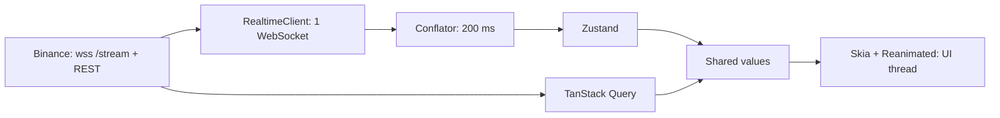

# Итоговый проект: живой рынок на Expo — system design, WebSocket, графики на Skia

Обновлено: 2026-10-21 · Тренинг 6 из 6 · ≈ 16 часов (+ ★ 13 часов) · Вакансия: [карточка](../../card.ru.md)

[1](06-websocket-demo-binance.md) · [2](06-websocket-demo-binance-part2.md) · [3](06-websocket-demo-binance-part3.md) · [4](06-websocket-demo-binance-part4.md) · [5](06-websocket-demo-binance-part5.md) · [6](06-websocket-demo-binance-part6.md) · [7](06-websocket-demo-binance-part7.md) · [8](06-websocket-demo-binance-part8.md) · Часть 9 из 11 · [10](06-websocket-demo-binance-part10.md) · [11](06-websocket-demo-binance-part11.md)

Этап 8 — наблюдаемость и проверка качества. Этап 9 — публикация на GitHub; его вторая половина (walkthrough и рассказ) — в [части 10](06-websocket-demo-binance-part10.md).

## Этап 8. Качество и наблюдаемость: dev-оверлей, замеры, мутации (0,75 ч)

**Цель.** Ты видишь, что происходит внутри, и доказываешь качество цифрами: сообщения, задержка, FPS, рендеры, упавшие под мутациями тесты.

**Что нужно знать**

- Задержка «биржа → приложение» = время получения + поправка часов − `E` биржи. Часы телефона врут на сотни миллисекунд, поэтому поправка — по `GET /api/v3/time`, как в NTP: сервер ответил в середине запроса.
- p95 честнее среднего: одна долгая пауза GC не видна в среднем, но видна пользователю.
- `PerformanceMonitor` из Reanimated 4.7 показывает FPS JS- и UI-потока. В debug-сборке цифры хуже реальных — сравнивай режимы между собой. Абсолютные числа — из release-сборки `preview`: в ней dev-оверлей включён флагом `EXPO_PUBLIC_DEV_OVERLAY=1` из `eas.json`. Без оверлея — Profile HWUI rendering в настройках разработчика Android: зелёная линия — 16,67 мс.
- Мутационное мышление: тест полезен, только если падает, когда код сломан ([тренинг 3, блок 8](../03-ai-tools-claude-code-codex/03-ai-tools-claude-code-codex-part3.md)).

**Шаги** (45 мин)

1. **Метрики и оверлей** (20 мин). Готовое — `src/dev/metrics.ts`:
   ```ts
   // Наблюдаемость без SDK: счётчики и задержка «биржа → приложение». Читает dev-оверлей раз в секунду.
   export const metrics = {
     messages: 0, // сообщений с данными
     invalid: 0, // не прошли Zod
     reconnects: 0, // переходов в reconnecting
     gaps: 0, // дыр в свечах или стакане → resync
     clockOffsetMs: 0, // serverTime − часы телефона
     latency: [] as number[], // последние 200 значений, мс
   };

   const MAX_SAMPLES = 200;

   export function recordLatency(eventTime: number, receivedAt = Date.now()): void {
     metrics.latency.push(receivedAt + metrics.clockOffsetMs - eventTime);
     if (metrics.latency.length > MAX_SAMPLES) metrics.latency.shift();
   }

   // Как в NTP: считаем, что сервер ответил в середине запроса
   export function estimateClockOffset(sentAt: number, serverTime: number, receivedAt: number): number {
     return serverTime - (sentAt + receivedAt) / 2;
   }

   // p-й перцентиль, nearest-rank: p95 из 200 значений — 190-е по возрастанию
   export function percentile(values: readonly number[], p: number): number | null {
     if (values.length === 0) return null;
     const sorted = [...values].sort((a, b) => a - b);
     const rank = Math.ceil((p / 100) * sorted.length);
     return sorted[Math.min(sorted.length, Math.max(1, rank)) - 1]!;
   }
   ```
   Тест — `src/dev/metrics.test.ts`: `percentile` от 1…100 даёт 50 и 95, пустой массив — `null`; `estimateClockOffset(1000, 1350, 1100)` = 300. В `client.ts` — `syncClock()`: `sentAt = Date.now()` → `fetchServerTime()` → `metrics.clockOffsetMs = estimateClockOffset(…)`; зови её один раз в `_layout.tsx` (`useEffect`, ошибку сети — проглотить: задержку покажем без поправки). `recordLatency(r.data.E)` — в `onMini` потока watchlist.

   `src/dev/DevOverlay.tsx` — кнопка «dev» в углу; раз в секунду (`setInterval` в эффекте, только когда панель открыта) — `msg/s`, `invalid`, `reconnects`, `gaps`, задержка p50 / p95 и `<PerformanceMonitor />`. Показывается в dev и в preview: `const ENABLED = __DEV__ || process.env.EXPO_PUBLIC_DEV_OVERLAY === '1'` (переменные `EXPO_PUBLIC_` попадают в бандл при сборке); иначе — `null`. Стили — `className`: `absolute top-12 right-2`, панель `rounded-lg border border-border bg-surface p-2`, строки `text-[11px] tabular-nums text-fg`. В `_layout.tsx` он уже стоит рядом с баннером (этап 4).
2. **Замеры** (15 мин). В начале этапа запусти `eas build -p android --profile preview`: облако соберёт release-APK, пока ты делаешь шаги 1 и 3. Заполни таблицу на одном устройстве — это твои числа для README и интервью; release-строку — если APK успел, иначе в ★ D:

   | Сценарий | Сообщений/с | Рендеров строк/с | FPS UI / JS | Задержка p50 / p95 |
   |---|---|---|---|---|
   | watchlist, батч 200 мс | | | | |
   | stress (+ trade), батч 200 мс | | | | |
   | stress, без батча | | | | |
   | график: pan и pinch 10 с | — | — | | — |
   | график: pan и pinch 10 с, `preview` (release) | — | — | | — |

3. **Мутации** (10 мин). По одной поломке за раз; после каждой — `npx jest src/realtime src/store src/chart`, запиши, какой тест упал, верни код.

   | Поломка | Должен упасть |
   |---|---|
   | убрать `if (ws !== this.ws) return` в `onclose` | «a late close of an old socket…» |
   | `attempt = 0` в `onopen` | «a server that accepts and drops…» |
   | `stop()` не отменяет reconnect-таймер | «stop() while waiting for a reconnect…» |
   | conflator заменяет значение вместо слияния полей | «fields of different streams are merged…» |
   | `upsertCandle` на дыре всё равно добавляет свечу | «upsertCandle: … a hole is a gap» |
   | `zoomAt` считает от правого края, а не от `focalX` | «zoomAt: the candle under the fingers stays in place» |

   Последние две поломки проверены на эталоне 2026-10-21: каждая роняет свой тест.

**Критерии приёмки**

- [ ] Dev-оверлей показывает живые цифры; в режиме полёта растут `reconnects`, а не `msg/s`.
- [ ] Таблица замеров заполнена твоими числами (dev и, если успел, `preview`); 6 мутаций роняют тесты (результаты — в `NOTES.md`).
- [ ] `npm test -- --coverage`: `RealtimeClient.ts` ≥ 90% строк, `src/chart` — 100% функций.

**Самопроверка**

- Как измерить задержку, если часы телефона отстают на 300 мс?
- UI 60 FPS, JS 25 FPS — что работает плавно, а что тормозит?
- Как убедиться, что тест вообще что-то проверяет?

**Готово, когда…** на «как ты это проверял?» ты отвечаешь тремя уровнями тестов и тремя числами из таблицы.

## Этап 9. Open source: репозиторий, README, релиз, профиль (1 ч)

**Цель.** Публичный репозиторий, который не стыдно открыть на интервью: понятный README с гифкой и цифрами, лицензия, шаблоны, зелёный CI, релиз `v0.1.0`, закреплён в профиле. Плюс репетиция рассказа — [часть 10](06-websocket-demo-binance-part10.md).

**Что нужно знать**

- Интервьюер смотрит 1–2 минуты: README сверху вниз, структуру папок, один-два файла (`RealtimeClient.ts`, `CandleChart.tsx` и тесты). Сверху — что это, гифка, цифры.
- **Лицензия.** Без лицензии действует обычное авторское право: никто не может законно копировать и менять код ([GitHub Docs](https://docs.github.com/en/repositories/managing-your-repositorys-settings-and-features/customizing-your-repository/licensing-a-repository)). MIT — короткая разрешительная лицензия; [choosealicense.com](https://choosealicense.com/) советует брать лицензию, принятую в твоём сообществе, — React Native, Expo, Reanimated и Skia распространяются под MIT.
- **Правило честности:** в README и в рассказе — только то, что сделал и измерил сам. Числа в `[квадратных скобках]` замени своими или убери.
- Публикуешь ты сам. Агенту не давай права на `git push` и на смену видимости репозитория.

**Шаги** (60 мин: 35 — здесь, 25 — репетиция в части 10)

1. **Файлы репозитория** (10 мин, черновики — с AI, решения — твои):

   | Файл | Что внутри |
   |---|---|
   | `LICENSE` | MIT, `Copyright (c) 2026 <Имя Фамилия>` (создан на этапе 0) |
   | `CONTRIBUTING.md` | как собрать dev build и запустить, проверки перед PR, Conventional Commits, «ядро — учебное, PR с готовым ядром не принимаю» |
   | `SECURITY.md` | как сообщить об уязвимости: GitHub private vulnerability reporting; ключей и секретов в проекте нет |
   | `CHANGELOG.md` | формат [Keep a Changelog](https://keepachangelog.com/en/1.1.0/); `## [0.1.0] - 2026-10-xx` |
   | `.github/ISSUE_TEMPLATE/bug_report.yml` | issue form: что случилось, устройство и ОС, сборка (dev build / preview / локальный release), логи |
   | `.github/ISSUE_TEMPLATE/config.yml` | `blank_issues_enabled: false`; ссылка на приватный отчёт об уязвимости |
   | `.github/pull_request_template.md` | что и зачем; как проверил (`typecheck`, `lint`, `test`, dev build на устройстве); была ли нативная правка и пересобран ли dev build; что сделал AI и что проверил ты; скриншот |
   | `.github/release.yml` | категории для автоматических release notes: Features, Fixes, Other |

   Кусок для сверки — issue form:
   ```yaml
   name: Bug report
   description: Something does not work as expected
   labels: [bug]
   body:
     - type: textarea
       id: what
       attributes:
         label: What happened?
         description: Steps to reproduce, what you expected, what you saw.
       validations:
         required: true
     - type: dropdown
       id: runtime
       attributes:
         label: How do you run the app?
         options:
           - Development build (debug, with Metro)
           - Preview build (release APK from EAS)
           - Local release build (npx expo run:android --variant release)
       validations:
         required: true
   ```
2. **README** (15 мин). Шаблон ниже, на простом английском. AI может поправить язык; факты и числа проверяешь сам.
3. **Запись экрана** (5 мин). Лучше в `preview`-сборке: без меню разработчика. Android: `adb shell screenrecord /sdcard/demo.mp4` (стоп — `Ctrl+C`), `adb pull /sdcard/demo.mp4`. 20–30 секунд: список со вспышками → экран символа → pan, pinch, перекрестие → режим полёта и баннер. Видео перетащи в README в веб-редакторе GitHub или сделай GIF до ≈ 5 МБ в `docs/media/`.
4. **Публикация и профиль** (5 мин; topics и social preview — ★ F):
   - проверка перед открытием: в истории и в файлах нет `.env`, ключей, личных данных; `NOTES.md` — в `.gitignore`; отладочные логи только под `__DEV__`;
   - Settings → General → Change visibility → Public; включи Issues и private vulnerability reporting (Settings → Security);
   - описание: «React Native (Expo SDK 58) realtime market demo: WebSocket client, Skia candlestick charts, UI-thread animations, Uniwind styling. Not affiliated with Binance.»;
   - релиз: тег `v0.1.0`, GitHub Release с автоматическими release notes; `CHANGELOG.md` обновлён;
   - закрепи репозиторий в профиле `github.com/yevhenjl` (до 6 закреплённых).

**Шаблон README**

````markdown
# rn-realtime-market

Realtime market data in React Native (Expo SDK 58, development build): a hand-written WebSocket client,
Skia candlestick charts with pan, pinch-zoom and a crosshair, list rows that update on the UI thread,
and Uniwind (Tailwind CSS 4) styling with a dark theme.

> Demo project (October 2026). Market data: Binance public API, no API key.
> Not affiliated with, endorsed or sponsored by Binance. Not financial advice: prices may be delayed or wrong.


## What it shows
- Realtime client: one WebSocket, reference-counted subscriptions, reconciliation within the limit of
  5 messages per second, full-jitter backoff, its own heartbeat, serverShutdown, AppState + NetInfo.
- No re-renders on ticks: conflation → one store update per 200 ms → rows read the store outside React
  and update shared values ([N] row renders per second, measured with React Profiler).
- Skia charts on the UI thread: 500 candles from REST plus a live candle every 2 s with rollover,
  pan with inertia, pinch-zoom around the fingers, crosshair with OHLC, price axis, volume.
- Pure, tested chart math: scales, viewport, nice ticks, candle rollover (src/chart).

## Architecture

Design doc: [docs/design.md](docs/design.md) · Decisions: [docs/adr](docs/adr)

## Quick start
The app runs in a development build (expo-dev-client), not in Expo Go. You need Node 24 (.nvmrc)
and an Android phone or emulator.

```bash
npm ci
npx eas-cli@latest build -p android --profile development   # option A: build in the cloud, install the APK
npm run android                                             # option B: build locally (Android Studio, JDK 17, SDK 37)
npx expo start                                              # then every day: Metro for the development build
```
iOS: `npm run ios` on a Mac with Xcode 26.4+, or an EAS build with `--profile development-simulator`.
Release APK for testing: `npx eas-cli@latest build -p android --profile preview`.

## Styling
Uniwind (Tailwind CSS 4): `className` on React Native components, theme tokens in `src/global.css` (dark by default).
Skia and Reanimated read the same tokens via `useCSSVariable`. Animations use Reanimated, not `className`.

## Scripts
| Command | What it does |
|---|---|
| `npm run android` · `npm run ios` | build and run the development build locally |
| `npx expo start` | Metro for the development build |
| `npm test` | unit and integration tests, no network |
| `npm run typecheck` | Uniwind types, then TypeScript strict |
| `npx expo lint --max-warnings 0` | ESLint with React Compiler rules |
| `npx tsx scripts/live-check.ts` | the realtime client against the live stream |

## Tests
[N] tests: pure logic; the client with a fake socket and fake timers (16 spec tests); REST without network.
Mutation check: [N] deliberate bugs, each one fails a test. CI runs without network.

## Performance (measured on [device], [build: preview / release], [date])
| Scenario | Messages/s | Row renders/s | UI FPS | JS FPS |
|---|---|---|---|---|
| Watchlist, 20 symbols | [ ] | [ ] | [ ] | [ ] |
| Stress mode (trades) | [ ] | [ ] | [ ] | [ ] |
| Chart: pan and pinch | — | — | [ ] | [ ] |

Latency exchange → app: p50 [ ] ms, p95 [ ] ms (clock offset corrected).

## Limitations and roadmap
- Public market data only: no orders, accounts or private streams. Binance may be unavailable in some regions.
- Next: subscriptions by visible rows; timeframes; Skia 3 (Graphite) once it settles: it needs Vulkan 1.1 and Android 8+.

## License
MIT — see [LICENSE](LICENSE). AI tools (Claude Code, Codex) were used for reviews; the core is written by me.
````

### Право и этика: чек-лист перед публикацией

Это не юридическая консультация. Условия Binance зависят от юрисдикции и меняются — перечитай их перед публикацией.

- **Что говорят условия** (проверено 2026-10-21):
  - Terms of Use со страницы binance.com/en/terms (PDF, редакция для юрлиц ADGM, действует с 2026-07-21): лицензия на Binance IP — «for non-commercial personal or internal business use» и «excluding the Trade Marks» (п. 27); нарушать товарные знаки запрещено (п. 31.1(d)).
  - Редакция 2021 года (цитата в issue Superalgos #1019): без письменного согласия запрещены коммерческие «data feeding or streaming services that make use of any market data of Binance» и приложения, которые зарабатывают на этих данных, в том числе на рекламе и реферальных ссылках.
  - Binance.US — другая компания, но подход тот же (редакция 2026-06-05): лицензия — для некоммерческого личного использования, без «public display» материалов, в том числе полученных через API.
- **Что из этого следует для демо:**
  - [ ] Проект некоммерческий: без рекламы, платных функций, реферальных ссылок и кнопок «торговать».
  - [ ] Это не «data feeding / streaming service»: своего сервера-ретранслятора нет, каждое устройство подключается к Binance напрямую; в репозитории — несколько фикстур, а не записи потока.
  - [ ] Никаких логотипов, цветов и шрифтов бренда Binance в иконке, названии и social preview. Имя Binance — только как источник данных.
  - [ ] Дисклеймер в README и в приложении (подпись на экране символа): «Market data: Binance public API. Not affiliated with Binance. Not financial advice.»
  - [ ] Ключей и секретов нет; push protection для пользователей GitHub включена по умолчанию — не отключай.
  - [ ] Лицензии зависимостей — MIT / Apache-2.0. Возьмёшь TradingView Lightweight Charts — нужны атрибуция и ссылка на tradingview.com.
  - [ ] Коммерческое использование или публикация в сторе — только после письменного согласия провайдера данных и консультации юриста.
- Геймификация (★ C) — без денег и ставок; ESMA, FCA, CySEC — [тренинг 2, блок 9](../02-trading-app-architecture/02-trading-app-architecture-part3.md).

### Гигиена репозитория

- Ветка на этап (`feat/realtime-client`, `feat/candle-chart`, `docs/design`) → PR по шаблону → зелёный CI → AI-ревью в чистом контексте (`rn-reviewer`, Codex `/review`) → squash merge. Даже когда пишешь один: история PR — доказательство процесса ([тренинг 3, блок 7](../03-ai-tools-claude-code-codex/03-ai-tools-claude-code-codex-part3.md)).
- Заголовки PR — [Conventional Commits 1.0.0](https://www.conventionalcommits.org/en/v1.0.0/): `feat: pinch-zoom around the fingers`, `fix: ignore a late close of an old socket`, `test: spec for upsertCandle gap`, `docs: ADR 0003 react-native-skia 2.15`.
- Версии — [SemVer 2.0.0](https://semver.org/spec/v2.0.0.html): `v0.1.0` после этапа 9, `v0.2.0` — ★ стакан.
- В каждом PR — строка «что сделал AI, что проверил я». На интервью это готовый ответ про работу с AI ([тренинг 3, блок 10](../03-ai-tools-claude-code-codex/03-ai-tools-claude-code-codex-part4.md)).
- ★ F: ruleset для `main` — merge только через PR и на зелёном CI.

### Резюме и LinkedIn

Честно: это демо, а не продакшен. Формулировки — черновик, правишь сам; резюме живут в `diary/cv/`.

- Резюме, раздел Projects: «**rn-realtime-market** — open-source demo project (2026-10). React Native (Expo SDK 58, development build with EAS): hand-written WebSocket client (full-jitter backoff, heartbeat, subscription reconciliation within Binance limits), Skia candlestick chart with pan, pinch-zoom and crosshair on the UI thread, Zustand + TanStack Query, Uniwind (Tailwind CSS 4), [N] tests, CI. github.com/yevhenjl/rn-realtime-market».
- В русской версии резюме и в рассказе — та же пометка: «демо-проект, 2026-10». Не ставь проект в раздел «Опыт работы» и не пиши «в продакшене».
- LinkedIn: ссылка в Featured; короткий пост с гифкой и тремя пунктами — что построил, что измерил, чему научился. Без слов «production» и «used by».
- На интервью: «WebSocket в продакшене я не делал — поэтому спроектировал и построил демо. Могу показать дизайн за 5 минут» → walkthrough из [части 10](06-websocket-demo-binance-part10.md).

**Критерии приёмки этапа 9**

- [ ] Репозиторий публичный: README по шаблону с твоими числами, запись экрана, зелёный CI, релиз `v0.1.0`.
- [ ] Чек-лист «право и этика» пройден; дисклеймер — в README и в приложении.
- [ ] Описание, релиз `v0.1.0`; репозиторий закреплён в профиле (topics и social preview — ★ F).
- [ ] Репетиция из части 10: walkthrough за 5–7 минут и рассказ за 2 минуты — без бумажки.

**Самопроверка**

- Что интервьюер увидит за первые 30 секунд в репозитории?
- Почему проект некоммерческий и как это видно со стороны?
- Какие 3 числа ты назовёшь на «как ты это проверял?»

**Готово, когда…** ссылку не стыдно вставить в резюме, а в README нет ни одного непроверенного утверждения.

[Дальше: часть 10 — system design walkthrough, вопросы, рассказ на 2 минуты, mock-интервью →](06-websocket-demo-binance-part10.md)
