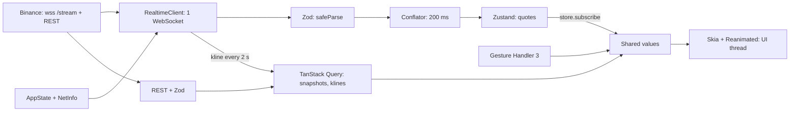

# Итоговый проект: живой рынок на Expo — system design, WebSocket, графики на Skia

Обновлено: 2026-10-21 · Тренинг 6 из 6 · ≈ 16 часов (+ ★ 13 часов) · Вакансия: [карточка](../../card.ru.md)

Часть 1 из 11 · [2](06-websocket-demo-binance-part2.md) · [3](06-websocket-demo-binance-part3.md) · [4](06-websocket-demo-binance-part4.md) · [5](06-websocket-demo-binance-part5.md) · [6](06-websocket-demo-binance-part6.md) · [7](06-websocket-demo-binance-part7.md) · [8](06-websocket-demo-binance-part8.md) · [9](06-websocket-demo-binance-part9.md) · [10](06-websocket-demo-binance-part10.md) · [11](06-websocket-demo-binance-part11.md)

## Что это за проект

Это capstone всей программы: одно open-source приложение, в котором сходятся тренинги 1–5. Ты строишь его сам, AI — репетитор и ревьюер. Потом показываешь репозиторий на техническом интервью в IBIT.

- **Что строим.** `rn-realtime-market` — приложение на Expo SDK 58 в development build (не в Expo Go) с живыми данными из публичного WebSocket Binance, без API-ключа. Стили — Uniwind: Tailwind CSS 4 через `className`, тёмная тема по умолчанию. Watchlist из 20 криптопар: цена, вспышка, изменение за 24 ч, sparkline на Skia. Экран символа: свечной график в реальном времени — история по REST, живая свеча из потока, pan, pinch-zoom, перекрестие с OHLC, шкала цен, объём, линия последней цены. ★ — стакан с графиком глубины, лента сделок, мини-игра «прогноз цены».
- **Что он доказывает** — пять тем, которые почти наверняка проверит Senior Frontend трейдинговой платформы:
  1. **System design.** `docs/design.md` и ADR: требования, лимиты Binance, оценки нагрузки, сбои, trade-offs. Ты защищаешь дизайн за 5–7 минут.
  2. **Realtime.** Свой `RealtimeClient`: подписки, переподключение, heartbeat, лимиты; 16 тестов-спецификаций.
  3. **Производительность.** Тики идут мимо React: conflation, transient updates, shared values. Доказательство — цифры Profiler и Perf Monitor.
  4. **Графики и анимации на UI-потоке.** Skia + Reanimated + Gesture Handler 3; математика графика — чистые функции с тестами.
  5. **Инженерная культура.** TypeScript strict, тесты, CI, dev build и EAS, стили на токенах темы, PR с AI-ревью, README, лицензия, релиз.
- **Мост к IBIT.** Основное приложение — трейдинговое, рядом mini-apps: турниры, челленджи, ачивки ([исследование](../../../../../research/companies/ibit.ru.md)). Watchlist и график — ядро любого такого приложения. ★ «Прогноз цены» — мост к геймификации и к твоему HabitHero.
- **Честная позиция.** «WebSocket в продакшене я не делал. Поэтому спроектировал и построил демо — вот репозиторий». Опора — только факты резюме: Hotline.Finance (тимлид React Native, 100k+ MAU, New Architecture, MobX-State-Tree → Zustand, Zod, Jest + Maestro) и Siimply Trade (Expo, трейдинг с нуля, 60+ экранов, 85% покрытия).
- **Правило учёбы: сначала сам, потом сверь с AI.** Ядро пишешь ты: `src/realtime`, `src/store`, `src/chart`, схемы Zod. Тесты к ядру даны готовыми — это спецификация.
- Теорию не повторяем: ссылки на тренинги 1–5 — в матрице ниже. Короткая шпаргалка — [WebSocket](../../../../../interview-prep/technical/websockets.ru.md).

## Матрица: этап → что применяешь из тренингов 1–5

| Этап | Что применяешь | Где это было |
|---|---|---|
| 0. Старт | development build (CNG, EAS), Uniwind и токены темы — новое, разбор здесь | [часть 2](06-websocket-demo-binance-part2.md) |
| 0. Старт | `CLAUDE.md` / `AGENTS.md`, права агента | [т. 3, блок 2](../03-ai-tools-claude-code-codex/03-ai-tools-claude-code-codex.md) |
| 0. Старт | hooks, subagent `rn-reviewer`, skill `/pr-ready`, CI | [т. 3, блоки 3–4](../03-ai-tools-claude-code-codex/03-ai-tools-claude-code-codex-part2.md) |
| 1. System design | рыночные данные: snapshot + delta, conflation, свежесть, `applyDepth` | [т. 2, блок 3](../02-trading-app-architecture/02-trading-app-architecture.md) |
| 1. System design | 7 шагов интервью, шаблон design doc, задача «watchlist на 500 символов», метрики | [т. 2, блоки 8 и 10](../02-trading-app-architecture/02-trading-app-architecture-part3.md) |
| 1. System design | бюджет кадра, графики: Skia или WebView, безопасность | [т. 2, блоки 6–7](../02-trading-app-architecture/02-trading-app-architecture-part2.md) |
| 2. Binance | числа строками, `Intl` и деньги без float (T33, T34) | [т. 1, блок 9](../01-javascript-typescript/01-javascript-typescript-part6.md) |
| 3. `RealtimeClient` | event loop и таймеры; отмена | [т. 1, блок 3](../01-javascript-typescript/01-javascript-typescript-part3.md) |
| 3. `RealtimeClient` | retry с backoff и jitter (T13), `TypedEmitter` (T18) | [т. 1, блоки 4–5](../01-javascript-typescript/01-javascript-typescript-part4.md) |
| 4. Стор и conflation | батчинг котировок, ре-рендеры, `<Profiler>` | [т. 5, задачи 4–5](../05-state-management-zustand-mobx/05-state-management-zustand-mobx-part4.md) |
| 4. Баннер | баннер статуса соединения: spec → тесты → маленькие диффы | [т. 3, блок 7](../03-ai-tools-claude-code-codex/03-ai-tools-claude-code-codex-part3.md) |
| 5. Математика графика | `toY`, `nearestIndex`, `visibleRange` с тестами | [т. 4, блок 7](../04-animations-reanimated-skia/04-animations-reanimated-skia-part3.md) |
| 6. Watchlist | вспышка цены, `AnimatedTextInput`, сброс строки в FlashList | [т. 4, упражнение 1](../04-animations-reanimated-skia/04-animations-reanimated-skia-part2.md) |
| 7. Свечной график | Skia: `PathBuilder`, `Picture`, текст; свечи с pinch-zoom | [т. 4, блоки 6–7](../04-animations-reanimated-skia/04-animations-reanimated-skia-part3.md) |
| 7. Свечной график | жесты GH 3: pan, pinch, композиция · `withDecay` | [т. 4, блок 4](../04-animations-reanimated-skia/04-animations-reanimated-skia-part2.md) · [т. 4, блок 2](../04-animations-reanimated-skia/04-animations-reanimated-skia.md) |
| 8. Качество | замеры в release, Reduce Motion, тесты анимаций | [т. 4, блок 10](../04-animations-reanimated-skia/04-animations-reanimated-skia-part5.md) |
| 8. Качество | риски AI-кода, чек-лист ревью, мутации | [т. 3, блоки 8–9](../03-ai-tools-claude-code-codex/03-ai-tools-claude-code-codex-part3.md) |
| 9. Open source | ответ про AI-инструменты на интервью | [т. 3, блок 10](../03-ai-tools-claude-code-codex/03-ai-tools-claude-code-codex-part4.md) |
| ★ Прогноз цены | турниры, честность, регуляторика | [т. 2, блок 9](../02-trading-app-architecture/02-trading-app-architecture-part3.md) |
| ★ Прогноз цены | лидерборд (упр. 5) · конфетти (упр. 6) | [т. 4, часть 2](../04-animations-reanimated-skia/04-animations-reanimated-skia-part2.md) · [т. 4, часть 4](../04-animations-reanimated-skia/04-animations-reanimated-skia-part4.md) |
| ★ Прогноз цены | челленджи, стрики, ачивки в сторе | [т. 5, задача 8](../05-state-management-zustand-mobx/05-state-management-zustand-mobx-part6.md) |
| ★ Настройки | persistence на MMKV, миграции | [т. 5, задача 6](../05-state-management-zustand-mobx/05-state-management-zustand-mobx-part5.md) |

## Как заниматься с AI

Подробно про Claude Code и Codex — [тренинг 3](../03-ai-tools-claude-code-codex/03-ai-tools-claude-code-codex.md). Здесь — правила этого репозитория.

1. **Ядро пишешь сам**: `src/realtime/`, `src/store/`, `src/chart/`, `src/binance/schemas.ts`. Правило записано в `AGENTS.md` (этап 0) — агент его видит.
2. **Тесты — спецификация.** Тесты ядра даны готовыми. Прочитай каждый тест до того, как писать код.
3. **Лестница подсказок.** Застрял дольше 10 минут — поднимайся по ступеням: (1) вопрос-подсказка → (2) объяснение идеи → (3) псевдокод одного метода. Готовый код ядра не проси.
4. **AI можно**: конфиги (`app.json`, `eas.json`, `metro.config.js`), стили через `className`, шаблоны GitHub, черновик README, новые тест-кейсы (решаешь ты), объяснение ошибок, ревью. Любой код — через `npm run typecheck`, `npx expo lint --max-warnings 0`, `npm test`.
5. **Каждый этап — ветка и PR.** Перед merge — AI-ревью в чистом контексте: subagent `rn-reviewer` и `/review` в Codex ([тренинг 3, блок 3](../03-ai-tools-claude-code-codex/03-ai-tools-claude-code-codex-part2.md); чек-лист — [блок 9](../03-ai-tools-claude-code-codex/03-ai-tools-claude-code-codex-part3.md)).

| Зачем | Промпт |
|---|---|
| Подсказка | «Делаю этап N, тест "<название>" красный. Вот мой код и вывод Jest. Дай одну подсказку-вопрос. Без кода.» |
| Объяснение | «Объясни, почему в `zoomAt` offset считается от точки под пальцами. Приведи числа. Потом задай мне 2 вопроса.» |
| Ревью | «Сделай ревью как senior React Native: потоки (JS / UI), ре-рендеры, утечки, лимиты Binance. Только замечания с приоритетом P1–P3 и сценарием. Без исправленного кода.» |
| Второе мнение | То же ревью в Codex (`/review`) в чистом контексте; сравни находки. |
| Проверка стилей | «Найди в диффе `StyleSheet`, inline-стили, хардкод цветов и смену `className` на тиках. Только список: файл, строка, почему.» |
| Проверка фактов | «Сверь мои константы и имена потоков с документацией Binance <ссылка>. Что не так?» |
| Design review | «Ты — Senior Frontend-интервьюер. Найди 5 слабых мест в моём docs/design.md и задай по ним вопросы. Решений не давай.» |

## Что изменилось к 2026-10 — где AI часто ошибается

Проверено 2026-10-21: документация, npm, исходники пакетов, запуск кода. Если AI советует иначе — это старые данные. Чаще всего он предлагает Expo Go, NativeWind и `StyleSheet.create`: запрет записан в `AGENTS.md` (этап 0).

| Тема | Как правильно сейчас |
|---|---|
| Запуск приложения | development build (`expo-dev-client`), не Expo Go. Для SDK 58 Expo Go в сторах ещё нет (Expo, 2026-10-15: «в ближайшие недели»), и в нём только его собственные нативные модули |
| `create-expo-app@latest` (5.0.0) | без `--template default@sdk-58` создаёт SDK 57; сам пишет `AGENTS.md` и `.claude/settings.json` (флаг `--no-agents-md` — без них) |
| CNG | `ios/` и `android/` генерирует `npx expo prebuild`, они в `.gitignore`. Нативная настройка — `app.json` и config plugins; после нового нативного пакета — новая сборка |
| Android-сборка RN 0.88 | compileSdk 37, Build-Tools 37.0.0, NDK 27.1.12297006, AGP 9.2.1, Gradle 9.4.1, JDK 17; minSdk 24, targetSdk 36 |
| iOS-сборка SDK 58 | Xcode 26.4+, а ему нужна macOS Tahoe 26.2+; приложение — iOS 16.4+. Сборка для iPhone через EAS — только с платным Apple Developer Program |
| Tailwind в React Native | Uniwind 1.13: Tailwind CSS 4, тема в CSS (`@theme`, `@variant`), без Babel-пресета и `tailwind.config.js`. AI по памяти даёт NativeWind 4: Tailwind 3, `nativewind/babel` |
| Uniwind: Metro | `withUniwindConfig` — самая внешняя обёртка; `cssEntryFile` — относительный путь; типы — Metro или `uniwind generate-artifacts` |
| Uniwind: анимации | в бесплатной версии `className` не анимируется: анимации — Reanimated через `style`. className-анимации — только в платной Pro |
| TS 6 и `import '../global.css'` | без типа для `*.css` — ошибка TS2882: `"types": ["jest", "expo/types"]` |
| Skia: пакет | `@shopify/react-native-skia` закончился на 2.14.0 (её ставит SDK 58). Берём `react-native-skia@2.15.1`: без версии `npx expo install` поставит 3.x |
| Skia 3 | Graphite: Android API 26+ и Vulkan 1.1 (без Vulkan Canvas пустой); у `<Canvas>` нет `onSize`; 25 релизов 3.x с 2026-10-02 по 2026-10-20 |
| Skia: пути | `SkPath` неизменяемый: `Skia.PathBuilder` или `usePathValue`; `Skia.Path.Make().moveTo()` не компилируется |
| victory-native | 43.0.1 (2026-10-20) требует `react-native-skia` ≥ 2.15.1 и < 3 — совместим с нашим выбором; 42.x ещё на `@shopify/react-native-skia` |
| Gesture Handler 3 | хуки `usePanGesture`, `usePinchGesture`; `onActivate` / `onUpdate` / `onDeactivate`; `useSimultaneousGestures`, `useCompetingGestures`; `Gesture.Pan()` устарел |
| Reanimated 4 + React Compiler | `.get()` / `.set()` вместо `.value`; `runOnJS` устарел → `scheduleOnRN` |
| Binance `!ticker@arr` | удалён 2026-03-26 → `!miniTicker@arr` или `<symbol>@ticker` |
| Binance `serverShutdown` | событие с 2026-05-08; с 2026-06-09 без фиксированного срока → сразу новое соединение |
| Имена потоков | символ строчными, тип — camelCase. `BTCUSDT@miniTicker` сервер принимает (`result: null`), но данных нет |
| Лимиты Binance | > 5 входящих сообщений в секунду → `1008`; ≤ 1024 потоков на соединение; ≤ 300 соединений за 5 минут с IP |
| Ping / pong | сервер шлёт ping каждые 20 с; в React Native pong отвечает нативный слой, JS его не видит → свой heartbeat |
| TypeScript 6.0 | `types` по умолчанию `[]` → перечисляй явно; `npm i typescript` ставит 7.x — не надо |
| Шаблон SDK 58 | включён React Compiler; ESLint `react-hooks` 7: `ref.current` и `Date.now()` в рендере — ошибки |
| `jest-expo` 58 | NetInfo в Jest без мока падает; `uniwind` в Jest — исходник ESM: в `jest.setup.js` заглушка |
| FlashList v2 | `estimatedItemSize` не нужен; строки переиспользуются — сбрасывай состояние строки; `withUniwind(FlashList)` теряет тип `item` |
| Zustand 5 | селектор с новым объектом → бесконечный цикл (`useShallow`); `subscribe((state, prev) => …)` — обновления без ре-рендера |
| TanStack Query 5 | у `useQuery` нет `onSuccess`; в React Native — `focusManager` и `onlineManager` |
| Hermes и `Intl` | на iOS нет `signDisplay` и `notation: 'compact'`; объект `Intl` в worklet не передать — формат на UI-потоке пишем сами |
| Node | Expo SDK 58: Node 22.13+, 24.3+ или 26+. Node 24 — LTS (maintenance с 2026-10-20); Node 26 станет LTS 2026-10-28 |
| GitHub Actions | `actions/checkout@v7`, `actions/setup-node@v7` (AI часто пишет `@v4`) |

## Стек и версии на 2026-10-21

| Пакет | Версия | Комментарий |
|---|---|---|
| expo · шаблон | 58.0.17 · `default@sdk-58` (58.0.26) | маршруты в `src/app`, React Compiler включён |
| expo-dev-client | ~58.0.14 | development build вместо Expo Go |
| react-native · react | 0.88.0 · 19.3.0 | только New Architecture, Hermes |
| react-native-skia | 2.15.1 (ветка `release-2.x`) | `@shopify/react-native-skia` не ставим; 3.x — ★ D |
| uniwind · tailwindcss | 1.13.0 · 4.3.3 | бесплатная версия, MIT |
| react-native-reanimated · react-native-worklets | 4.7.1 · 0.13.0 | уже в шаблоне |
| react-native-gesture-handler | ~3.3.0 (npm — 3.4.0) | уже в шаблоне; нужен `GestureHandlerRootView` |
| @shopify/flash-list | 2.3.2 | |
| @react-native-community/netinfo | 12.0.1 | iOS 14+ |
| zustand · @tanstack/react-query · zod | 5.0.15 · 5.104.5 · 4.6.7 | |
| typescript | ~6.0.3 | 7.x не ставить |
| jest · jest-expo · @testing-library/react-native | 30.5.2 · ~58.0.12 · 14.1.0 | `render` и `act` асинхронные |
| eslint · eslint-config-expo | ^9 · 58.0.4 | ставит `npx expo lint` |
| eas-cli · expo-doctor | 25.3.0 · 1.21.5 | на этом Mac стоит eas-cli 24.12.0 — хватает |
| jest-websocket-mock | 2.5.0 | ★ mock-сервер |
| tsx | 4.23.15 | `npx tsx` — скрипты на TypeScript в Node |

## Как устроено приложение



Стили в потоке данных не участвуют. `className` — статика: Uniwind разрешает его при рендере, а рендеров на тиках нет. Всё, что меняется на тиках, идёт через shared values. Подробная схема и все потоки данных — в design doc ([часть 3](06-websocket-demo-binance-part3.md)).

```text
rn-realtime-market/
├── AGENTS.md · CLAUDE.md · README.md · LICENSE · CHANGELOG.md · CONTRIBUTING.md · SECURITY.md · .nvmrc
├── app.json · eas.json · metro.config.js · jest.setup.js     (ios/ и android/ генерирует prebuild, они в .gitignore)
├── .github/          workflows/ci.yml · ISSUE_TEMPLATE/ · pull_request_template.md · release.yml
├── .maestro/         ★ watchlist.yaml
├── docs/             design.md · adr/0001…0004 · media/ (demo.gif, social-preview.png)
├── scripts/          peek.mjs · live-check.ts · ★ live-book.ts
└── src/
    ├── global.css    Tailwind + Uniwind, токены темы
    ├── app/          _layout.tsx · index.tsx · symbol/[symbol].tsx · ★ book/[symbol].tsx
    ├── config.ts · queryClient.ts
    ├── binance/      schemas · streams · mappers · rest · fixtures
    ├── realtime/     RealtimeClient · backoff · decideConnection · lifecycle · client
    ├── store/        types · conflator · quotesStore · connectionStore
    ├── chart/        types · scale · viewport · ticks · series · layout — чистая математика
    ├── features/     watchlist/ · symbol/ · ★ book/ · ★ tape/ · ★ predict/
    ├── ui/           theme · styled · ConnectionBanner · getBannerState · useNow
    ├── dev/          metrics · DevOverlay · renderStats
    └── test/         FakeSocket.ts
```

Правило: чистая логика (`chart`, `store`, `binance`, `RealtimeClient`, `backoff`, `decideConnection`) не импортирует `react-native`, Skia и `uniwind`. Тесты быстрые и без моков.

## План на 16 часов

16 часов — впритык. Это реально, если boilerplate (конфиги, шаблоны GitHub, черновик README) делает AI, а ты ревьюишь. Ядро и design doc — твои. Подготовка Mac (место на диске, Android SDK 37, устройство, аккаунт EAS) — до этих 16 часов: ≈ 1–2 часа с ожиданием загрузок (оценка), разбор — в [части 2](06-websocket-demo-binance-part2.md).

| # | Этап | Часы | Где |
|---|---|---|---|
| 0 | Старт: dev build, Uniwind, Skia, правила для AI, CI | 1,5 | [часть 2](06-websocket-demo-binance-part2.md) |
| 1 | System design: `docs/design.md` и 4 ADR — до кода | 2 | [части 3–4](06-websocket-demo-binance-part3.md) |
| 2 | Binance на практике: поток в Node, схемы Zod, REST-снимки | 1 | [часть 4](06-websocket-demo-binance-part4.md) |
| 3 | `RealtimeClient` по тестам-спецификации | 3 | [части 5–6](06-websocket-demo-binance-part5.md) |
| 4 | Жизненный цикл, баннер, стор, conflation, счётчик рендеров | 1,5 | [часть 6](06-websocket-demo-binance-part6.md) |
| 5 | Математика графика: чистые функции по тестам | 1,5 | [часть 7](06-websocket-demo-binance-part7.md) |
| 6 | Watchlist: строки без ре-рендеров, вспышка, sparkline на Skia | 1,5 | часть 7 |
| 7 | Свечной график на Skia: live, pan, pinch, перекрестие, оси | 2,25 | [часть 8](06-websocket-demo-binance-part8.md) |
| 8 | Качество и наблюдаемость: dev-оверлей, замеры, мутации | 0,75 | [часть 9](06-websocket-demo-binance-part9.md) |
| 9 | Open source и интервью: README, релиз, профиль, walkthrough | 1 | части 9–10 |
| | **Итого** | **16** | |

★ — по желанию, после ядра; у каждой вехи свои часы ([часть 11](06-websocket-demo-binance-part11.md)).

| ★ | Веха | Часы |
|---|---|---|
| A | Стакан: snapshot + diff, проверка последовательности, график глубины на Skia | 3 |
| B | Лента сделок с layout animations | 1 |
| C | Мини-игра «прогноз цены»: state machine раунда, лидерборд, конфетти | 3 |
| D | Ветка со Skia 3 (Graphite) и EAS Update для preview-сборки | 1,5 |
| E | Тесты глубже: mock-сервер, компонентный тест, Maestro на dev build, покрытие | 1,5 |
| F | OSS-полировка: Dependabot, правила веток, бейджи, social preview, Discussions | 1 |
| G | Таймфреймы 1m / 5m / 1h (агрегация), настройки и тема на MMKV | 1 |
| H | Mock-интервью по промпту, в том числе на английском | 1 |
| | **Итого ★** | **13** |

Полный трек — **29 часов**. Ритм ядра: 4 сессии — этапы 0–2 (4,5 ч), 3–4 (4,5 ч), 5–6 (3 ч), 7–9 (4 ч). После каждой сессии — PR, merge и строка в `NOTES.md` (в `.gitignore`): что понял, что спросить у AI.

[Дальше: часть 2 — подготовка Mac и этап 0: dev build, Uniwind, CI →](06-websocket-demo-binance-part2.md)
